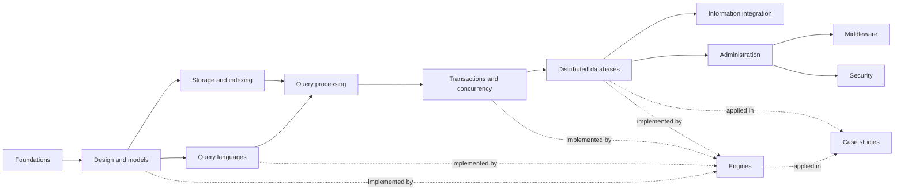

# Databases Knowledge

A personal, expert level knowledge base about databases: technology agnostic concepts organized by the Data management systems branch of the ACM Computing Classification System, a dedicated area for concrete engines such as PostgreSQL, MongoDB and Redis, and case studies.

## Table of Contents

- [About](#about)
- [Purpose](#purpose)
- [Scope](#scope)
- [Areas](#areas)
- [Full table of contents](#full-table-of-contents)
- [How to use this repository](#how-to-use-this-repository)
- [Reading the knowledge base](#reading-the-knowledge-base)
- [Repository layout](#repository-layout)
- [Sources and migration](#sources-and-migration)
- [Contributing and working with AI agents](#contributing-and-working-with-ai-agents)
- [Status](#status)

## About

This repository collects what I learn about databases as a backend and cloud engineer: how data is modeled, queried, kept correct under concurrency, distributed over many machines, integrated and operated, and how specific engines implement these ideas. Each note explains one topic in plain English, with diagrams, a worked example (SQL and commands are run against real engines in Docker where possible) and links to primary sources. The notes are written so that they are still useful when I come back after a year, and so that someone new to the topic can follow them from top to bottom.

This is a personal knowledge base, not a tutorial site or official documentation. Engines change every year; every engine-specific statement records the version and the date it was checked, and open gaps are marked with `TODO:` lines.

## Purpose

The repository exists to:

- build a durable reference on databases that I can search, extend and trust,
- force real understanding by explaining every concept precisely, with examples, analogies and diagrams,
- separate what holds for every database from what is specific to one engine, so both stay easy to find,
- keep one consistent standard, so the collection stays coherent as it grows,
- provide a source of truth that both people and AI assistants can work with under the same rules.

## Scope

**In scope**

- Data models, database design, query languages, query processing, transactions and concurrency, distributed databases, information integration, administration and security.
- Concrete engines (PostgreSQL, MySQL, SQLite, MongoDB, Redis, Cassandra, Neo4j, Elasticsearch and more): architecture, features, tooling, versions and licenses.
- Case studies of real systems, in my own words and with links to the original sources.

**Out of scope**

- Credentials, connection strings, dumps or any real customer or personal data.
- Content copied wholesale from documentation, books or courses.
- Data analytics platforms and data engineering pipelines beyond what a database note needs; they belong in a separate knowledge base.

## Areas

The technology agnostic areas follow the *Data management systems* branch of the [ACM Computing Classification System 2012](https://dl.acm.org/ccs), in the order of the parts of *Database System Concepts* (Silberschatz, Korth, Sudarshan). Four areas are outside that branch: foundations, database security (from the CCS security branch), engines and case studies. The placement rules are in [GUIDELINE.md](GUIDELINE.md#311-placement-of-a-note).

| Area | CCS 2012 concept | What it covers |
| --- | --- | --- |
| [Foundations](foundations/README.md) | (none) | SQL versus NoSQL, choosing a database, popular open source databases. |
| [Database design and models](database-design-and-models/README.md) | Database design and models | Relational model, constraints, normalization, denormalization; key-value, document, wide-column and graph models. |
| [Storage and indexing](storage-and-indexing/README.md) | Data structures | Storage layouts and index structures (planned). |
| [Query languages](query-languages/README.md) | Query languages | SQL overview, joins, stored procedures, triggers. |
| [Query processing and optimization](query-processing-and-optimization/README.md) | DBMS engines: query processing and optimization | SQL tuning and execution plans. |
| [Transactions and concurrency](transactions-and-concurrency/README.md) | DBMS engines: transaction processing | Transactions, ACID, isolation levels, deadlocks. |
| [Distributed databases](distributed-databases/README.md) | DBMS engines: parallel and distributed DBMSs | Scaling strategies, nodes, consistent hashing, replication, sharding. |
| [Information integration](information-integration/README.md) | Information integration | Database federation. |
| [Database administration](database-administration/README.md) | Database administration | Backup, monitoring, migrations (planned). |
| [Database middleware](database-middleware/README.md) | Middleware for databases | Connection pooling, proxies, ORMs (planned). |
| [Database security](database-security/README.md) | Security and privacy: database and storage security | Access control, injection, encryption (planned). |
| [Engines](engines/README.md) | (none) | PostgreSQL, MySQL and MariaDB, SQLite, MongoDB, Redis, Cassandra, Neo4j, Elasticsearch. |
| [Case studies](case-studies/README.md) | (none) | Figma's database scaling. |

The map shows the areas and how the concept areas relate to the engines.



Where a topic fits two areas, it has one home note and the other area links to it. A concept (for example replication) lives in its concept area; what one engine does differently (for example PostgreSQL logical replication) lives under [engines](engines/README.md).

## Full table of contents

[ToC.md](ToC.md) lists every file in the repository as an indented tree, with planned topics shown without links. Use the area READMEs for the recommended reading order.

## How to use this repository

- To learn a topic, open the area, then read the notes in the order the area `README.md` gives.
- To look something up, start from [ToC.md](ToC.md) or search with `grep -rn "term" --include="*.md" .`.
- To find open gaps and claims still to verify, run `grep -rn "TODO:" --include="*.md" .`.

## Reading the knowledge base

This repository is set up for [Librarian OS](https://japonics.io), a reader for Markdown knowledge repositories. [librarian-os.json](librarian-os.json) names the project and lists the entry points (the area directories). Librarian OS renders the notes with Mermaid diagrams, search, a graph of the relations between notes and practice questions.

```bash
# in the librarian-os directory
npm install
npm run dev -- --repo /absolute/path/to/this/repository
```

The relations come from the sidecar files described in [GUIDELINE.md](GUIDELINE.md#35-sidecar-metadata): every `note.md` has a `note.md.json` next to it. The tools that keep them valid run from Librarian OS: `npm run check`, `npm run scaffold` and `npm run toc`, each with this repository's path as the argument.

## Repository layout

```text
ToC.md                  # full tree of every file
GUIDELINE.md            # rules for structure, note format and style
INSTRUCTIONS.md         # Librarian OS adaptation guide
_sources/               # original exports that notes are migrated from (not versioned)
librarian-os.json       # configuration for Librarian OS (project name, entry points, rules)
_assets/<area>/         # images and other files used by notes
<area>/
    README.md           # notes in reading order and planned topics
    README.md.json      # its sidecar
    <topic>.md          # a single note
    <topic>.md.json     # its sidecar: node header, relations and sources
    <subarea>/          # optional group of related notes (for example engines/postgresql/)
```

## Sources and migration

The notes were migrated from an export of my earlier database notes, kept locally in `_sources/` and excluded from version control. Every topic of the export was carried over, restructured into the areas above, translated into the note skeleton, extended with diagrams, tested examples and primary sources, and checked for outdated statements: corrections are stated in the notes (for example multi-document transactions in MongoDB and current engine licenses). Images from the export, mostly ByteByteGo infographics and figures from articles, are kept in `_assets/` for personal study with credit in their alt text, and each one is also redrawn as a Mermaid diagram next to it.

## Contributing and working with AI agents

All notes follow [GUIDELINE.md](GUIDELINE.md). It applies to people and to AI agents alike. Agent-specific entry points are [AGENTS.md](AGENTS.md) and [CLAUDE.md](CLAUDE.md). Both point to the GUIDELINE and do not repeat its rules.

## Status

All thirteen areas exist with READMEs and planned topics. Eight areas have notes; storage and indexing, database administration, database middleware and database security have their scope defined by planned topics. Every note is in `draft` status until it has been checked against the current documentation of the engines it names.
