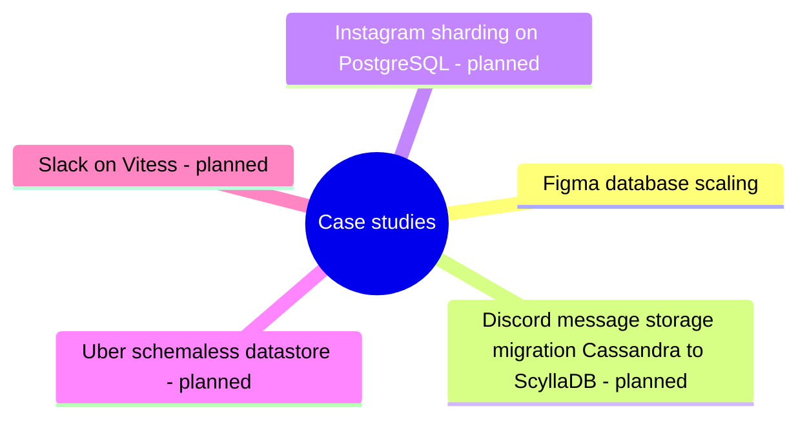

# Case studies

Real systems and the database decisions behind them, described in my own words and linked to the concept and engine notes they apply.

## Map

The map shows the parts of this section: written notes and subsections, and planned topics, which end with the word planned.

## Reading order

1. [Figma database scaling](figma-database-scaling.md): Between 2020 and 2023 Figma's database stack, which stores the metadata of the product (permissions, file information, comments), grew about 100 times while the user base kept growing fast.

## Planned topics

- Discord message storage migration (Cassandra to ScyllaDB)
- Instagram sharding on PostgreSQL
- Uber schemaless datastore
- Slack on Vitess
