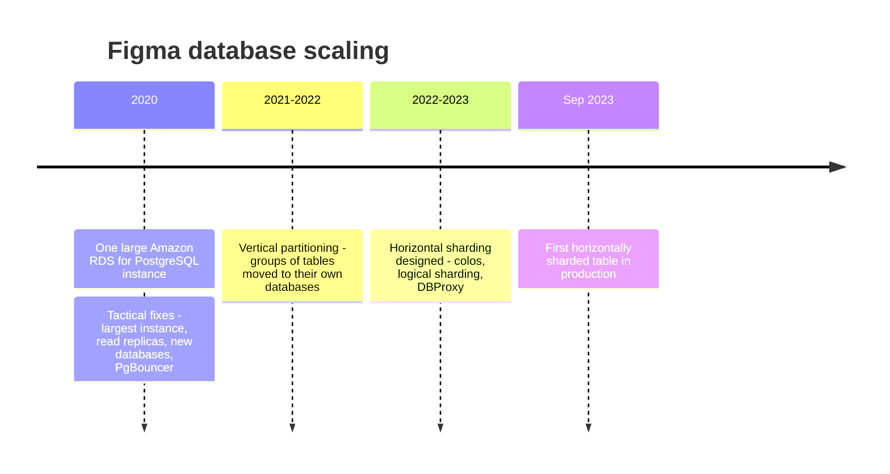
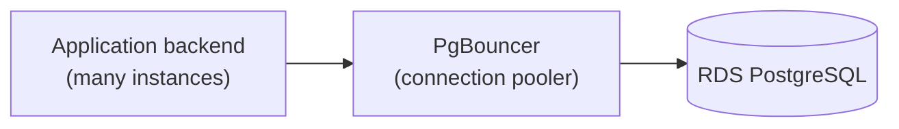
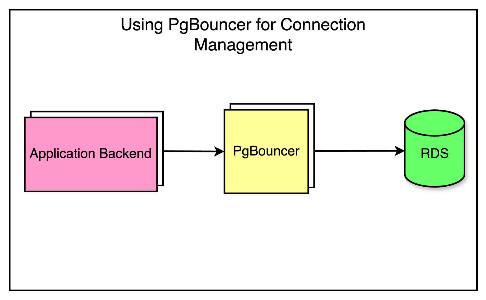
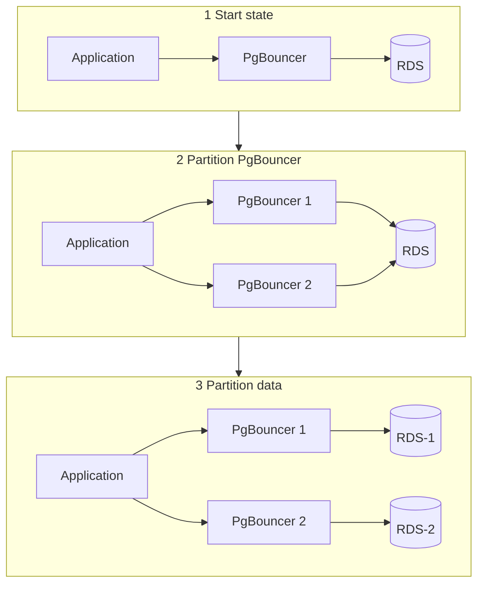
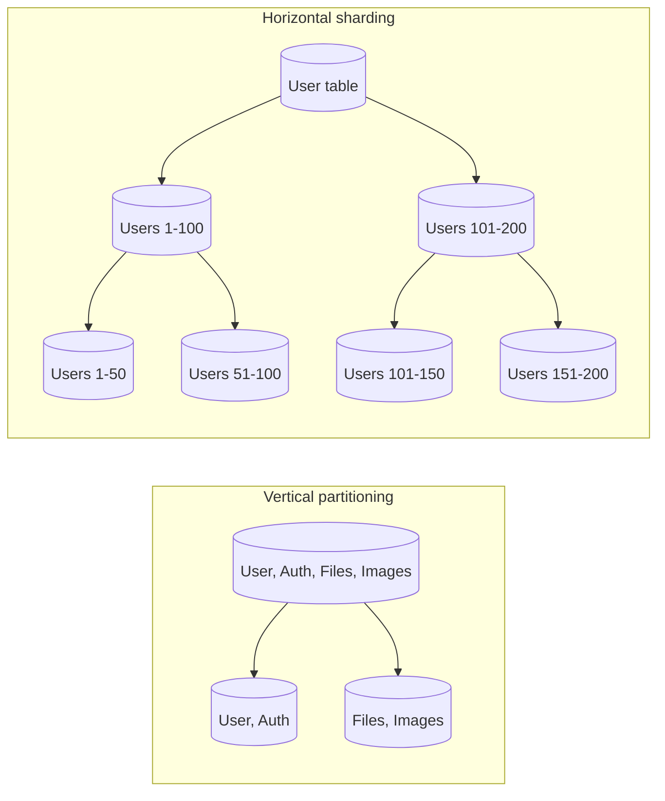
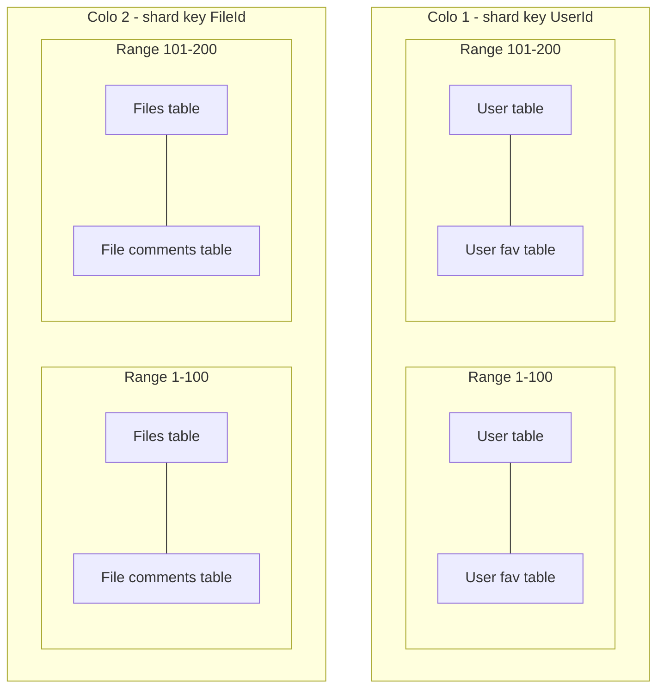
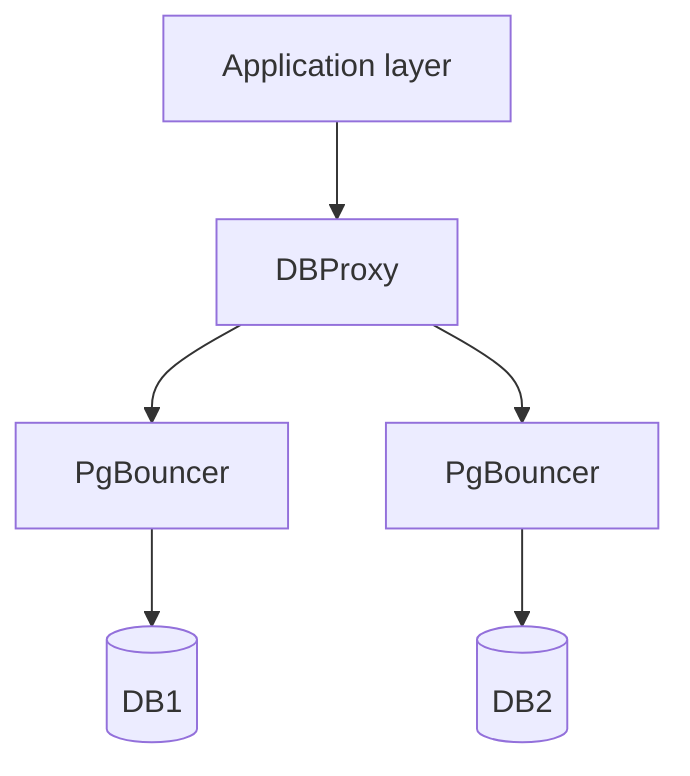
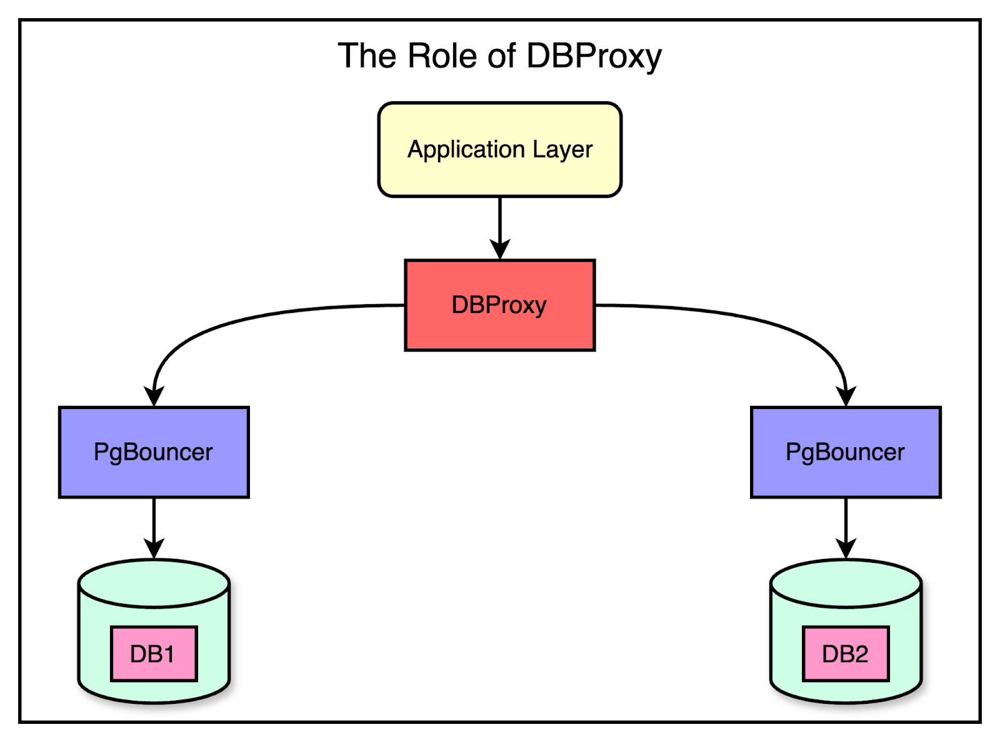
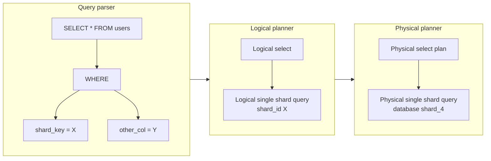
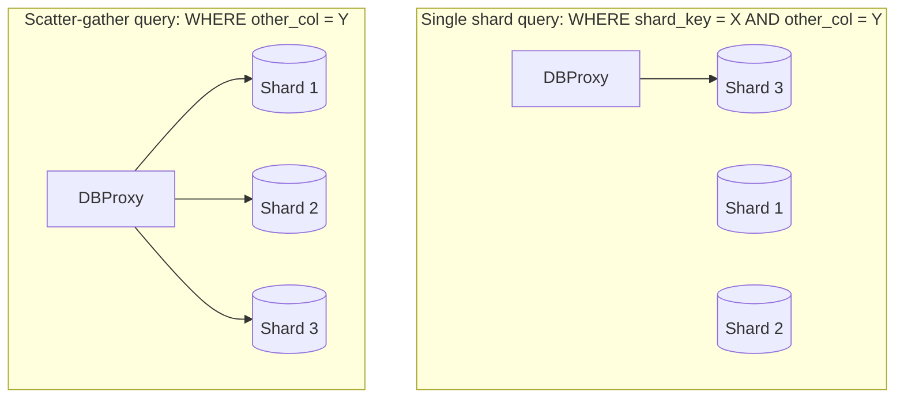

# Figma database scaling

## Summary

Between 2020 and 2023 Figma's database stack, which stores the metadata of the product (permissions, file information, comments), grew about 100 times while the user base kept growing fast. The team scaled a single Amazon RDS for PostgreSQL instance in three stages: tactical fixes (the largest instance, read replicas, new databases for new features, PgBouncer), then vertical partitioning (moving groups of related tables into their own databases with logical replication and a sub-minute cutover), and finally horizontal sharding built in-house on top of RDS PostgreSQL, with "colos" of tables that share a shard key, logical sharding before physical sharding, and a query engine called DBProxy. The first horizontally sharded table shipped in September 2023 without regressions in latency or availability. The case shows the [database scaling strategies](../distributed-databases/database-scaling-strategies.md) applied in order, and why a team may build its own sharding layer instead of migrating to another database.

## Prerequisites

- [Database scaling strategies](../distributed-databases/database-scaling-strategies.md), [replication](../distributed-databases/replication.md) and [sharding](../distributed-databases/sharding.md).
- [PostgreSQL streaming and logical replication](../engines/postgresql/streaming-and-logical-replication.md) and [PostgreSQL VACUUM](../engines/postgresql/vacuum.md).

## Core concepts

### Context and growth

Figma is a collaborative design platform. Its user base grew by almost 200 percent from 2018 and reached around 3 million monthly users (figures as reported in the articles in further reading, not verified independently). The database stack is the backbone of the product: it stores and manages the metadata, such as permissions, file information and comments, and it grew about 100 times from 2020. The infrastructure team needed a quick way to scale the databases to keep up with demand, without stopping the product.

The timeline shows the stages.

### Stage 1: the initial state and tactical fixes

In 2020 Figma used a single, large Amazon RDS database to persist most of the metadata. It handled the load well, but one machine has limits: during peak traffic, CPU utilization was above 65 percent, which made database latencies unpredictable. Complete saturation was still far away, but the team wanted to find and fix scalability problems before they hurt. The first, tactical fixes were:

- upgrade to the largest instance available (from `r5.12xlarge` to `r5.24xlarge`),
- create several read replicas to scale read traffic,
- establish new databases for new use cases, to limit the growth of the original database,
- add PgBouncer as a connection pooler to limit the impact of the growing number of connections.

The diagram shows the connection path after the fixes: the application talks to PgBouncer, which keeps a small pool of connections to RDS.

These fixes gave about one more year of runway, but limits remained:

- Analysis of the database traffic showed that write operations were a major part of the utilization. Replicas do not help with writes.
- Not all reads could move to replicas, because some use cases were sensitive to replication lag.

A longer-term solution was needed.

### Stage 2: vertical partitioning

The team could not shut everything down and start from scratch. They needed a solution that kept Figma running while they worked on the problem. That was vertical partitioning.

*Analogy.* Vertical partitioning is like reorganizing a wardrobe: instead of one big pile, things are split into separate sections. In database terms, certain tables move to separate databases. The analogy breaks at the boundaries: a shirt and trousers in different sections can still be worn together, while tables in different databases can no longer be joined or updated in one transaction, which is why the choice of tables matters.

For Figma, vertical partitioning moved high-traffic, related tables, such as those for "Figma files" and "Organizations", into their own databases, which gave much-needed breathing room.

To identify the tables to move, Figma considered two factors:

1. **Impact.** Moving the tables should move a significant portion of the workload.
2. **Isolation.** The tables should not be strongly connected to other tables (few joins and transactions with tables that stay behind).

For impact, they looked at *average active sessions* (AAS) per query: the average number of active threads working on a given query at a point in time. Measuring isolation was harder. They used runtime validators hooked into ActiveRecord, their Ruby ORM, that sent production query and transaction information to Snowflake for analysis. This showed which tables were ideal to partition, based on query patterns and table relationships.

#### Migration without downtime

Once the tables were chosen, they had to be moved between databases without downtime. The goals for the migration solution were:

- limit the potential availability impact to less than 1 minute,
- automate the procedure so that it is easily repeatable,
- be able to undo a recent partition.

No ready-made solution met these requirements, so Figma built one. At a high level it worked as follows:

1. Prepare client applications to query several database partitions.
2. Replicate the tables from the original database to the new database until the replication lag is near 0.
3. Pause activity on the original database.
4. Wait for the databases to synchronize.
5. Reroute query traffic to the new database.
6. Resume activity.

To make the move smoother, they first created separate PgBouncer services to split the traffic *virtually*, while all of them still pointed at the original database. Security groups ensured that only the PgBouncers could access the databases directly. Partitioning the PgBouncer layer first gave a cushion: a client that routed a query to the wrong PgBouncer still reached the right data, because all PgBouncers had the same target database. During this period the team could detect routing mismatches and correct them. Only then was the data itself partitioned.

The diagram shows the three states: start state, partitioned PgBouncer layer with one database, and partitioned data.

#### Replication for the move

Data replication is a common way to scale reads; here it was used to copy tables into the new databases. PostgreSQL offered two options, streaming replication and logical replication, and Figma chose logical replication for three reasons: it can copy a subset of tables (a smaller starting footprint in the destination), it can replicate into a different PostgreSQL major version, and it allows reverse replication to roll back. Its initial copy was slow (days or weeks), because PostgreSQL updates destination indexes one row at a time during the bulk copy; dropping the indexes in the destination and rebuilding them after the copy reduced it to hours. Details and a tested example are in [PostgreSQL streaming and logical replication](../engines/postgresql/streaming-and-logical-replication.md#why-figma-chose-logical-replication).

### Stage 3: the need for horizontal scaling

As the user base and the feature set grew, so did the demands on the databases. Vertical partitioning had limits, especially for the largest tables: some had several terabytes of data and billions of rows, too large for one database. Two problems stood out:

- **PostgreSQL vacuum.** Vacuuming is an essential background process that reclaims storage occupied by deleted or obsolete rows. Without regular vacuuming, the database eventually runs out of transaction IDs and stops. Vacuuming very large tables is resource-intensive and causes performance problems and even downtime (see [PostgreSQL VACUUM](../engines/postgresql/vacuum.md)).
- **Maximum I/O operations per second.** The tables with the most writes were growing so fast that they would soon exceed the maximum IOPS of Amazon RDS.

*Analogy.* A library with a fast-growing collection first copes by adding shelves (vertical partitioning). Eventually the building runs out of space: no matter how well the shelves are arranged, one building cannot hold an infinite number of books. That is when you open branch libraries. This is horizontal sharding: splitting large tables across several physical databases so that they scale beyond the limits of one machine.

The diagram contrasts the two: vertical partitioning moves whole tables to different databases; horizontal sharding splits one table's rows by key range across databases, and the shards can split again.

Horizontal sharding brings its own challenges:

- some SQL queries become inefficient to support,
- application code must be updated to route queries to the correct shard,
- schema changes must be coordinated across all shards,
- PostgreSQL can no longer enforce foreign keys and globally unique indexes,
- transactions can span several shards, so PostgreSQL alone can no longer guarantee transactionality.

### Alternatives considered

The team evaluated distributed SQL options (CockroachDB, TiDB, Spanner and Vitess) as well as NoSQL databases. They decided instead to build horizontal sharding on top of their existing vertically partitioned RDS PostgreSQL infrastructure, because:

- they could use their existing expertise with RDS PostgreSQL, which they had run reliably for years,
- they could tailor the solution to Figma's needs instead of adapting the application to a generic sharding solution,
- they could easily roll back to the unsharded PostgreSQL databases if something went wrong,
- they did not need to change their complex relational data model to a new approach such as NoSQL, so product teams could keep building features.

### Figma's sharding design

Figma's approach was tailored to its needs and existing architecture, with some unusual design choices.

#### Colos: colocated groups of tables

Figma introduced *colos* (colocations): groups of related tables that share the same sharding key and the same physical sharding layout. They chose a handful of sharding keys, such as `UserId`, `FileId` and `OrgId`; almost every table could be sharded by one of them. Colos give developers a friendly abstraction: tables in one colo support cross-table joins and full transactions when the query is restricted to a single sharding key value. Most application code already accessed the database this way, which minimized the work to make a table ready for sharding.

The diagram shows two colos: the user colo (user table and user favorites table) and the file colo (files table and file comments table), each split into the same ranges.

#### Logical sharding before physical sharding

Figma separated *logical sharding* at the application layer from *physical sharding* at the PostgreSQL layer. Logical sharding creates several views per table, each corresponding to the subset of data in one shard. All reads and writes go through these views, so the table behaves as if it were horizontally sharded, even though the data still lives on a single database host.

This let them split the migration into two independent parts: a safer, lower-risk logical sharding rollout first, and the riskier distributed physical sharding afterward. Rolling back logical sharding was a simple configuration change, while rolling back a physical shard operation would need complex coordination to keep data consistent.

#### DBProxy: routing and query execution

To support horizontal sharding, the team built a new service, *DBProxy*, which sits between the application and the connection pooling layer (PgBouncer).

DBProxy contains a lightweight query engine that parses and executes horizontally sharded queries. It has three components:

1. A **query parser** reads the SQL sent by the application and turns it into an abstract syntax tree (AST).
2. A **logical planner** walks the AST, extracts the query type (insert, update and so on) and the logical shard IDs from the query plan.
3. A **physical planner** maps the query from logical shard IDs to physical databases and rewrites it to run on the right physical shard.

The diagram follows `SELECT * FROM table WHERE shard_key = X AND other_col = Y` through the three components.

#### Single-shard and scatter-gather queries

Queries for a single shard key value are relatively easy: the engine extracts the shard key and routes the query to the right physical database. A query without a sharding key needs a *scatter-gather* operation, like a game of hide and seek: send the query to every shard (scatter), then assemble the answers from each shard (gather).

Scatter-gather increases the load on the databases: every shard does work for every such query, so too many of them limit horizontal scalability. DBProxy also handles load shedding, transaction support, database topology management and improved observability.

#### Shadow application readiness framework

Figma added a *shadow application readiness* framework that predicts how live production traffic would behave under different candidate sharding keys. All queries and their plans were logged to Snowflake for offline analysis. From this data the team chose a supported query language that covered the most common 90 percent of queries while avoiding worst-case complexity in the query engine. The framework kept DBProxy simple and reduced how much application code had to be rewritten.

### Outcome and next steps

The first horizontally sharded table shipped in September 2023. The rollout had minimal impact on availability, and the team observed no regressions in latency or availability afterward. The goal is to shard every table horizontally. Open problems they listed:

- horizontally sharded schema updates,
- globally unique ID generation for sharded primary keys,
- atomic cross-shard transactions for business-critical use cases,
- distributed globally unique indexes,
- an ORM model that improves developer velocity,
- automatic resharding, so that shard splits happen "at the click of a button".

After reaching enough runway, they planned to reassess the in-house approach against open source or managed alternatives.

## Worked example

Map the case to the [scaling ladder](../distributed-databases/database-scaling-strategies.md):

| Ladder step | What Figma did | Limit that forced the next step |
| --- | --- | --- |
| Vertical scaling | `r5.12xlarge` to `r5.24xlarge` | Largest instance reached |
| Replication | Read replicas | Writes dominated; lag-sensitive reads |
| Connection pooling | PgBouncer | Does not reduce query work |
| Vertical partitioning | Tables moved to their own databases | Single tables of terabytes: vacuum and IOPS |
| Horizontal sharding | Colos, logical then physical sharding, DBProxy | Open problems listed above |

Two design choices generalize beyond Figma: choose shard keys so that most transactions stay inside one shard (colos), and separate the routing change from the data move so that each can be rolled back independently (PgBouncer partitioning first, logical sharding before physical).

## Trade offs and when to use it

- **Build versus buy.** Building on known technology kept the relational model and the team's skills and allowed rollback, at the cost of building a query engine and leaving hard problems (cross-shard transactions, global indexes) for later. A distributed SQL engine would have solved those but required a migration of the whole data layer.
- **Restricting the query language** to the 90 percent of common queries kept the engine simple but required rewriting the rest.

## Common mistakes

These are lessons the case illustrates, not mistakes Figma made:

- **Moving reads to replicas when writes are the bottleneck.** Measure first.
- **Big-bang migrations.** Figma's stepwise approach (route first, then move data; logical first, then physical) kept each step reversible.
- **Ignoring engine maintenance limits.** Vacuum and IOPS, not CPU, forced the final step.

## Practice

1. Why did read replicas not solve Figma's problem?
2. What two criteria chose the tables for vertical partitioning, and how was each measured?
3. What is a colo, and which guarantee does it preserve?
4. Why did Figma separate logical sharding from physical sharding?
5. What is a scatter-gather query, and why does it hurt scalability?

Hints:

1. Writes were a major share of the load, and some reads could not tolerate lag.
2. Impact (average active sessions) and isolation (ORM validators feeding query and transaction data to Snowflake).
3. A group of tables with the same shard key and layout; joins and transactions within one shard key value.
4. To roll out and roll back the risky physical move independently of the routing change.
5. A query without the shard key sent to all shards; every shard does work for it.

## Further reading

- Sammy Steele, "How Figma's databases team lived to tell the scale", Figma blog, March 2024. https://www.figma.com/blog/how-figmas-databases-team-lived-to-tell-the-scale/ - Primary source for horizontal sharding, colos and DBProxy.
- Tim Liang, "The growing pains of database architecture", Figma blog, May 2023. https://www.figma.com/blog/how-figma-scaled-to-multiple-databases/ - Primary source for the tactical fixes and vertical partitioning.
- ByteByteGo, "How Figma scaled its databases" (newsletter). https://blog.bytebytego.com/ - The summary that the figures above come from.
- Figma user statistics, as cited by the ByteByteGo newsletter for the 3 million monthly users figure. TODO: find and verify the original statistics source.
- PgBouncer, "Features". https://www.pgbouncer.org/features.html - Pooling modes of the connection pooler Figma used.
