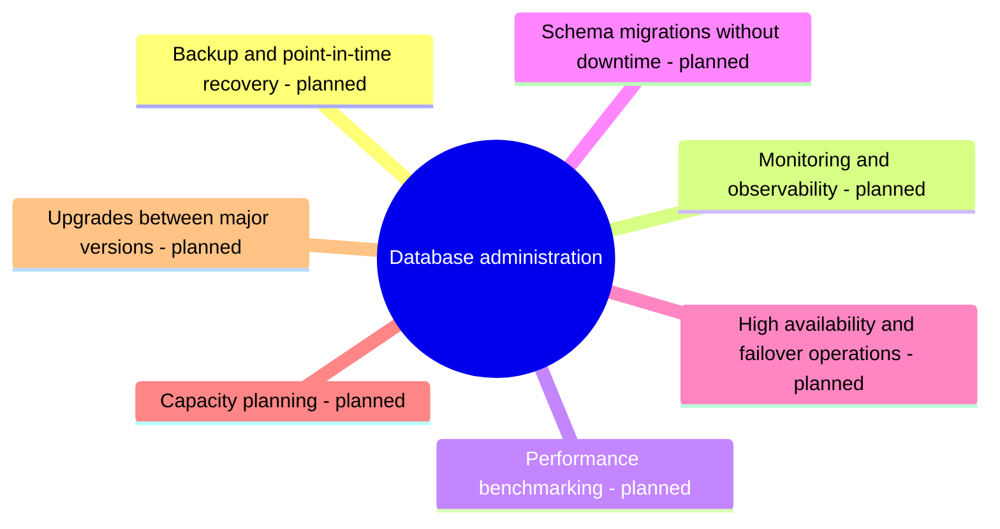

# Database administration

Running databases in production: backup and recovery, monitoring, performance evaluation, schema migrations and high availability operations.

This area corresponds to the ACM CCS 2012 concept *Database administration*. See [GUIDELINE.md](../GUIDELINE.md#311-placement-of-a-note) for what belongs here.

## Map

The map shows the parts of this section: written notes and subsections, and planned topics, which end with the word planned.

## Status

No notes have been written in this section yet. The planned topics below define its scope.

TODO: write the first notes of this section.

## Planned topics

- Backup and point-in-time recovery
- Monitoring and observability
- Performance benchmarking
- Schema migrations without downtime
- High availability and failover operations
- Capacity planning
- Upgrades between major versions
