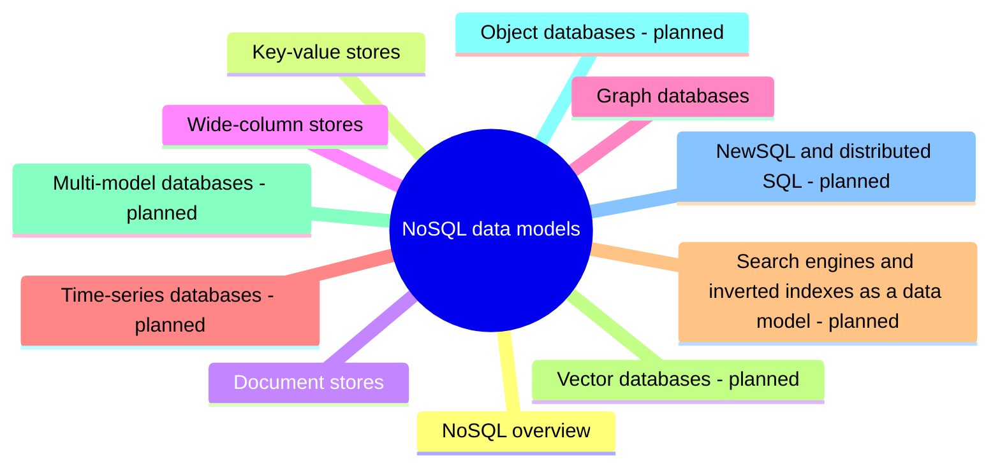

# NoSQL data models

The non-relational data models: key-value, document, wide-column and graph, with their properties, API models, use cases and representative engines.

## Map

The map shows the parts of this section: written notes and subsections, and planned topics, which end with the word planned.

## Reading order

1. [NoSQL overview](nosql-overview.md): NoSQL ("not only SQL") is a family of databases that store data in models other than relational tables: key-value, document, wide-column and graph.
2. [Key-value stores](key-value-stores.md): A key-value store is the simplest database model: a large distributed hash table that maps a unique key to a value, with get, put and delete as the main operations.
3. [Document stores](document-stores.md): A document store keeps each object as a self-contained *document* (usually JSON or a binary form of it, such as BSON) that holds all information about that object, including nested objects and lists.
4. [Wide-column stores](wide-column-stores.md): A wide-column store (also called a column-family store) is a NoSQL database that uses tables, rows and columns like a relational database, but stores each row as a sparse, sorted map of columns: each row can have a different set of columns, and missing columns cost nothing.
5. [Graph databases](graph-databases.md): A graph database stores data as a graph: *nodes* (entities), *edges* or relationships between them, and *properties* on both.

## Planned topics

- Time-series databases
- Search engines and inverted indexes as a data model
- Vector databases
- Multi-model databases
- Object databases
- NewSQL and distributed SQL
