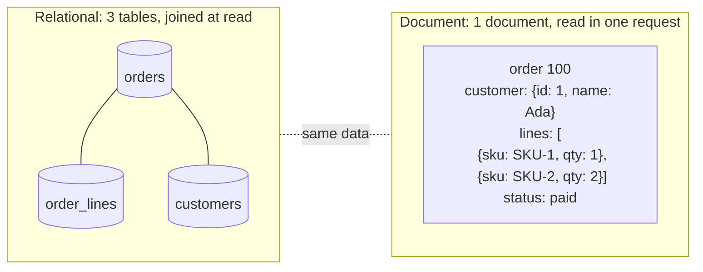

# Document stores

## Summary

A document store keeps each object as a self-contained *document* (usually JSON or a binary form of it, such as BSON) that holds all information about that object, including nested objects and lists. Unlike a key-value store, the database understands the structure of the document, so it can query, index and update individual fields. Documents are grouped in collections, but documents in one collection may have completely different fields. This fits aggregates that are read and written as a whole (a product with its variants, a user profile with preferences) and evolving schemas. The price is weaker integrity: no foreign keys, duplicated data, and atomicity that traditionally covered only one document. MongoDB is the most widely used engine; Couchbase, Azure Cosmos DB, RavenDB and Amazon DocumentDB are others.

## Prerequisites

- [NoSQL overview](nosql-overview.md).
- [Key-value stores](key-value-stores.md), since a document store is a key-value store whose values the engine can read.

## Core concepts

### Definition

A *document store* is centered around documents (XML, JSON, binary formats and so on), where one document stores all information for a given object. Document stores provide APIs or a query language to query based on the internal structure of the document itself. Many key-value stores include features for working with a value's metadata, which blurs the line between the two types.

Depending on the implementation, documents are organized by collections, tags, metadata or directories. Although documents can be organized or grouped together, documents may have fields that are completely different from each other.

The diagram contrasts a relational representation of an order with the document representation of the same aggregate.



*Analogy.* A document store is a set of patient files in a clinic. Each file contains everything about one patient: details, visits, prescriptions, scans. A doctor grabs one file and has the whole story. Two files can contain different kinds of pages. But if the clinic's phone number is printed on every file and changes, someone must update every file, and nothing stops a file from referring to a doctor who never worked there. The analogy breaks because a document store can also index pages across all files, so "all patients prescribed drug X" does not require opening every folder.

### Embedding versus referencing

The central modeling decision in a document store is whether related data is *embedded* in the document or *referenced* by ID.

| Embed when | Reference when |
| --- | --- |
| The data is read together with the parent (order lines with the order). | The related data is read independently or shared by many parents (a product used in many orders). |
| The relationship is one-to-few and bounded. | The relationship is one-to-many with unbounded growth (comments on a viral post). |
| The child has no meaning without the parent. | The related data changes often and is duplicated in many documents. |

MongoDB limits a document to 16 MiB (checked against MongoDB 8.0 documentation, 2026-11), which is another reason not to embed unbounded lists.

### Advantages

- **Schemaless.** There are no restrictions on the format and structure of stored data. This helps retain existing data at large volumes and in different structural states, especially in a system that changes continuously.
- **Faster creation and less maintenance.** Once a document is created, little maintenance is needed; storing a complex object can be as simple as inserting it once.
- **No foreign keys.** Without this relationship mechanism, documents are independent of one another, which makes them easy to distribute across shards.
- **Open formats.** Documents are described with XML, JSON and their derivatives, which map directly to objects in application code.
- **Built-in versioning.** As documents grow in size and complexity, versioning reduces conflicts. Support differs: Couchbase and CouchDB keep revision identifiers for conflict detection, RavenDB has document revisions; MongoDB has no built-in document history (applications add a version field or use change streams).

### Disadvantages

- **Consistency-check limitations.** In a book database, it is possible to search for books whose author does not exist: a book document can reference an author document that is not in the author collection. Each listing may also duplicate author information in every book. These inconsistencies are not significant in some contexts, but at the consistency standards of relational databases they are serious and make audits slow and expensive.
- **Atomicity weaknesses.** In a relational system you change a fact in one place, and every later query that joins to it sees the change. In a document database, a change that involves two collections needs two separate writes (one per collection). Without a multi-document transaction, a failure between them breaks atomicity. MongoDB has offered multi-document transactions since 4.0 (replica sets, 2018) and 4.2 (sharded clusters, 2019), at a performance cost.
- **Security.** Document stores behind web applications are exposed to web application vulnerabilities, such as NoSQL injection through query operators in JSON input, and to misconfiguration, such as databases exposed to the internet without authentication. A frequently quoted claim is that nearly half of web applications leak sensitive data (unverified figure). Owners of NoSQL databases must pay close attention to application and deployment security (see [database security](../../database-security/README.md)).

### API model

The core operations of a document-oriented database are similar to other databases. The terminology is not perfectly standardized, but most practitioners recognize them as CRUD:

| Operation | Also called | MongoDB method |
| --- | --- | --- |
| Creation | Insertion | `insertOne`, `insertMany` |
| Retrieval | Query, search, read, find | `find`, `findOne`, `aggregate` |
| Update | Edit | `updateOne`, `updateMany`, `replaceOne` |
| Deletion | Removal | `deleteOne`, `deleteMany` |

Updates can change single fields in place (`$set`, `$inc`, `$push`) without rewriting the document from the client, and a single-document update is atomic.

### Use cases

- **Session management.** Storing user session data: when a user logs in, a session ID is generated and associated with user data.
- **User preferences.** When a user customizes settings, the preferences are saved with the user ID, so the application loads them at each login.
- **Event logging.** Each action a user takes (clicking a button, completing a form) is logged with a timestamp and user ID, to analyze behavior and improve the application.
- **Large datasets.** Document stores manage large datasets well because they scale out across many servers while keeping performance and availability. The schemaless design allows new data types to be added without migrations, and the stores are optimized for fast reads and writes of whole documents, which matters at high volume.
- **Multi-device syncing.** When users switch devices, their activity is synced across platforms. Documents store the current state of the user's session, so the user can continue where they left off.
- **IoT device management.** Each device has a document storing its state and activity log, which supports remote monitoring and control.

### Types

Most document stores persist to disk. In-memory document storage exists too, for example Redis with the JSON data type (RedisJSON, part of Redis Stack and built into Redis 8), which stores and queries JSON documents in memory for fast reads and writes, for caching, session storage and real-time processing. Memcached, sometimes listed here, is a pure key-value cache and does not understand documents.

### Representative engines

| Engine | Description | Use cases |
| --- | --- | --- |
| [MongoDB](../../engines/mongodb/mongodb-overview.md) | A document-oriented database used for high volume data storage. | Content management, mobile apps, real-time analytics, IoT. |
| Azure Cosmos DB | A globally distributed, multi-model database service for large scale applications. | Web and mobile applications, games, telematics, AI and machine learning workloads. |
| Couchbase | A distributed NoSQL cloud database with a flexible data model for ease of development and performance at scale. | E-commerce platforms, catalogs, profile stores. |
| RavenDB | A document database with an emphasis on easy setup, high availability and low-latency operations. | Online gaming platforms, CRM systems, real-time logistics. |
| Amazon DocumentDB | A fully managed document database service that supports MongoDB workloads (MongoDB API compatible, different engine). | Migrating MongoDB applications to AWS, microservices, mobile backends. |
| [Redis](../../engines/redis/redis-overview.md) | An in-memory data structure store, used as a database, cache and message broker; JSON documents through the JSON data type. | Real-time analytics, caching, session management. |

## Worked example

Tested on MongoDB 8.0.34 (Docker image `mongo:8.0`) with `mongosh`. Books embed a copy of their author; one book references an author that does not exist.

```javascript
db.authors.insertOne({ _id: 1, name: "Ursula K. Le Guin" });
db.books.insertMany([
  { _id: "978-0441478125", title: "The Left Hand of Darkness", year: 1969,
    author: { id: 1, name: "Ursula K. Le Guin" }, tags: ["sf", "classic"] },
  { _id: "978-0547928227", title: "The Hobbit", year: 1937,
    author: { id: 2, name: "J. R. R. Tolkien" }, tags: ["fantasy"],
    editions: [{ year: 2012, format: "paperback" }] },          // a field the others do not have
  { _id: "978-0000000000", title: "Orphan book", author: { id: 99 } }
]);
db.books.createIndex({ "author.id": 1 });                       // index on a nested field

// Query by a value inside an array
printjson(db.books.find({ tags: "sf" }, { title: 1, _id: 0 }).toArray());

// Integrity check the database cannot do for us: books whose author is missing
printjson(db.books.find({ "author.id": { $nin: db.authors.distinct("_id") } }, { title: 1, _id: 0 }).toArray());

// Atomic in-place update of several fields of one document
db.books.updateOne({ _id: "978-0441478125" },
  { $set: { "author.name": "Ursula Le Guin" }, $push: { tags: "hugo" } });
printjson(db.books.findOne({ _id: "978-0441478125" }, { _id: 0, author: 1, tags: 1 }));
```

Output:

```text
[ { title: 'The Left Hand of Darkness' } ]
[ { title: 'The Hobbit' }, { title: 'Orphan book' } ]
{ author: { id: 1, name: 'Ursula Le Guin' }, tags: [ 'sf', 'classic', 'hugo' ] }
```

All three inserts succeeded, including the book with author 99, and the books of Tolkien and of author 99 are "orphans" that only an application-side check finds. The update changed the embedded author name in one book; the `authors` collection still says "Ursula K. Le Guin", which is the duplication problem described above.

## Trade offs and when to use it

- **Use** when the application reads and writes aggregates as a whole, fields vary between records, the schema evolves quickly, or the data must be sharded by an aggregate key.
- **Avoid** when many-to-many relationships dominate, when invariants span many entities, or when ad hoc analytics across the data is the main workload.
- **Alternatives.** A relational database with `jsonb` columns gives documents plus foreign keys and joins on one node; a key-value store when you never query by field.

## Common mistakes

- **Unbounded arrays** (all comments inside the post). Documents grow past size limits and every update rewrites a large document. Fix: reference with a separate collection, or bucket the array.
- **Relational modeling with references everywhere.** Every page needs several queries or `$lookup`. Fix: model around the read pattern, embed what is read together.
- **No schema validation.** Shapes diverge over years. Fix: JSON Schema validation and a version field per document.
- **Building queries from raw user JSON.** Opens NoSQL injection (`{"$ne": null}` as a password). Fix: validate types and never pass client objects directly into filters.

## Practice

1. What distinguishes a document store from a key-value store?
2. When do you embed related data and when do you reference it?
3. Why does a document store allow a book to reference a non-existent author, and how can you detect it?
4. What did MongoDB 4.0 change about atomicity?

Hints:

1. The engine understands the structure of the value and can query and index fields.
2. Embed what is read together, bounded and owned; reference what is shared, large or unbounded.
3. There are no foreign keys; detect with an anti-join query or validate in the application.
4. It added multi-document ACID transactions (on replica sets; sharded clusters in 4.2).

## Further reading

- Donne Martin, "The System Design Primer: Document store" (GitHub). https://github.com/donnemartin/system-design-primer#document-store - Short definition.
- MongoDB, "Data Modeling", MongoDB Manual. https://www.mongodb.com/docs/manual/data-modeling/ - Embedding versus referencing, schema validation, limits.
- MongoDB, "Transactions", MongoDB Manual. https://www.mongodb.com/docs/manual/core/transactions/ - Multi-document transactions and their costs.
- OWASP, "Testing for NoSQL Injection", Web Security Testing Guide. https://owasp.org/www-project-web-security-testing-guide/latest/4-Web_Application_Security_Testing/07-Input_Validation_Testing/05.6-Testing_for_NoSQL_Injection - The main application-level risk.
