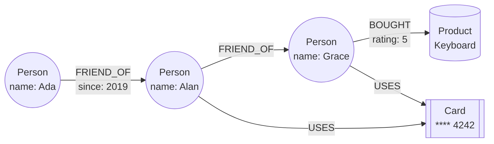

# Graph databases

## Summary

A graph database stores data as a graph: *nodes* (entities), *edges* or relationships between them, and *properties* on both. It is optimized for queries that follow relationships, such as "friends of friends who bought this product" or "accounts connected to this card within three hops". In a native graph engine, following a relationship is a direct pointer lookup, so the cost of a traversal depends on how much of the graph it touches, not on the total size of the data. Two families exist: property graphs (Neo4j, queried with Cypher or the new ISO GQL standard, or Gremlin) and RDF graphs (queried with SPARQL). Graph databases fit social networks, recommendations, fraud detection and knowledge graphs, and are a poor fit for bulk aggregation over all records.

## Prerequisites

- [NoSQL overview](nosql-overview.md).
- [Relational model](../relational/relational-model.md), to compare joins with traversals.

## Core concepts

### Definition

A *graph database* is a type of NoSQL database designed to store and query data in the form of a graph. The graph consists of nodes (entities), edges (relationships) and properties (information on nodes and edges). Graph databases are optimized for querying and traversing complex relationships and are ideal where the relationships between data points are as important as the data itself.

The diagram shows a small property graph: people, a product and a card, with typed, directed relationships that carry properties.



### Why it exists: joins versus traversals

In a relational database, a relationship is a foreign key, and following it is a join: the engine looks up matching keys in an index whose cost grows (logarithmically) with the table size, and each additional hop is another join. For a query with a variable number of hops ("all people within four steps"), SQL needs recursive common table expressions, and the intermediate results can explode.

A native graph database stores, for each node, direct references to its relationships (*index-free adjacency*). Following an edge is a pointer dereference. The cost of a traversal is proportional to the number of edges actually visited.

*Analogy.* A relational database finds your friends' friends like a phone operator with a directory: for each friend, look up their entry in the big book, then look up each of their friends in the book again. A graph database is a party where everyone holds hands with their friends: to find friends of friends, you follow the hands. The book gets slower to search as the city grows; following hands does not. The analogy breaks for questions about everyone at once ("average age of all guests"), where the directory, read front to back, is faster than walking hand to hand.

### Advantages

1. **Performance.** Efficient for complex queries and traversals over multiple hops, which are slow in relational databases.
2. **Flexibility.** Schemaless or flexible schema; new node labels, relationship types and properties can be added as the application evolves.
3. **Intuitive modeling.** A natural way to model real-world relationships, such as social networks, organizational hierarchies and recommendation systems. The whiteboard drawing is the data model.
4. **Rich relationships.** Relationships are first-class: typed, directed and carrying properties, which captures relationships more richly than a foreign key.
5. **Real-time insights.** Graph algorithms (shortest path, centrality, community detection) give pattern detection on live data.

### Disadvantages

1. **Complexity.** Can be more complex to design and manage than a relational database.
2. **Learning curve.** Requires a different mindset and some graph theory.
3. **Scalability.** Some graph databases scale poorly for very large or highly connected graphs: a graph does not partition cleanly, because many traversals cross any partition boundary. Many engines scale reads with replicas but keep writes on one primary.
4. **Limited tooling.** Fewer tools and libraries than relational databases.

### API model

The examples use Cypher, Neo4j's query language. Patterns are written as ASCII art: `(n:Label)` is a node, `-[r:TYPE]->` a relationship.

- **Create.** Nodes and relationships are created with labels or types and properties.

  ```cypher
  CREATE (n:Label {property: value})
  ```

- **Read.** Data is retrieved by matching patterns of nodes and relationships.

  ```cypher
  MATCH (n:Label {property: value}) RETURN n
  ```

- **Update.** Properties of nodes and relationships can be set.

  ```cypher
  MATCH (n:Label {property: value}) SET n.newProperty = newValue
  ```

- **Delete.** Nodes and relationships can be deleted. A node with relationships must be removed with `DETACH DELETE`.

  ```cypher
  MATCH (n:Label {property: value}) DELETE n
  ```

- **Traversal.** Queries explore the graph by following edges from node to node.

  ```cypher
  MATCH (n:Label)-[r:RELATIONSHIP]->(m:Label) RETURN m
  ```

Query languages by model: Cypher and its open variant openCypher; GQL, the ISO graph query language standard (ISO/IEC 39075, published 2024), which Neo4j and others are adopting; Gremlin, the traversal language of Apache TinkerPop; SPARQL for RDF.

### Use cases

- **Social networks.** Modeling and querying social relationships and interactions.
- **Recommendation engines.** Recommendations based on user behavior and preferences ("people who bought what you bought also bought").
- **Fraud detection.** Identifying fraud by analyzing connections and patterns, for example rings of accounts that share cards, devices or addresses.
- **Knowledge graphs.** Storing and querying interconnected facts for insights and search, including retrieval for generative AI (GraphRAG).
- **Network and IT operations.** Managing and optimizing network infrastructure: dependency maps, impact analysis.
- **Supply chain management.** Tracking and optimizing logistics and supplier relationships.

### Types

| Type | Model | Example engines |
| --- | --- | --- |
| Property graph | Nodes and relationships, both with properties (key-value pairs) and labels or types. | Neo4j |
| RDF graph | Based on the Resource Description Framework: every fact is a triple (subject, predicate, object), identified by URIs; used primarily in semantic web applications. | Apache Jena, Virtuoso |

### Representative engines

| Engine | Description |
| --- | --- |
| [Neo4j](../../engines/neo4j/neo4j-overview.md) | One of the most popular graph databases, known for its reliability and the Cypher query language. |
| Amazon Neptune | A fully managed graph database service supporting both property graph and RDF models. |
| ArangoDB | A multi-model database that supports graph, document and key-value models. |
| OrientDB | Combines graph and document capabilities, with complex querying and transactions. |
| JanusGraph | A scalable graph database optimized for storing and querying large graphs over storage backends such as Cassandra or HBase. |
| Apache TinkerPop | Not a database but a graph computing framework (with Gremlin) that works with many graph databases, for example JanusGraph, the former Titan, and Azure Cosmos DB's Gremlin API. |

## Worked example

Fraud ring detection: find people who share a payment card with someone who shares a card with a known fraudster, within up to four hops. Tested on Neo4j 5.26.32 (Docker image `neo4j:5`) with `cypher-shell`.

```cypher
CREATE (f:Person {name: 'Mallory', flagged: true}),
       (a:Person {name: 'Alan'}), (g:Person {name: 'Grace'}), (d:Person {name: 'Dan'}),
       (c1:Card {last4: '4242'}), (c2:Card {last4: '1881'}),
       (f)-[:USES]->(c1), (a)-[:USES]->(c1),
       (a)-[:USES]->(c2), (g)-[:USES]->(c2);

MATCH (f:Person {flagged: true})-[:USES*1..4]-(p:Person)
WHERE p <> f
RETURN DISTINCT p.name AS suspect;
```

Output:

```text
suspect
"Alan"
"Grace"
```

`Alan` shares card 4242 with Mallory (two hops) and `Grace` shares card 1881 with Alan (four hops); `Dan` is not returned because he has no card. The equivalent SQL needs a recursive CTE over a `person_card` junction table, with cycle detection, and its cost grows with the size of that table.

## Trade offs and when to use it

- **Use** when queries follow relationships of variable depth, when relationships carry data, or when the schema of connections evolves quickly.
- **Do not use** as the system of record for transactional business data that is mostly tabular, or for analytics that aggregate over all records.
- **Alternatives.** Recursive CTEs in PostgreSQL for shallow or occasional graph queries; graph extensions on relational engines (Apache AGE for PostgreSQL, SQL/PGQ in SQL:2023); a graph analytics engine for offline algorithms on huge graphs.

## Common mistakes

- **Supernodes.** A node with millions of relationships (a celebrity, a "country" node) makes every traversal through it slow. Fix: model the attribute as a property, or split the node by time or type.
- **Using a graph database for everything.** Fix: keep tabular data in a relational store and sync the relationship data to the graph.
- **Unbounded variable-length patterns** (`-[*]-`). Fix: always bound the depth (`*1..4`).
- **Expecting easy horizontal write scaling.** Fix: check the engine's clustering model before choosing it for very large write-heavy graphs.

## Practice

1. What is index-free adjacency, and why does it make traversal cost independent of total graph size?
2. Name the two graph data model types and one engine for each.
3. Why is graph partitioning harder than key partitioning?
4. Write the Cypher pattern for "products bought by friends of Ada".

Hints:

1. Each node stores direct references to its relationships, so following an edge is a pointer lookup, not an index search.
2. Property graph (Neo4j), RDF graph (Apache Jena, Virtuoso).
3. Traversals cross partition boundaries, and no cut of a dense graph avoids many cross-partition edges.
4. `MATCH (:Person {name: 'Ada'})-[:FRIEND_OF]-(:Person)-[:BOUGHT]->(p:Product) RETURN DISTINCT p`.

## Further reading

- Ian Robinson, Jim Webber, Emil Eifrem, *Graph Databases*, 2nd edition, O'Reilly, 2015. https://neo4j.com/graph-databases-book/ - Property graph modeling and index-free adjacency.
- Neo4j, "Cypher Manual". https://neo4j.com/docs/cypher-manual/current/ - The query language used in this note.
- ISO/IEC 39075:2024, "Information technology - Database languages - GQL". https://www.iso.org/standard/76120.html - The standard graph query language.
- W3C, "RDF 1.1 Concepts and Abstract Syntax", 2014. https://www.w3.org/TR/rdf11-concepts/ - The RDF model.
- Apache TinkerPop documentation. https://tinkerpop.apache.org/docs/current/ - Gremlin and the graph computing framework.
