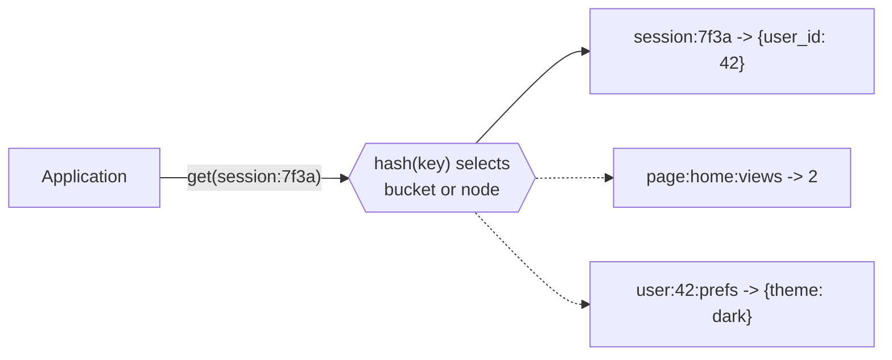

# Key-value stores

## Summary

A key-value store is the simplest database model: a large distributed hash table that maps a unique key to a value, with get, put and delete as the main operations. Reads and writes by key take constant time on average and are often served from memory or SSD, which makes key-value stores the standard choice for caches, sessions, counters and other data that is always accessed by a known key. The price of that simplicity is that the store cannot answer questions about the values themselves, so any query beyond "give me the value for this key" moves into the application.

## Prerequisites

- [NoSQL overview](nosql-overview.md) for the family and the BASE properties.

## Core concepts

### Definition

A *key-value store* stores pairs of a unique *key* and a *value*. It generally allows O(1) reads and writes (constant time on average, independent of the number of keys) and is often backed by memory or SSD. Some stores keep keys in lexicographic order, which allows efficient retrieval of key ranges. Some allow storing metadata with a value (a version, an expiry time, flags).

Key-value stores provide high performance and are often used for simple data models or for rapidly changing data, such as an in-memory cache layer. Since they offer only a limited set of operations, complexity is shifted to the application layer when other operations are needed.

The underlying data model can be considered one large hash table. The diagram shows the model: the store sees only keys; the value is opaque unless the store offers typed values.



*Analogy.* A key-value store is a cloakroom. You hand over a coat and receive a numbered ticket; with the ticket you get the coat back immediately, however many coats hang there. You cannot ask the attendant "give me all red coats": the attendant only knows ticket numbers. The analogy breaks for stores with typed values, such as Redis, where the attendant can also add an item to a bag you left, or keep a ranked list, without handing the whole bag back.

### API model

The basic form of API access is:

- `get(key)`: extract the value for a key,
- `put(key, value)`: create or update the value for a key,
- `delete(key)`: remove the key and its value.

A more advanced API allows executing user-defined functions in the server environment:

- `execute(key, operation, parameters)`: invoke an operation on a value that is a special data structure (list, set, map and so on). Redis commands such as `HSET`, `LPUSH` and `ZADD`, and Lua scripts or Redis Functions, are this kind of API.
- `mapreduce(keyList, mapFunc, reduceFunc)`: invoke a map and reduce function across a key range (offered by Riak, for example).

### Advantages

1. **Simplicity.** The data model is simple, which makes the store easy to understand and use.
2. **Performance.** Reads and writes are fast because the access pattern is direct: hash the key, go to the value.
3. **Scalability.** Designed to handle large amounts of data and to scale horizontally by adding nodes, because keys partition naturally (see [consistent hashing](../../distributed-databases/consistent-hashing.md)).
4. **Flexibility.** Values can be any type of data (strings, numbers, JSON objects, binary blobs).

### Disadvantages

1. **Lack of structure.** The model has no built-in support for complex queries or relationships between data.
2. **Limited querying.** Querying is typically limited to retrieval by key. Anything else needs extra processing in the application, or a scan.
3. **Redundancy.** Without relationships, data often has to be duplicated to support different access patterns (for example `user:42` and `user-by-email:ada@example.com`), which leads to redundancy and the need to keep copies in sync.

### Types

| Type | Examples | Description | Use case |
| --- | --- | --- | --- |
| In-memory | Redis, Memcached | Store data primarily in memory for fast reads and writes; persistence is optional (Redis) or absent (Memcached). | Caching, session storage, real-time data processing. |
| Persistent | Amazon DynamoDB, Riak | Data is stored on disk and survives restarts. | Applications that need durability and long-term storage. |

The line between the types is soft: Redis can persist with snapshots and an append-only file, and DynamoDB has an in-memory accelerator (DAX).

### Use cases

- **Session management.** A web application stores user session data. When a user logs in, a session ID is generated and associated with the user's data. Every request reads the session by ID.
- **Caching.** Frequently accessed data is stored in a cache to improve application performance and to take load off the primary database.
- **Frequently read data.** User settings and preferences, feature flags, configuration.
- **Real-time analytics.** Aggregating real-time counters (page views, rate limits, leaderboards) for quick access.

### Representative engines

| Engine | Description | Use cases |
| --- | --- | --- |
| [Redis](../../engines/redis/redis-overview.md) | An in-memory data structure store, used as a database, cache and message broker. | Real-time analytics, caching, session management. |
| Amazon DynamoDB | A fully managed NoSQL database service from AWS, designed for high availability and performance. Supports key-value and document models. | Mobile backends, IoT applications, real-time bidding. |
| Riak (Riak KV) | A distributed NoSQL key-value store that offers high availability, fault tolerance and operational simplicity; a Dynamo-style design. | Data logging, session storage, distributed data storage. |
| Memcached | A distributed in-memory cache with no persistence and string values only. | Caching database query results and rendered fragments. |

Riak's original company, Basho, closed in 2017; the code continues as an open source community project. Checked 2026-11.

## Worked example

Tested on Redis 7.2.17 (Docker image `redis:7.2-alpine`) with `redis-cli`. A session with an expiry time, a counter, a hash of preferences and a leaderboard.

```bash
SET session:7f3a '{"user_id":42,"role":"admin"}' EX 1800   # value expires after 30 minutes
GET session:7f3a
TTL session:7f3a
INCR page:home:views                                     # atomic counter on the server
INCR page:home:views
HSET user:42:prefs theme dark lang en                    # typed value: hash
HGETALL user:42:prefs
ZADD leaderboard 3100 ada 2900 alan 3500 grace           # typed value: sorted set
ZREVRANGE leaderboard 0 1 WITHSCORES
DEL session:7f3a
GET session:7f3a
```

Output:

```text
OK
{"user_id":42,"role":"admin"}
1800
1
2
2
theme
dark
lang
en
3
grace
3500
ada
3100
1

```

The last `GET` returns nothing (`nil`), because the key was deleted. `INCR` and `ZADD` are `execute`-style operations: the server changes the value in place, atomically, without the client reading and writing it back. That removes a race condition that a plain `get` and `put` would have.

## Trade offs and when to use it

- **Use** for access by known key at high rate: caches, sessions, counters, rate limiters, feature flags, idempotency keys, leaderboards (with sorted sets).
- **Do not use** as the only store for data that needs queries by attribute, relationships or multi-key transactions. Redis offers `MULTI`/`EXEC` and Lua scripts for atomic multi-key operations on one node, but not across a cluster unless keys share a hash slot.
- **Alternatives.** A document store when you need queries on fields of the value; a relational table with a primary key lookup when the volume is moderate and data must be durable and queryable.

## Common mistakes

- **Using a cache as the source of truth.** An in-memory store can lose recent writes on failure, depending on persistence settings. Fix: keep the authoritative data in a durable database, or configure and test persistence.
- **Unbounded keys and values.** Keys without expiry fill memory; large values block single-threaded servers. Fix: set TTLs, cap value sizes, use an eviction policy.
- **Key design without a namespace.** Fix: use a prefix convention (`object:id:field`).
- **Read-modify-write races.** `GET`, change in the client, `SET` loses concurrent updates. Fix: server-side operations (`INCR`, `HINCRBY`), Lua scripts or optimistic locking (`WATCH`).

## Practice

1. Why can a key-value store offer O(1) reads, and what does it give up for that?
2. Which two API forms beyond get, put and delete were described, and why do they reduce round trips?
3. A team wants "all sessions of user 42". How do you support it in a key-value store?
4. What is the difference between Redis and Memcached for a cache that must survive a restart?

Hints:

1. Hashing the key locates the value directly; it gives up queries on the value.
2. `execute` (server-side operation on a typed value) and `mapreduce` over a key range.
3. Maintain a second key, for example a set `user:42:sessions`, and update it with every session write.
4. Redis can persist (RDB snapshots, AOF); Memcached cannot.

## Further reading

- Donne Martin, "The System Design Primer: Key-value store" (GitHub). https://github.com/donnemartin/system-design-primer#key-value-store - Short definition and properties.
- Ricky Ho, "NOSQL Patterns", 2009. https://horicky.blogspot.com/2009/11/nosql-patterns.html - The API model of get, put, delete, execute and mapreduce.
- Redis Ltd., "Redis data types", Redis documentation. https://redis.io/docs/latest/develop/data-types/ - Strings, hashes, lists, sets, sorted sets and streams.
- Amazon Web Services, "What is Amazon DynamoDB?", DynamoDB Developer Guide. https://docs.aws.amazon.com/amazondynamodb/latest/developerguide/Introduction.html - A managed persistent key-value and document store.
