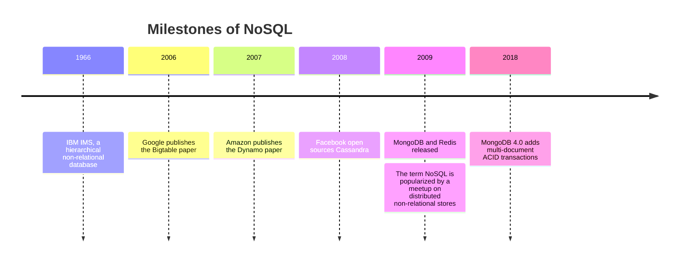
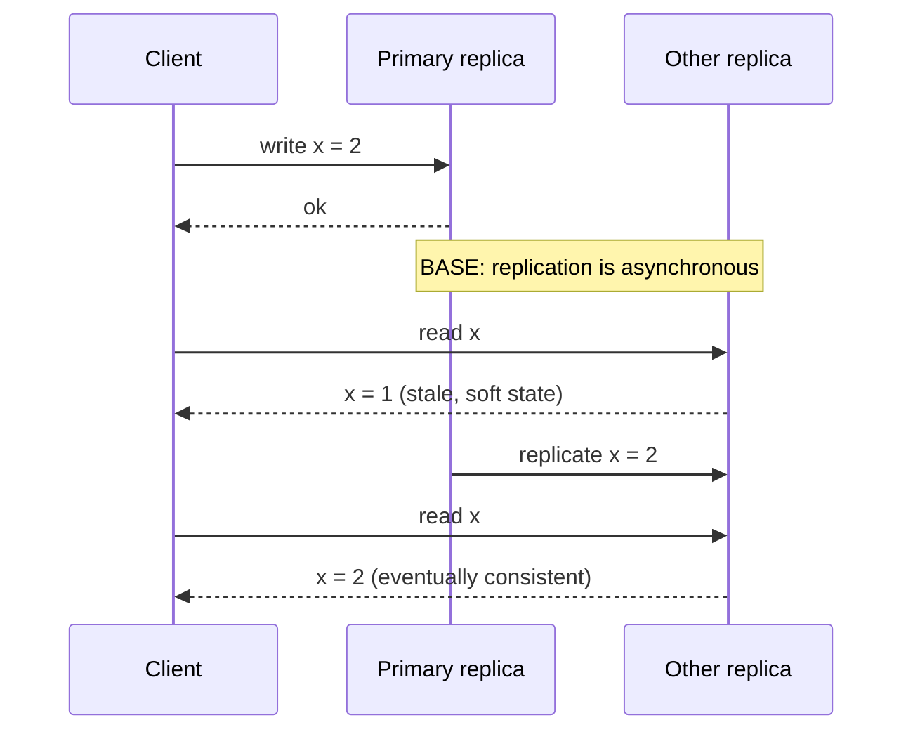

# NoSQL overview

## Summary

NoSQL ("not only SQL") is a family of databases that store data in models other than relational tables: key-value, document, wide-column and graph. Most were built in the late 2000s for web-scale workloads, so they share a design: data is partitioned and replicated across many cheap machines, schemas are flexible, data is denormalized, joins happen in application code, and consistency is often relaxed to eventual consistency in exchange for availability and write throughput. These properties are summarized as BASE, in contrast to the ACID properties of relational transactions. Today the boundary is blurred: many NoSQL engines offer transactions and schemas, and many relational engines store documents.

## Prerequisites

- [SQL versus NoSQL](../../foundations/sql-vs-nosql.md) for the comparison with relational databases.
- [Transactions and ACID](../../transactions-and-concurrency/transactions-and-acid.md) for the ACID side of the contrast.

## Core concepts

### Definition

A *NoSQL database* is a collection of data items represented in a key-value store, document store, wide-column store or graph database. Data is denormalized, and joins are generally done in application code. Most NoSQL stores lack full ACID transactions and favor eventual consistency.

Non-relational databases have existed since the 1960s (IBM IMS, a hierarchical database, dates from 1966). The current family gained traction in the late 2000s with options such as MongoDB, CouchDB, Redis and Apache Cassandra. Over those years an emerging set of storage mechanisms appeared for storing data at large scale. They differ significantly from the RDBMS model and became known as NoSQL. The key players were:

- Google Bigtable, HBase, Hypertable,
- Amazon Dynamo, Voldemort, Cassandra, Riak,
- Redis,
- CouchDB, MongoDB.

The timeline places the events that shaped the family.



### Common characteristics

The solutions of the first NoSQL generation have a number of characteristics in common:

- **Key-value access.** At the bottom, each is a key-value store: data is located by a key.
- **Commodity hardware.** They run on a large number of commodity machines.
- **Partitioning and replication.** Data is partitioned and replicated among these machines.
- **Relaxed consistency.** They relax the consistency requirement, because the CAP theorem shows that a distributed store cannot be both consistent and available while the network is partitioned.

The same underlying techniques appear in all of them, regardless of the data model on top: a cluster of [physical and virtual nodes](../../distributed-databases/physical-and-virtual-nodes.md), data partitioning with [consistent hashing](../../distributed-databases/consistent-hashing.md), and [replication](../../distributed-databases/replication.md) of each partition. Understanding these mechanisms explains the implications for application design better than comparing feature lists of individual products.

A precise reading of CAP matters here. The theorem (Brewer 2000, proven by Gilbert and Lynch 2002) does not say "pick two of three". Network partitions happen whether you like it or not, so partition tolerance is not optional; the theorem says that *during* a partition, each operation must give up either consistency (linearizability) or availability. When there is no partition, the real trade off is between consistency and latency, which the PACELC formulation (Abadi 2012) makes explicit.

### BASE

*BASE* describes the properties of many NoSQL databases. In terms of the CAP theorem, BASE chooses availability over consistency.

- **Basically available.** The system guarantees availability: every request gets a response, possibly with stale data.
- **Soft state.** The state of the system may change over time, even without input, because replicas are still converging.
- **Eventual consistency.** The system becomes consistent over time, provided it receives no new input during that period.

The diagram contrasts what a reader sees right after a write in an ACID system and in a BASE system with asynchronous replicas.



| Property | ACID | BASE |
| --- | --- | --- |
| Priority | Correctness of every transaction | Availability and throughput |
| Consistency | Strong, immediately after commit | Eventual |
| State | Changes only through committed transactions | May change without input while replicas converge |
| Typical scope | Many rows, many tables | Single key or document |
| Typical engines | PostgreSQL, MySQL, Oracle | Cassandra, Riak, DynamoDB (default reads) |

*Analogy.* BASE is like a news story spreading through a town. The moment something happens, only the people nearby know it. Ask someone across town and you get yesterday's news, but you always get an answer. Given a quiet afternoon with no new events, everyone ends up knowing the same story. The analogy breaks because databases bound the delay and offer tunable reads (for example quorum reads in Cassandra) that return the latest value at a higher latency.

### Data models

| Model | Data shape | Strength | Note |
| --- | --- | --- | --- |
| Key-value | Opaque value per key | Fastest access by key | [Key-value stores](key-value-stores.md) |
| Document | JSON or similar tree per key | Whole aggregates, flexible fields, queries on fields | [Document stores](document-stores.md) |
| Wide-column | Rows with sparse, dynamic columns grouped in families | Massive write throughput, range scans by key | [Wide-column stores](wide-column-stores.md) |
| Graph | Nodes, relationships and properties | Multi-hop relationship queries | [Graph databases](graph-databases.md) |

## Worked example

A social application stores a user profile with posts. Modeled in NoSQL style for a document store, the read path "show the profile page" is one lookup, and the write path "user changes display name" must update the copies.

```json
{
  "_id": "user:42",
  "displayName": "ada",
  "followers": 1520,
  "recentPosts": [
    { "postId": "p:9001", "text": "Hello", "authorName": "ada" },
    { "postId": "p:9000", "text": "First!", "authorName": "ada" }
  ]
}
```

- Read: `get("user:42")` returns everything for the page in one request on one partition.
- Write: renaming the user changes `displayName` and every embedded `authorName`; posts embedded in other users' timelines are updated asynchronously, and readers may see the old name for a short time. That is soft state and eventual consistency in practice.

## Trade offs and when to use it

- **Choose NoSQL** when the access pattern is known and simple (by key or aggregate), the volume or write rate exceeds one node, the schema varies, or availability matters more than immediate consistency.
- **Avoid it** when the system needs ad hoc queries, many-to-many joins, or multi-entity invariants (money, inventory) and a single relational node is enough.
- The decision process is in [choosing a database](../../foundations/choosing-a-database.md).

## Common mistakes

- **Reading CAP as "choose two of three".** Fix: partitions are a given; the choice is C or A during a partition, and latency versus consistency otherwise.
- **Assuming eventual consistency is "almost immediate".** Lag can be seconds or more under load or failure. Fix: design reads that tolerate staleness, or use stronger read settings where needed.
- **Modeling relationally in a NoSQL store.** Fix: model by query: one partition or document per access pattern.

## Practice

1. Expand BASE and explain each letter in one sentence.
2. Why does denormalization go together with horizontal partitioning?
3. Restate the CAP theorem precisely, and explain why "CA" is not a meaningful choice for a distributed database.
4. Name the four NoSQL data models and one engine for each.

Hints:

1. Basically available, soft state, eventual consistency.
2. Joins across partitions need network round trips; storing data together keeps a read on one partition.
3. During a partition, an operation must give up consistency or availability; a distributed system cannot opt out of partitions.
4. Key-value (Redis), document (MongoDB), wide-column (Cassandra), graph (Neo4j).

## Further reading

- Ricky Ho, "NOSQL Patterns", Pragmatic Programming Techniques (blog), 2009. https://horicky.blogspot.com/2009/11/nosql-patterns.html - The common technologies under the first NoSQL generation.
- Donne Martin, "The System Design Primer: NoSQL" (GitHub). https://github.com/donnemartin/system-design-primer#nosql - BASE and the four data models in brief.
- Seth Gilbert, Nancy Lynch, "Brewer's Conjecture and the Feasibility of Consistent, Available, Partition-Tolerant Web Services", *ACM SIGACT News* 33(2), 2002. https://doi.org/10.1145/564585.564601 - The proof of CAP.
- Daniel Abadi, "Consistency Tradeoffs in Modern Distributed Database System Design", *IEEE Computer* 45(2), 2012. https://doi.org/10.1109/MC.2012.33 - PACELC.
- Giuseppe DeCandia et al., "Dynamo: Amazon's Highly Available Key-value Store", SOSP 2007. https://www.allthingsdistributed.com/files/amazon-dynamo-sosp2007.pdf - The design many NoSQL stores copied.
