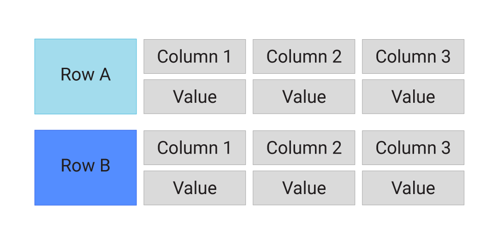
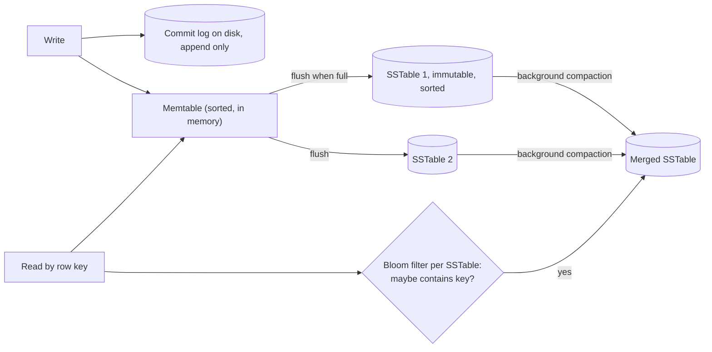

# Wide-column stores

## Summary

A wide-column store (also called a column-family store) is a NoSQL database that uses tables, rows and columns like a relational database, but stores each row as a sparse, sorted map of columns: each row can have a different set of columns, and missing columns cost nothing. Data is addressed by row key, column (grouped into column families) and often a timestamp, and is partitioned by row key across many nodes. Writes go to an append-only log and memory first, which gives very high write throughput. The model descends from Google's Bigtable; Apache Cassandra, Apache HBase, ScyllaDB and Google Cloud Bigtable are the main engines. It suits huge, write-heavy data read by key or key range, such as time series and event logs.

## Prerequisites

- [NoSQL overview](nosql-overview.md).
- [Key-value stores](key-value-stores.md), because a wide-column store is a key-value store whose value is itself a sorted map.

## Core concepts

### Definition

A *wide-column store* is a type of NoSQL database that uses tables, rows and columns, but unlike a relational database it stores data as a sparse matrix. Each row can have a different number of columns, which makes the model flexible for varied data.

Put another way, a wide-column database organizes data into flexible columns that can be spread across several servers or nodes, and uses a multi-dimensional map to reference data by row, column and timestamp. Bigtable's paper describes the model exactly as "a sparse, distributed, persistent multi-dimensional sorted map", indexed by `(row key, column key, timestamp)`.

The figure shows two rows, each a row key followed by its own column-name and value pairs.



The model as a nested map, with sparse rows:

```text
table "sensor_readings"
  row key "device-17#2026-11-09"            (partition key + bucket)
    column family "m"
      "08:00:00" -> 21.4   @ts1
      "08:00:10" -> 21.5   @ts2
      "08:00:20" -> 21.5   @ts3
  row key "device-18#2026-11-09"
    column family "m"
      "08:00:05" -> 19.9   @ts4             (different columns, no empty cells stored)
    column family "meta"
      "firmware" -> "2.1.0" @ts5
```

*Analogy.* A wide-column table is a filing cabinet with one drawer per customer. Each drawer holds only the folders that customer actually has, sorted by label, and you never store empty folders. Finding a drawer is fast because the drawers are labeled in order and spread across several cabinets by label. The analogy breaks because a relational database would need one fixed set of folders for every drawer, while here each drawer decides its own folders, and a drawer may hold millions of them.

### Terms

| Term | Meaning |
| --- | --- |
| Row key | Identifies a row; data is sorted and partitioned by it. In Cassandra the partition key decides the node, and clustering columns sort rows inside a partition. |
| Column family | A group of columns stored together on disk; defined in the schema (HBase, Bigtable). Cassandra's modern CQL table is the successor of the column family. |
| Column qualifier | The name of a column inside a family; can be created dynamically per row and can itself carry data (a timestamp, an ID). |
| Cell | The value at (row, column, timestamp). Several timestamped versions can be kept. |
| Wide row | A row (partition) with many columns, for example one row per device per day with one column per reading. |

### How writes and reads work

Most wide-column engines use a *log-structured merge tree* (LSM tree). The write path explains the write throughput, and the read path explains why reads by key range are fast and reads by anything else are not.



A write is one sequential append plus a memory insert, which is why these engines sustain very high write rates. A read must check the memtable and possibly several SSTables, using Bloom filters and indexes to skip files that do not contain the key; compaction keeps the number of files small.

### Advantages

1. **Scalability.** Scales horizontally by adding servers; data is partitioned by row key.
2. **Flexibility.** Each row can have a different set of columns, which gives a flexible schema.
3. **Performance.** Optimized for reads and writes on large amounts of data, especially writes.
4. **Data locality.** Groups related columns (a column family, or a partition's rows) together for faster reads.
5. **Distributed.** Designed to run on distributed clusters, which makes them fault tolerant and highly available.

### Disadvantages

1. **Complexity.** Harder to design and manage than a relational database. Tables must be designed per query, and a wrong partition key is expensive to change.
2. **Consistency.** May offer eventual consistency rather than strong consistency, which is a problem for some applications. Cassandra makes consistency tunable per request; HBase and Bigtable are strongly consistent per row.
3. **Limited query capabilities.** Less powerful than SQL: no joins, limited secondary indexes, filtering only on key columns without a scan.
4. **Learning curve.** Requires new ways of thinking about storage and retrieval (query-first modeling, partition sizing, tombstones).

### API model

- **Write operations.** Data is written in batches or as individual rows; the API allows inserting rows with varying numbers of columns.

  ```text
  PUT /table/rowID/columnFamily:column {value}
  ```

- **Read operations.** Data is retrieved by row key and, optionally, by columns or column families.

  ```text
  GET /table/rowID/columnFamily:column
  ```

- **Delete operations.** Single columns or entire rows can be deleted. In LSM engines a delete writes a marker (a *tombstone*) that hides older values until compaction removes them.

  ```text
  DELETE /table/rowID/columnFamily:column
  ```

- **Scan operations.** Scanning a range of rows, often with filters to narrow the results.

  ```text
  SCAN /table?startRow=rowID1&endRow=rowID2
  ```

These are generic REST-style forms (close to the HBase REST gateway). Cassandra exposes the same operations through CQL, a SQL-like language over partitions.

### Use cases

- **Time-series data.** Storing and retrieving time-stamped data such as logs and sensor readings.
- **Real-time analytics.** Applications that analyze data as it arrives, such as recommendation engines and ad tech.
- **IoT applications.** Large volumes of data generated by devices.
- **Content management systems.** Storing and retrieving varied content types and their metadata.
- **Financial services.** Transaction data, market data and real-time trading applications (as an event store, not as the ledger of record).

### Types

- **Cassandra-like stores.** Apache Cassandra, ScyllaDB. Focus on high availability and scalability: leaderless, Dynamo-style replication on a hash ring.
- **HBase-like stores.** Apache HBase (and Google Bigtable, which it copies). Focus on Hadoop integration and large-scale storage: a master assigns key ranges (regions or tablets) to servers; strong consistency per row.

### Representative engines

| Engine | Description |
| --- | --- |
| [Apache Cassandra](../../engines/cassandra/cassandra-overview.md) | A highly scalable, distributed wide-column store designed for high availability and fault tolerance. |
| Apache HBase | Runs on top of the Hadoop Distributed File System (HDFS) and provides real-time read and write access to large datasets. |
| ScyllaDB | A database compatible with Cassandra, rewritten in C++ for higher performance and lower latency. |
| Google Cloud Bigtable | A fully managed, scalable NoSQL database service for large analytical and operational workloads. |
| Hypertable | An open source, high-performance, scalable database modeled after Google's Bigtable. The project is no longer maintained (checked 2026-11). |

## Worked example

Design for "show the readings of one device for one day, newest first", with 100 000 devices writing every 10 seconds. The CQL below is untested in this repository; it follows the Cassandra 5.0 CQL syntax.

```sql
-- Cassandra CQL, untested
CREATE TABLE sensor_readings (
  device_id  text,
  day        date,
  ts         timestamp,
  value      double,
  PRIMARY KEY ((device_id, day), ts)        -- partition key (device_id, day), clustering column ts
) WITH CLUSTERING ORDER BY (ts DESC);

INSERT INTO sensor_readings (device_id, day, ts, value)
VALUES ('device-17', '2026-11-09', '2026-11-09 08:00:10', 21.5);

SELECT ts, value FROM sensor_readings
WHERE device_id = 'device-17' AND day = '2026-11-09'
LIMIT 100;
```

Sizing: one reading every 10 seconds is 8 640 readings per device per day, so each partition holds 8 640 rows, small enough to read in one request. Partitioning by `(device_id, day)` instead of `device_id` alone keeps partitions bounded; without the `day` bucket, a partition would grow forever. The query names the full partition key, so it goes to exactly the replicas that own that partition. A query like "all devices with value above 30" would require a full cluster scan and needs a different table designed for it.

## Trade offs and when to use it

- **Use** for write-heavy data at large scale with known access patterns by key and range: time series, event logs, messaging inboxes, IoT.
- **Do not use** for ad hoc queries, joins, aggregations across partitions or small datasets that fit one relational node.
- **Alternatives.** A time-series database (TimescaleDB, InfluxDB) for metrics with rich time functions; a relational database with partitioning for moderate volume; an analytical column store (ClickHouse, BigQuery) for aggregations. Note the naming trap: a *wide-column* store is not a *column-oriented* (columnar) analytical database, which stores each column contiguously for scans and compression.

## Common mistakes

- **Unbounded partitions.** A partition per device with no time bucket grows until it hurts reads and repairs. Fix: add a time bucket to the partition key.
- **Hot partitions.** A partition key with low cardinality (country, status) concentrates load on a few nodes. Fix: choose a high-cardinality key, or add a synthetic suffix.
- **Modeling relationally.** Normalized tables with joins in the application multiply round trips. Fix: one table per query, denormalized.
- **Heavy deletes.** Tombstones slow reads until compaction. Fix: use TTLs and time-bucketed tables that are dropped whole.
- **Confusing wide-column with columnar.** Fix: see the trade offs above.

## Practice

1. What are the three dimensions that address a cell in Bigtable's data model?
2. Why are writes cheap in an LSM-based wide-column store?
3. In the worked example, why is `day` part of the partition key?
4. What is the difference between Cassandra-like and HBase-like stores?

Hints:

1. Row key, column key (family and qualifier) and timestamp.
2. A write is an append to the commit log and an insert into an in-memory structure; sorting and merging happen later in the background.
3. To bound the partition size and spread one device's history over many partitions.
4. Cassandra-like: leaderless, hash ring, tunable consistency. HBase-like: master assigns key ranges, strong consistency per row, built on a distributed file system.

## Further reading

- Fay Chang et al., "Bigtable: A Distributed Storage System for Structured Data", OSDI 2006. https://research.google/pubs/bigtable-a-distributed-storage-system-for-structured-data/ - The origin of the model.
- Apache Software Foundation, "Data modeling", Apache Cassandra documentation. https://cassandra.apache.org/doc/latest/cassandra/developing/data-modeling/index.html - Query-first modeling and partition sizing.
- Apache Software Foundation, "Apache HBase Reference Guide". https://hbase.apache.org/book.html - Column families, regions and the HBase data model.
- Patrick O'Neil et al., "The Log-Structured Merge-Tree (LSM-Tree)", *Acta Informatica* 33, 1996. https://doi.org/10.1007/s002360050048 - The storage structure behind the write path.
