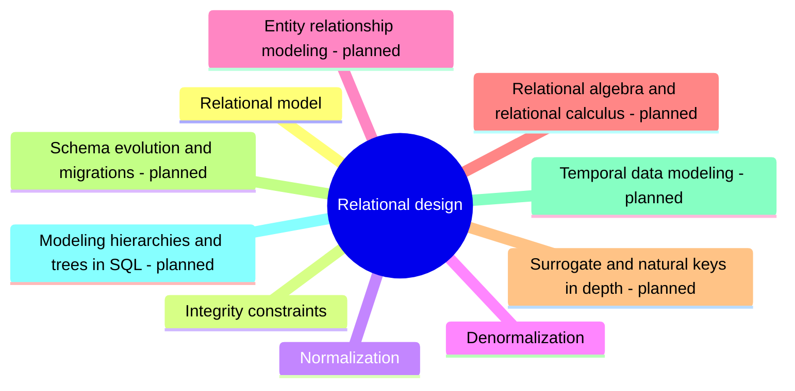

# Relational design

The relational model and how to design a relational schema: keys, relationships, integrity constraints, normalization and deliberate denormalization.

## Map

The map shows the parts of this section: written notes and subsections, and planned topics, which end with the word planned.

## Reading order

1. [Relational model](relational-model.md): The relational model, proposed by Edgar F.
2. [Integrity constraints](integrity-constraints.md): Database constraints are rules, declared in the schema, that limit the data a table can hold.
3. [Normalization](normalization.md): Normalization is the process of organizing a relational schema so that each fact is stored exactly once.
4. [Denormalization](denormalization.md): Denormalization deliberately adds redundancy to a normalized schema to make reads faster.

## Planned topics

- Entity relationship modeling
- Relational algebra and relational calculus
- Surrogate and natural keys in depth
- Schema evolution and migrations
- Temporal data modeling
- Modeling hierarchies and trees in SQL
