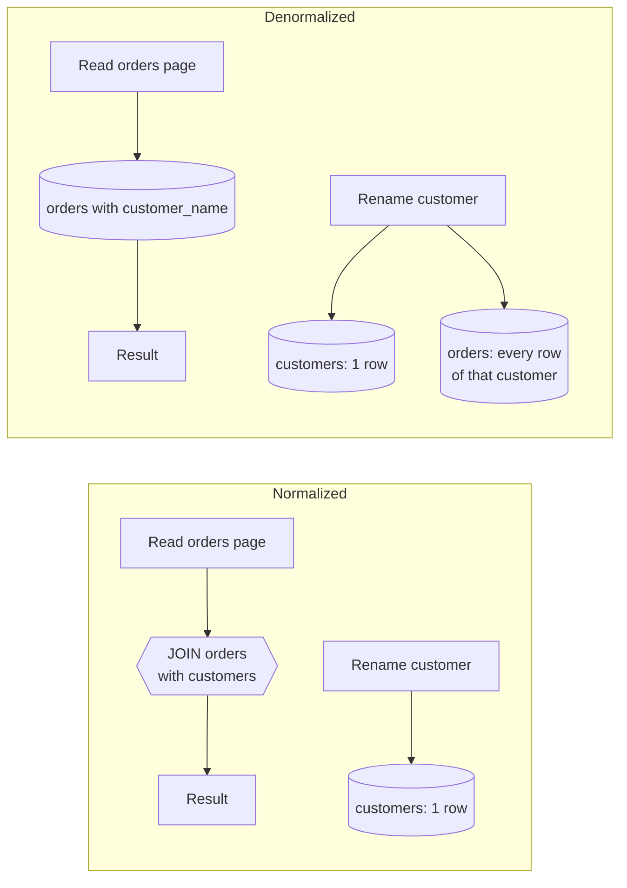
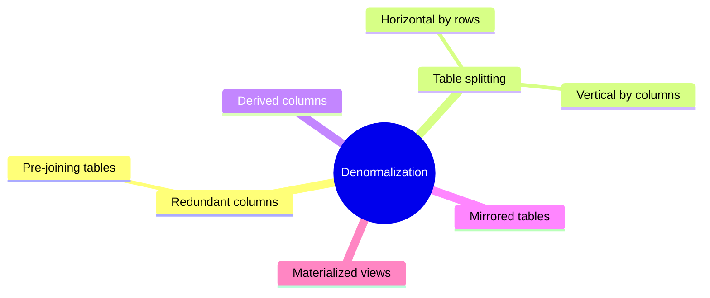

# Denormalization

## Summary

Denormalization deliberately adds redundancy to a normalized schema to make reads faster. Copies of data are written to several tables, totals are precomputed, and tables are split or mirrored so that frequent queries avoid expensive joins and scans. Reads get faster and simpler; writes get slower, storage grows, and the copies can drift apart unless something keeps them in sync. Some engines, such as PostgreSQL and Oracle, offer materialized views that store and refresh redundant results for you. Denormalization is a targeted optimization applied after normalization, not a substitute for it.

## Prerequisites

- [Normalization](normalization.md), which this note reverses on purpose.
- [Relational model](relational-model.md) for joins and keys.

## Core concepts

### Definition

*Denormalization* attempts to improve read performance at the expense of some write performance. Redundant copies of data are written in several tables to avoid expensive joins. It combines data from several tables into one table that can be queried faster. Some RDBMSs, such as PostgreSQL and Oracle, support *materialized views*, which handle the work of storing redundant information and keeping the copies consistent.

Denormalization techniques include:

- table splitting,
- adding derived and redundant columns,
- mirrored tables,
- materialized views.

Once data is distributed with techniques such as [federation](../../information-integration/database-federation.md) and [sharding](../../distributed-databases/sharding.md), joins across servers or data centers become even more expensive. Denormalization may remove the need for such joins. This is why NoSQL data modeling, which assumes distribution, is denormalized by default (see the [NoSQL overview](../nosql/nosql-overview.md)).

*Analogy.* A normalized schema is a library where you look up the author in one catalog and the book's shelf in another. Denormalization is printing the author's name and the shelf number on the book's catalog card: one lookup instead of two. If the library moves the shelf, every card that carries the old number is now wrong unless someone reprints them. That reprinting job is the real cost of denormalization. The analogy breaks for materialized views, where the database itself does the reprinting.

### How it works

A normalized database has a single copy of each piece of information, and related data lives in separate tables. Queries combine data from several tables at read time.

When the amount of data grows, or queries join many tables, performance can degrade significantly. Consider an online shop: customer data is in one table and order data in another, and `orders` has a foreign key to `customers`. The page that shows all orders of a customer, with the customer's name, needs a join between `orders` and `customers`. With a high volume of orders and customers, that join runs on every page view and slows the website down.

Denormalization offers two options here:

- add a `customer_name` column to the `orders` table, or
- introduce a separate table that merges the data of both tables.

The diagram contrasts the two read paths and shows the extra write work that denormalization introduces.



### Advantages

- **Faster reads.** With more data in one place, it is quicker to retrieve what you need, which improves user experience through better query performance.
- **Simpler queries.** You do not combine as many tables, so queries are simpler and the data model seen by readers stays simple.
- **Better performance for specific tasks.** When you know exactly how the database will be used, denormalization tailors it for speed in those paths.
- **Better scalability.** Avoiding joins makes it easier to distribute data and scale reads.
- **Faster reports.** Precomputed data generates reports faster.

### Disadvantages

- **Redundancy.** The most obvious cost: the same data is stored in more than one place.
- **Risk of inconsistency.** If data changes in one place but not the other, the copies no longer match. Mirrored databases, for example, need replication to stay up to date, and a failure of the replica leaves them inconsistent.
- **More storage.** Table splitting and mirrored tables need extra storage space, which costs money.
- **More complex schema.** The data store is harder to maintain as the number of tables grows.
- **Costly inserts and updates.** Every write must update every copy.
- **Higher maintenance cost** because of the extra complexity and redundancy.

The comparison table of normalization and denormalization (redundancy, integrity, query complexity, read and write performance, maintenance) is in [normalization](normalization.md#normalization-versus-denormalization).

### Techniques

The mind map lists the techniques covered below.



#### Redundant columns and pre-joining tables

Used when join operations are expensive and data from several tables is frequently read together. The frequently used data is added to one table. For example, with tables `customer` and `order`, adding `customer_name` to `order` removes the join from the "orders with customer names" query. It also introduces a lot of redundancy: the name is repeated in every order of the customer.

The figure shows the `Customer` and `Order` tables on the left and the denormalized `Order` table, which now carries `customer_name`, on the right.


#### Table splitting

Table splitting decomposes a table into several smaller tables so that they can be queried and managed more easily. There are two ways to split.

**Horizontal table splitting** puts the rows into smaller tables; each table has the same columns. This is useful when the data separates by region, physical location, task or a similar attribute. For example, a table with student information for all departments of a science faculty can be split by department: computer science, chemistry, botany and so on. Department-based queries now read a smaller data set, which makes them faster.

The figure shows a four-row student table split by `Department_ID` into Computer Science (Alex, Sam), Chemistry (Marie) and Botany (Sara) tables with identical columns.


Inside one database, horizontal splitting is what declarative *table partitioning* automates (PostgreSQL `PARTITION BY LIST/RANGE/HASH`), with the advantage that queries still address one logical table. Across servers it becomes [sharding](../../distributed-databases/sharding.md).

**Vertical table splitting** splits a table by columns and repeats the primary key in each part. For example, a hospital's `Patients` table with patient ID, name, address and medical history can be split into `Patient_Details` and `Patient_Medical_History`. This is best when some columns are accessed much more often than others: queries read only the required attributes, and large, rarely used columns do not slow down scans of the frequent ones.

The figure shows the `Patients` table split into `Patient_Details` (ID, name, address) and `Patient_Medical_History` (ID, medical history), both keyed by `Patient_ID`.


Strictly, vertical splitting with a shared primary key does not add redundancy beyond the key, so it is a physical design technique rather than denormalization. It is listed here because it is applied for the same reason: read performance of a specific access path.

#### Derived columns

A *derived column* stores a value computed from other data. Take two tables, `Student` (student information) and `Student_Grades` (marks per assignment). If the application shows each student's total marks with the student's details, a `total_marks` column in `Student` removes the need to sum the grades on every query. The [worked example](#worked-example) keeps such a column in sync with a trigger.

#### Mirrored tables

A *mirrored table* is a full or partial copy of an existing table, stored in a separate location and optimized for faster queries, for example with additional indexes or a different partitioning. Mirrored tables usually serve read-heavy workloads such as analytics, so that they do not compete with the transactional workload. They are created with replication into separate database instances or servers. The cost is keeping several copies in sync, which needs resources and adds failure modes. A read replica that serves reports is a mirrored table at database level (see [replication](../../distributed-databases/replication.md)).

#### Materialized views

A *materialized view* stores the precomputed result of a query in a separate table. It is typically used for expensive join and aggregation queries whose results are read frequently. The database reads the stored result instead of executing the same query again. The trade off is freshness: in PostgreSQL the result is updated only by `REFRESH MATERIALIZED VIEW` (with `CONCURRENTLY` to avoid blocking readers, which requires a unique index), while Oracle and SQL Server (indexed views) can maintain some views automatically on commit. Checked against PostgreSQL 17 documentation, 2026-11.

### Keeping copies in sync

Every denormalization needs a defined mechanism that updates the copies:

| Mechanism | Freshness | Cost |
| --- | --- | --- |
| Same transaction in application code | Immediate | Every write path must remember all copies |
| Trigger | Immediate | Hidden logic, slower writes, harder debugging |
| Materialized view refresh | Periodic | Stale between refreshes, refresh cost |
| Change data capture or replication | Seconds | Extra infrastructure, eventual consistency |
| Batch job | Hours | Stale, but simple |

## Worked example

Tested on PostgreSQL 17.11. A derived column maintained by a trigger, and a materialized view that is stale until refreshed.

```sql
CREATE TABLE students (student_id int PRIMARY KEY, name text NOT NULL, total_marks int NOT NULL DEFAULT 0);
CREATE TABLE student_grades (
  student_id int REFERENCES students, assignment text, marks int NOT NULL,
  PRIMARY KEY (student_id, assignment)
);
-- Derived column kept in sync by a trigger: recompute the total of the affected student
CREATE FUNCTION sync_total_marks() RETURNS trigger LANGUAGE plpgsql AS $$
BEGIN
  UPDATE students s
  SET total_marks = (SELECT coalesce(sum(marks), 0) FROM student_grades g WHERE g.student_id = s.student_id)
  WHERE s.student_id = coalesce(NEW.student_id, OLD.student_id);
  RETURN NULL;
END $$;
CREATE TRIGGER student_grades_total AFTER INSERT OR UPDATE OR DELETE ON student_grades
FOR EACH ROW EXECUTE FUNCTION sync_total_marks();

INSERT INTO students (student_id, name) VALUES (1, 'Alex'), (2, 'Marie');
INSERT INTO student_grades VALUES (1, 'A1', 40), (1, 'A2', 35), (2, 'A1', 50);
UPDATE student_grades SET marks = 45 WHERE student_id = 1 AND assignment = 'A2';
SELECT student_id, name, total_marks FROM students ORDER BY student_id;

CREATE MATERIALIZED VIEW grade_report AS
SELECT s.name, count(*) AS assignments, avg(g.marks)::numeric(5, 2) AS avg_marks
FROM students s JOIN student_grades g USING (student_id) GROUP BY s.name;
INSERT INTO student_grades VALUES (2, 'A2', 10);
SELECT * FROM grade_report ORDER BY name;   -- stale
REFRESH MATERIALIZED VIEW grade_report;
SELECT * FROM grade_report ORDER BY name;   -- fresh
```

Output:

```text
 student_id | name  | total_marks
------------+-------+-------------
          1 | Alex  |          85
          2 | Marie |          50
(2 rows)

 name  | assignments | avg_marks
-------+-------------+-----------
 Alex  |           2 |     42.50
 Marie |           1 |     50.00
(2 rows)

 name  | assignments | avg_marks
-------+-------------+-----------
 Alex  |           2 |     42.50
 Marie |           2 |     30.00
(2 rows)
```

The trigger kept `total_marks` correct after an update (40 + 45 = 85). The materialized view still showed one assignment for Marie after the insert, until the refresh. This is the freshness trade off in one picture.

## Trade offs and when to use it

- Use denormalization for read-heavy paths with measured join or aggregation cost, for reporting, and for data that is distributed across shards or services.
- Avoid it for data that changes often and must be exact everywhere at once (balances, stock), unless the copies are updated in the same transaction.
- Prefer engine-managed redundancy (materialized views, indexes, partitioning) over hand-written copies, because the engine maintains it consistently.
- Alternatives: a better index (often removes the need), a covering index, a cache in front of the database, or a read replica.

## Common mistakes

- **Denormalizing before measuring.** A missing index is a more common cause of slow joins than the join itself. Fix: run `EXPLAIN ANALYZE` first (see [SQL tuning](../../query-processing-and-optimization/sql-tuning.md)).
- **No sync mechanism.** A copied column that nothing updates is a data quality bug. Fix: choose a mechanism from the table above and document it.
- **Trigger chains.** Triggers that update tables with more triggers make writes slow and failures hard to trace. Fix: keep one level, or move the logic to an explicit write path.
- **Forgetting to refresh materialized views.** Fix: schedule the refresh and monitor its age.

## Practice

1. Name four denormalization techniques and the problem each one solves.
2. What is the difference between horizontal and vertical table splitting?
3. Why does sharding push a design toward denormalization?
4. When is a derived column with a trigger better than a materialized view, and when is it worse?

Hints:

1. Redundant columns (joins), table splitting (scan size), derived columns (repeated computation), mirrored tables (read load isolation), materialized views (expensive aggregates).
2. Horizontal keeps all columns and splits rows; vertical keeps all rows and splits columns, repeating the key.
3. Joins across shards need network round trips and coordination; co-locating data avoids them.
4. Better when the value must be fresh at every read; worse when writes are frequent, because every write pays the trigger cost.

## Further reading

- Donne Martin, "The System Design Primer: Denormalization" (GitHub). https://github.com/donnemartin/system-design-primer#denormalization - Short rationale in the context of federation and sharding.
- PostgreSQL Global Development Group, "Materialized Views", PostgreSQL 17 documentation. https://www.postgresql.org/docs/17/rules-materializedviews.html - Creation, refresh and limits.
- PostgreSQL Global Development Group, "Table Partitioning", PostgreSQL 17 documentation. https://www.postgresql.org/docs/17/ddl-partitioning.html - Engine-managed horizontal splitting.
- Martin Kleppmann, *Designing Data-Intensive Applications*, O'Reilly, 2017, chapter 3 and chapter 11 (derived data). https://dataintensive.net/ - Denormalized data as derived data kept in sync by streams.
