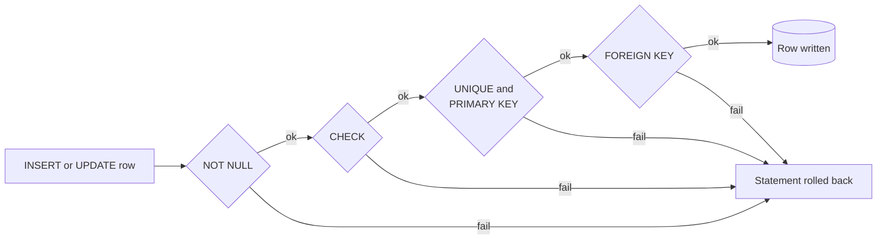

# Integrity constraints

## Summary

Database constraints are rules, declared in the schema, that limit the data a table can hold. The database checks them on every write and rejects any statement that would break them, so invalid data cannot enter no matter which application, script or person writes it. Common constraints are primary keys, foreign keys, `UNIQUE`, `NOT NULL` and `CHECK`. They enforce the integrity and accuracy of the data and can encode business rules such as "a balance is never negative".

## Prerequisites

- [Relational model](relational-model.md) for tables, keys and relationships.

## Core concepts

### Definition

An *integrity constraint* is a predicate over the database state that must be true after every statement (or, for deferred constraints, after every transaction). Constraints can be specified when a table is created (`CREATE TABLE`) or added to an existing table (`ALTER TABLE ... ADD CONSTRAINT`). Adding a constraint to an existing table checks all existing rows first.

For example, a constraint can ensure that a column only contains positive numbers, or that a column always holds a unique value.

### Why constraints belong in the database

An application can validate input too, and it should, for good error messages. But application validation does not protect the data:

- several applications, batch jobs and administrators write to the same database,
- two concurrent requests can each pass an application check ("is this email free?") and both insert,
- bugs and future code changes skip checks.

A constraint is checked by the engine inside the transaction, under the engine's own concurrency control, so it holds even for concurrent writers.

*Analogy.* Constraints are the safety interlocks of a machine, while application validation is the operator's checklist. A careful operator rarely needs the interlock, but the interlock stops the machine even when the operator is tired, new or in a hurry. The analogy breaks in one way: an interlock that blocks too much only annoys the operator, while a constraint that is too strict rejects valid business data, so constraints must be designed with the business rules.

### Constraint types

| Constraint | Rule | Example |
| --- | --- | --- |
| `NOT NULL` | The column must have a value. | `owner text NOT NULL` |
| `UNIQUE` | No two rows have the same value (or combination). `NULL` values do not collide by default. | `iban text UNIQUE` |
| `PRIMARY KEY` | `UNIQUE` plus `NOT NULL`; one per table; identifies the row. | `account_id int PRIMARY KEY` |
| `FOREIGN KEY` | The value must exist as a key in the referenced table (*referential integrity*). | `REFERENCES accounts (account_id)` |
| `CHECK` | A Boolean expression on the row must not be false. | `CHECK (balance >= 0)` |
| `DEFAULT` | Not a constraint in the strict sense: supplies a value when none is given. | `DEFAULT 'open'` |
| `EXCLUDE` (PostgreSQL) | No two rows satisfy an operator together, for example overlapping time ranges for the same room. | `EXCLUDE USING gist (room WITH =, during WITH &&)` |

The flowchart shows the order in which PostgreSQL checks a row on insert: column constraints, then unique indexes, then foreign keys. The first failure aborts the statement.



The exact order is an implementation detail, but the outcome is defined by the standard: a violating statement has no effect.

### Referential actions

A foreign key also defines what happens when the referenced row is deleted or its key is updated:

| Action | Effect on referencing rows |
| --- | --- |
| `NO ACTION` (default) | Error, checked at the end of the statement (or transaction if deferred). |
| `RESTRICT` | Error, checked immediately. |
| `CASCADE` | Delete or update the referencing rows too. |
| `SET NULL` / `SET DEFAULT` | Set the referencing columns to `NULL` or their default. |

`CASCADE` is convenient for owned children (order lines of an order) and dangerous for shared references (deleting a customer should not silently delete invoices kept for tax purposes).

### Deferred constraints

By default a constraint is checked after each statement. A constraint declared `DEFERRABLE INITIALLY DEFERRED` is checked at `COMMIT`. This allows temporary violations inside a transaction, for example inserting two rows that reference each other. Support differs: PostgreSQL and Oracle support deferrable unique and foreign key constraints; MySQL (InnoDB) does not support deferred constraints. Checked against PostgreSQL 17 and MySQL 8.4 documentation, 2026-11.

### Constraints in NoSQL databases

Most NoSQL stores enforce only uniqueness of the primary key. Document stores may offer schema validation (MongoDB JSON Schema validation) and unique indexes, but not foreign keys. The consequence is described in [document stores](../nosql/document-stores.md#disadvantages): it becomes possible to store a book whose author does not exist.

## Worked example

Tested on PostgreSQL 17.11. A bank account table encodes four business rules as constraints, and each invalid statement is rejected.

```sql
CREATE TABLE accounts (
  account_id int PRIMARY KEY,
  owner      text NOT NULL,
  iban       text NOT NULL UNIQUE,
  balance    numeric(12, 2) NOT NULL DEFAULT 0 CHECK (balance >= 0),
  status     text NOT NULL DEFAULT 'open' CHECK (status IN ('open', 'frozen', 'closed'))
);
CREATE TABLE transfers (
  transfer_id  int PRIMARY KEY,
  from_account int NOT NULL REFERENCES accounts ON DELETE RESTRICT,
  to_account   int NOT NULL REFERENCES accounts ON DELETE RESTRICT,
  amount       numeric(12, 2) NOT NULL CHECK (amount > 0),
  CONSTRAINT different_accounts CHECK (from_account <> to_account)
);
INSERT INTO accounts (account_id, owner, iban, balance) VALUES (1, 'Ada', 'PL00 0000 0001', 100), (2, 'Alan', 'PL00 0000 0002', 50);
INSERT INTO accounts (account_id, owner, iban, balance) VALUES (3, 'Eve', 'PL00 0000 0001', 10);  -- duplicate IBAN
UPDATE accounts SET balance = balance - 150 WHERE account_id = 1;                             -- overdraft
INSERT INTO transfers VALUES (1, 1, 1, 10);                                                    -- to itself
INSERT INTO transfers VALUES (2, 1, 2, 10);                                                    -- valid
DELETE FROM accounts WHERE account_id = 2;                                                     -- still referenced
INSERT INTO accounts (account_id, owner, iban) VALUES (4, NULL, 'PL00 0000 0004');            -- no owner
SELECT account_id, balance, status FROM accounts ORDER BY account_id;
```

Output (the `CREATE` and successful `INSERT` lines are omitted):

```text
ERROR:  duplicate key value violates unique constraint "accounts_iban_key"
DETAIL:  Key (iban)=(PL00 0000 0001) already exists.
ERROR:  new row for relation "accounts" violates check constraint "accounts_balance_check"
DETAIL:  Failing row contains (1, Ada, PL00 0000 0001, -50.00, open).
ERROR:  new row for relation "transfers" violates check constraint "different_accounts"
DETAIL:  Failing row contains (1, 1, 1, 10.00).
ERROR:  update or delete on table "accounts" violates foreign key constraint "transfers_to_account_fkey" on table "transfers"
DETAIL:  Key (account_id)=(2) is still referenced from table "transfers".
ERROR:  null value in column "owner" of relation "accounts" violates not-null constraint
DETAIL:  Failing row contains (4, null, PL00 0000 0004, 0.00, open).
 account_id | balance | status
------------+---------+--------
          1 |  100.00 | open
          2 |   50.00 | open
(2 rows)
```

The failed `UPDATE` left the balance at 100.00, because a statement that violates a constraint has no effect at all.

## Trade offs and when to use it

- **Benefits.** Integrity is guaranteed for every writer; the schema documents the business rules; the optimizer can use constraints (for example, a `NOT NULL` or a foreign key lets it remove unnecessary joins or checks).
- **Costs.** Each check costs time on write; a foreign key check reads the parent table, and a missing index on the referencing column makes deletes on the parent slow because every delete scans the child table. Adding a constraint to a large table locks or scans it (PostgreSQL allows `NOT VALID` followed by `VALIDATE CONSTRAINT` to reduce locking).
- **When not to.** Across shards or services, the database cannot enforce foreign keys (see the [Figma case study](../../case-studies/figma-database-scaling.md)); those rules move to the application or to asynchronous reconciliation.

## Common mistakes

- **No index on foreign key columns.** Parent deletes and joins become full scans. Fix: index the referencing columns (PostgreSQL does not do it automatically).
- **Business rules only in the application.** Fix: encode invariants as `CHECK`, `UNIQUE` and foreign keys, and keep application validation for user messages.
- **`ON DELETE CASCADE` everywhere.** One delete removes far more data than intended. Fix: cascade only from owner to owned children.
- **Expecting `UNIQUE` to block several `NULL` values.** By default `NULL`s are distinct. Fix: `NOT NULL`, or `UNIQUE NULLS NOT DISTINCT` (PostgreSQL 15 and later).

## Practice

1. Why is "check in the application whether the email exists, then insert" not enough to guarantee unique emails?
2. What is the difference between `RESTRICT` and `NO ACTION`?
3. When do you need a deferred constraint?
4. Why does a missing index on `orders.customer_id` slow down `DELETE FROM customers`?

Hints:

1. Two concurrent requests can both pass the check before either inserts; only a unique constraint is checked atomically.
2. `RESTRICT` checks immediately; `NO ACTION` checks at the end of the statement and can be deferred.
3. When a transaction must pass through a temporarily invalid state, such as mutually referencing rows.
4. The engine must find referencing orders for each deleted customer, which is a scan without an index.

## Further reading

- PostgreSQL Global Development Group, "Constraints", PostgreSQL 17 documentation. https://www.postgresql.org/docs/17/ddl-constraints.html - All constraint types with examples, including `EXCLUDE`.
- Oracle, "FOREIGN KEY Constraints", MySQL 8.4 Reference Manual. https://dev.mysql.com/doc/refman/8.4/en/create-table-foreign-keys.html - Referential actions and InnoDB limits.
- Abraham Silberschatz, Henry F. Korth, S. Sudarshan, *Database System Concepts*, 7th edition, McGraw-Hill, 2019, section 4.4 "Integrity Constraints". https://db-book.com/ - Formal treatment of constraints and assertions.
