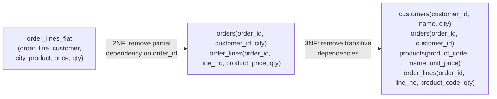

# Normalization

## Summary

Normalization is the process of organizing a relational schema so that each fact is stored exactly once. Large tables that mix several subjects are divided into smaller tables linked by keys. The result has less redundancy and no update, insert or delete anomalies, so integrity is easier to keep, at the cost of joins when data is read together. The levels of normalization are called *normal forms*: first (1NF), second (2NF), third (3NF) and Boyce-Codd (BCNF) are the ones used in practice. [Denormalization](denormalization.md) is the deliberate opposite, used to speed up reads.

## Prerequisites

- [Relational model](relational-model.md) for keys and relationships.
- [Integrity constraints](integrity-constraints.md) for how keys are enforced.

## Core concepts

### Definition and goal

*Normalization* is a process in databases where data is organized to reduce redundancy and improve data integrity. Its main goal is to divide large tables into smaller, more manageable pieces with relationships between them. Normalization removes redundancy by keeping exactly one copy of each fact in the tables, maintains the relationships between data and eliminates unstructured data.

A normalized database also standardizes data across an organization, ensures logical data storage and gives a clean data set for other processes.

### The problem it solves: anomalies

When one table stores facts about several subjects, the same fact is repeated in many rows. Three kinds of *anomaly* follow:

- **Update anomaly.** A customer moves city; the city is stored in every order line, and an update that misses one row leaves two cities for one customer.
- **Insert anomaly.** A new product cannot be recorded until someone orders it, because the table needs an order to have a row.
- **Delete anomaly.** Deleting the last order of a product also deletes the only record of the product's name and price.

The [worked example](#worked-example) shows the update anomaly on real data.

### Functional dependencies

Normal forms are defined with *functional dependencies*. `X -> Y` (X determines Y) means: rows that agree on the columns X also agree on Y. In an order line table, `customer_id -> customer_city` (one customer has one city) and `product_code -> unit_price`. A normal form forbids certain kinds of dependency, and decomposition removes them by moving the dependent columns into their own table, keyed by the determinant.

### Normal forms

There are mainly four forms applied in practice: first, second and third normal forms and Boyce-Codd normal form (sometimes called 3.5NF). Each form includes the previous one.

| Normal form | Rule | Violation example | Fix |
| --- | --- | --- | --- |
| 1NF | Every column holds one atomic value; no repeating groups; rows identified by a key. | `phones = '555-1, 555-2'` | One row per phone in a child table. |
| 2NF | 1NF, and no non-key column depends on only part of a composite key. | In `order_lines(order_id, line_no, customer_city)`, the city depends on `order_id` alone. | Move order-level columns to `orders`. |
| 3NF | 2NF, and no non-key column depends on another non-key column (no transitive dependency). | `orders(order_id, customer_id, customer_city)`: `order_id -> customer_id -> customer_city`. | Move `customer_city` to `customers`. |
| BCNF | For every non-trivial dependency `X -> Y`, X is a superkey. | `(student, course) -> teacher` and `teacher -> course`: `teacher` is not a key. | Split into `(teacher, course)` and `(student, teacher)`. |

Higher forms exist: 4NF removes multi-valued dependencies (independent lists stored in one table), and 5NF removes join dependencies. They matter rarely in application schemas. A common summary of 3NF is the oath "every non-key attribute must provide a fact about the key, the whole key, and nothing but the key" (attributed to Bill Kent, 1983).

The diagram shows the decomposition steps of the worked example, from one flat table to four tables in 3NF.



*Analogy.* Normalization is like keeping a contact list on a phone instead of writing a friend's address on every letter you send them. When the friend moves, you change one entry and every future letter is correct. The analogy breaks in one place: the letters you already sent should keep the old address (a historical fact), and in a database that means storing a snapshot on purpose, for example the price at the time of the order.

### Advantages

- **Reduces redundancy.** The same information is not stored in several places.
- **Improves data integrity.** With a single place to update data, accuracy and consistency are easier to keep.
- **Easier to maintain.** Smaller tables are simpler to manage and understand.
- **Saves space.** Less duplicated data means less storage.
- **Faster writes.** An update touches one row instead of many, and rows are narrower.

### Disadvantages

- **Complex queries.** Getting the information you need often means joining several tables.
- **Slower reads.** Those joins can slow down queries, especially at large volume or across servers.
- **Harder to understand.** For someone new, a highly normalized database can be hard to navigate.

### Normalization versus denormalization

*Denormalization* is the opposite process: you purposely add back redundancy to improve read performance. It is described in its own note, [denormalization](denormalization.md).

| Factor | Normalization | Denormalization |
| --- | --- | --- |
| Redundancy | Minimized | Increased |
| Data integrity | High | Can be compromised |
| Query complexity | High | Low |
| Performance (read) | Slower | Faster |
| Performance (write) | Fast | Slower |
| Maintenance | Easier | More complex |

The differences can be summed up in two points:

1. Normalization removes redundancy and stores non-redundant, standardized data. Denormalization combines data from several tables into one table that can be queried faster.
2. Normalization is used when joins are cheap and there are many inserts, updates and deletes. Denormalization is useful when there are many costly join queries.

In summary, normalization organizes data efficiently and maintains its integrity, while denormalization speeds up reads at the cost of redundancy and maintenance complexity. The usual practice is to normalize first (to 3NF or BCNF), measure, and denormalize only where a measured read path needs it.

## Worked example

Tested on PostgreSQL 17.11. First the unnormalized table, then an update anomaly, then the 3NF version.

```sql
-- Unnormalized: one row per order line, customer and product facts repeated
CREATE TABLE order_lines_flat (
  order_id int, line_no int,
  customer_id int, customer_name text, customer_city text,
  product_code text, product_name text, unit_price numeric(8, 2),
  quantity int,
  PRIMARY KEY (order_id, line_no)
);
INSERT INTO order_lines_flat VALUES
  (100, 1, 1, 'Ada',  'London',   'SKU-1', 'Keyboard', 49.90, 1),
  (100, 2, 1, 'Ada',  'London',   'SKU-2', 'Lamp',     25.00, 2),
  (101, 1, 1, 'Ada',  'London',   'SKU-2', 'Lamp',     25.00, 1),
  (102, 1, 2, 'Alan', 'Wilmslow', 'SKU-1', 'Keyboard', 49.90, 3);
-- Update anomaly: the city is changed in one row only
UPDATE order_lines_flat SET customer_city = 'Paris' WHERE order_id = 100 AND line_no = 1;
SELECT DISTINCT customer_id, customer_city FROM order_lines_flat WHERE customer_id = 1 ORDER BY customer_city;
```

Output:

```text
 customer_id | customer_city
-------------+---------------
           1 | London
           1 | Paris
(2 rows)
```

Customer 1 now lives in two cities. The 3NF schema stores each fact once:

```sql
CREATE TABLE customers (customer_id int PRIMARY KEY, name text NOT NULL, city text NOT NULL);
CREATE TABLE products  (product_code text PRIMARY KEY, name text NOT NULL, unit_price numeric(8, 2) NOT NULL);
CREATE TABLE orders    (order_id int PRIMARY KEY, customer_id int NOT NULL REFERENCES customers);
CREATE TABLE order_lines (
  order_id int REFERENCES orders, line_no int,
  product_code text NOT NULL REFERENCES products,
  quantity int NOT NULL CHECK (quantity > 0),
  PRIMARY KEY (order_id, line_no)
);
-- (same data inserted)
UPDATE customers SET city = 'Paris' WHERE customer_id = 1;
SELECT o.order_id, c.name, c.city, sum(p.unit_price * ol.quantity) AS order_total
FROM orders o
JOIN customers c    ON c.customer_id = o.customer_id
JOIN order_lines ol ON ol.order_id = o.order_id
JOIN products p     ON p.product_code = ol.product_code
GROUP BY o.order_id, c.name, c.city
ORDER BY o.order_id;
```

Output:

```text
 order_id | name |   city   | order_total
----------+------+----------+-------------
      100 | Ada  | Paris    |       99.90
      101 | Ada  | Paris    |       25.00
      102 | Alan | Wilmslow |      149.70
(3 rows)
```

One `UPDATE` of one row changed the city everywhere. The price of the read is a four-table join.

## Trade offs and when to use it

- Normalize transactional (OLTP) schemas, where writes are frequent and integrity is critical.
- Denormalize read-heavy paths, reporting tables and analytical schemas (star schemas in data warehouses are deliberately denormalized).
- In distributed systems, joins across shards or services are expensive, which shifts the balance toward denormalization (see [denormalization](denormalization.md)).

## Common mistakes

- **Normalizing away historical facts.** The order total must not change when the product price changes next year. Fix: store `unit_price_at_order` in `order_lines`; it is a different fact, not redundancy.
- **Over-normalizing.** Splitting `first_name` and `last_name` into separate tables or creating a table for every enumeration of three values adds joins without removing anomalies. Fix: stop at 3NF or BCNF unless a real anomaly remains.
- **Calling every redundancy "denormalization".** Redundancy without a mechanism that keeps it in sync is a bug. Fix: denormalize only with a defined update path (trigger, materialized view, application write path).

## Practice

1. Name the three anomalies and give one example of each.
2. In `enrollments(student_id, course_id, course_title)` with key `(student_id, course_id)`, which normal form is violated and why?
3. What is the difference between 3NF and BCNF?
4. Why can a normalized schema be faster for writes than a denormalized one?

Hints:

1. Update (city in many rows), insert (product without order), delete (last order removes the product).
2. 2NF: `course_title` depends only on `course_id`, a part of the key.
3. BCNF also forbids dependencies whose determinant is not a superkey even when the dependent column is part of a key.
4. Each fact is written once, in one narrow row, and fewer indexes must be updated.

## Further reading

- E. F. Codd, "Further Normalization of the Data Base Relational Model", in *Data Base Systems*, Prentice-Hall, 1972. - Original definitions of 2NF and 3NF.
- William Kent, "A Simple Guide to Five Normal Forms in Relational Database Theory", *Communications of the ACM* 26(2), 1983. https://doi.org/10.1145/358024.358054 - Short and clear explanation of 1NF to 5NF.
- Abraham Silberschatz, Henry F. Korth, S. Sudarshan, *Database System Concepts*, 7th edition, McGraw-Hill, 2019, chapter 7 "Relational Database Design". https://db-book.com/ - Functional dependencies, BCNF and decomposition algorithms.
