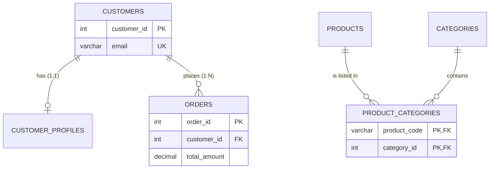

# Relational model

## Summary

The relational model, proposed by Edgar F. Codd in 1970, organizes data as *relations*: tables of rows (tuples) with named, typed columns (attributes). Rows are identified by keys, and relationships between tables are expressed by storing the key of one row in another (a foreign key), not by pointers. Because the data is just values in tables, any question can be answered by a declarative query that combines tables with joins, and the database, not the application, decides how to execute it. Almost every SQL database implements this model.

## Prerequisites

- [SQL versus NoSQL](../../foundations/sql-vs-nosql.md) for where the relational model sits among data models.

## Core concepts

### Why it exists

Before the relational model, hierarchical (IBM IMS) and network (CODASYL) databases linked records with physical pointers. A program had to navigate the pointers in the order the database designer chose, so a new question often meant new code and sometimes a reorganization of the stored data. Codd's idea was *data independence*: describe data only by its values, so that the physical storage can change without changing the programs, and any question that can be stated in terms of the data can be answered.

### Fundamental terms

| Term (SQL) | Formal term | Meaning |
| --- | --- | --- |
| Table | Relation | A set of rows that share the same columns. |
| Row (record) | Tuple | One fact, for example one customer. |
| Column (field) | Attribute | A named property with a data type (domain). |
| Primary key | Chosen candidate key | The column or columns that identify each row uniquely. |
| Foreign key | Referential constraint | Columns whose values must exist as a key in another (or the same) table. |
| Join | Join operator | Combines rows of two tables whose columns match a condition. |
| Index | (physical, not part of the model) | A separate data structure that finds rows by column values without reading the whole table. |
| View | Derived relation | A stored query that is used like a table. |

Two simplifications of SQL against the formal model matter in practice: an SQL table may contain duplicate rows (a relation is a set and cannot), and SQL has `NULL`, a marker for a missing value, which leads to three-valued logic (`TRUE`, `FALSE`, `UNKNOWN`).

### Keys

A *superkey* is any set of columns that uniquely identifies a row. A *candidate key* is a minimal superkey: no column can be removed without losing uniqueness. The *primary key* is the candidate key chosen as the main identifier; the others are *alternate keys* and are declared `UNIQUE`.

- A *natural key* is a candidate key that has a meaning outside the database: an ISBN, a product code, an email address.
- A *surrogate key* is an artificial identifier with no business meaning, usually a sequence number or a UUID.
- A *foreign key* is a column (or set of columns) that references a candidate key of another table and so expresses a relationship.

The three key kinds in table definitions:

```sql
-- Primary key (surrogate)
CREATE TABLE books (
  book_id int PRIMARY KEY,
  title   varchar(100),
  author  varchar(100)
);

-- Natural key used as the primary key
CREATE TABLE products (
  product_code varchar(20) PRIMARY KEY,
  product_name varchar(100),
  category     varchar(50),
  price        decimal(10, 2)
);

-- Foreign key
CREATE TABLE customers (
  customer_id int PRIMARY KEY,
  first_name  varchar(50),
  last_name   varchar(50),
  email       varchar(100)
);
CREATE TABLE orders (
  order_id     int PRIMARY KEY,
  customer_id  int,
  order_date   date,
  total_amount decimal(10, 2),
  FOREIGN KEY (customer_id) REFERENCES customers (customer_id)
);
```

Natural keys change more often than expected (people change email addresses, product codes are renumbered), and every foreign key that copies them must change too. For that reason most schemas use a surrogate primary key and declare the natural key as `UNIQUE`. The rules that keys enforce are described in [integrity constraints](integrity-constraints.md).

### Relationship types

Relationships are classified by *cardinality*, the number of rows on each side.

- **One-to-one.** A user has one user profile. Implemented by a foreign key that is also unique, usually by sharing the primary key.
- **One-to-many.** A customer places many orders, each order belongs to one customer. Implemented by a foreign key on the "many" side (`orders.customer_id`).
- **Many-to-many.** A product belongs to many categories and a category contains many products. The relational model cannot store a list in a column, so a *junction table* (also called an associative or link table) holds one row per pair.

The entity relationship diagram shows the three cardinalities with the tables of the worked example.



### Joins, indexes and views

- A *join* combines rows from two tables on a condition, usually equality of a foreign key and a primary key. The join types (inner, left, right, full, cross) and how they treat unmatched rows are in [SQL joins](../../query-languages/sql/sql-joins.md).
- An *index* is a separate structure (usually a B-tree) that maps column values to row locations. It speeds up reads by key or range and slows down writes, because every insert and update must also update the index. Indexing is part of [SQL tuning](../../query-processing-and-optimization/sql-tuning.md#index-optimization).
- A *view* is a named query. It hides joins, restricts the columns or rows a user can see, and gives a stable interface when the tables underneath change. A *materialized view* stores the result physically and must be refreshed (see [denormalization](denormalization.md#materialized-views)).

### Operations

SQL is the standard language for working with relational databases. Its four basic data operations are known as CRUD:

| Operation | SQL statement | Meaning |
| --- | --- | --- |
| Create | `INSERT` | Insert new records into tables. |
| Read | `SELECT` | Retrieve data from one or more tables based on criteria. |
| Update | `UPDATE` | Modify existing records. |
| Delete | `DELETE` | Remove records from tables. |

The full structure of the language is in the [SQL language overview](../../query-languages/sql/sql-language-overview.md).

*Analogy.* A relational database is a set of spreadsheets that refer to each other by ID numbers instead of by copying data. The order sheet does not repeat the customer's address; it stores the customer number, and you look the address up in the customer sheet when you need it. The analogy breaks in two places: a spreadsheet does not stop you from typing a customer number that does not exist (a foreign key does), and a spreadsheet has an order of rows, while a relation has none unless the query asks for `ORDER BY`.

### Original figure

The infographic below summarizes the same building blocks (CRUD, key types, relationship types, join types, table, rows, columns, primary key, foreign key, joins, index, views). Credit: ByteByteGo, "A Crash Course on Relational Database Design".


## Worked example

Tested on PostgreSQL 17.11. The schema has all three relationship types, a view and a junction table.

```sql
CREATE TABLE customers (
  customer_id int PRIMARY KEY,
  first_name  varchar(50),
  last_name   varchar(50),
  email       varchar(100) UNIQUE          -- natural key kept as alternate key
);
CREATE TABLE customer_profiles (             -- 1:1, shares the primary key
  customer_id int PRIMARY KEY REFERENCES customers (customer_id),
  bio         text
);
CREATE TABLE orders (                        -- 1:N, foreign key on the many side
  order_id     int PRIMARY KEY,
  customer_id  int NOT NULL REFERENCES customers (customer_id),
  order_date   date,
  total_amount decimal(10, 2)
);
CREATE TABLE products (product_code varchar(20) PRIMARY KEY, product_name varchar(100), price decimal(10, 2));
CREATE TABLE categories (category_id int PRIMARY KEY, name varchar(50) UNIQUE);
CREATE TABLE product_categories (            -- M:N junction table
  product_code varchar(20) REFERENCES products (product_code),
  category_id  int REFERENCES categories (category_id),
  PRIMARY KEY (product_code, category_id)
);

INSERT INTO customers VALUES (1, 'Ada', 'Lovelace', 'ada@example.com'), (2, 'Alan', 'Turing', 'alan@example.com');
INSERT INTO orders VALUES (100, 1, '2026-11-01', 59.90), (101, 1, '2026-11-03', 12.50), (102, 2, '2026-11-04', 99.00);
INSERT INTO products VALUES ('SKU-1', 'Keyboard', 49.90), ('SKU-2', 'Lamp', 25.00);
INSERT INTO categories VALUES (1, 'Office'), (2, 'Electronics');
INSERT INTO product_categories VALUES ('SKU-1', 1), ('SKU-1', 2), ('SKU-2', 1);

CREATE VIEW customer_order_totals AS
SELECT c.customer_id, c.first_name, count(o.order_id) AS orders, sum(o.total_amount) AS spent
FROM customers c LEFT JOIN orders o ON o.customer_id = c.customer_id
GROUP BY c.customer_id, c.first_name;

SELECT * FROM customer_order_totals ORDER BY customer_id;

SELECT p.product_name, string_agg(cat.name, ', ' ORDER BY cat.name) AS categories
FROM products p
JOIN product_categories pc ON pc.product_code = p.product_code
JOIN categories cat ON cat.category_id = pc.category_id
GROUP BY p.product_name ORDER BY p.product_name;

-- The 1:1 rule is enforced by the primary key of customer_profiles
INSERT INTO customer_profiles VALUES (1, 'First programmer'), (1, 'Duplicate');
```

Output:

```text
 customer_id | first_name | orders | spent
-------------+------------+--------+-------
           1 | Ada        |      2 | 72.40
           2 | Alan       |      1 | 99.00
(2 rows)

 product_name |     categories
--------------+---------------------
 Keyboard     | Electronics, Office
 Lamp         | Office
(2 rows)

ERROR:  duplicate key value violates unique constraint "customer_profiles_pkey"
DETAIL:  Key (customer_id)=(1) already exists.
```

## Trade offs and when to use it

- **Strengths.** Any question can be asked later without redesign; integrity is enforced centrally; a mature optimizer chooses execution plans; the SQL standard and decades of tooling exist.
- **Costs.** Reading an aggregate (an order with its lines, customer and products) needs joins; the schema must be migrated when the structure changes; scaling writes beyond one node needs [sharding](../../distributed-databases/sharding.md) or a distributed SQL engine.
- **Alternatives.** Document stores for aggregates read as a whole, graph databases for deep relationship traversal, wide-column stores for very high write rates (see the [NoSQL overview](../nosql/nosql-overview.md)).

## Common mistakes

- **Storing lists in a column** (`category_ids = '1,2,5'`). The database cannot index, join or enforce the references. Fix: a junction table.
- **Using a mutable natural key as the primary key.** Fix: surrogate primary key plus a `UNIQUE` natural key.
- **Relying on row order without `ORDER BY`.** A relation has no order; results may change with the plan. Fix: always specify `ORDER BY` when order matters.
- **Skipping foreign keys "for performance".** Orphaned rows appear and are expensive to clean later. Fix: keep them unless measurements show a real problem, and index the referencing columns.

## Practice

1. What is the difference between a superkey, a candidate key and a primary key?
2. How do you implement a many-to-many relationship, and what is the primary key of the junction table?
3. Why do most schemas prefer a surrogate primary key even when a natural key exists?
4. Name two ways in which SQL tables differ from relations in Codd's model.

Hints:

1. Superkey: unique; candidate key: minimal unique; primary key: the chosen candidate key.
2. A junction table with two foreign keys; its primary key is the pair of them.
3. Natural keys change and the change must cascade to every referencing row.
4. Duplicate rows are allowed and `NULL` introduces three-valued logic.

## Further reading

- E. F. Codd, "A Relational Model of Data for Large Shared Data Banks", *Communications of the ACM* 13(6), 1970. https://doi.org/10.1145/362384.362685 - The original paper; sections 1 and 2 explain data independence.
- Abraham Silberschatz, Henry F. Korth, S. Sudarshan, *Database System Concepts*, 7th edition, McGraw-Hill, 2019, chapter 2 "Introduction to the Relational Model". https://db-book.com/ - Standard textbook treatment of keys and schema diagrams.
- ByteByteGo, "A Crash Course on Relational Database Design" (infographic). https://bytebytego.com/ - Visual summary of keys, relationships and joins.
- PostgreSQL Global Development Group, "Constraints", PostgreSQL 17 documentation. https://www.postgresql.org/docs/17/ddl-constraints.html - Exact semantics of primary, unique and foreign keys.
