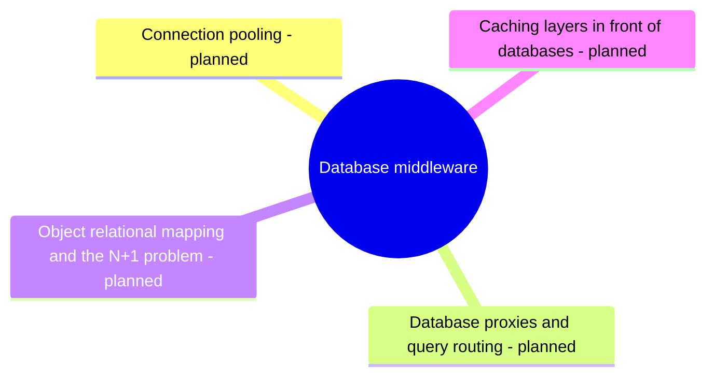

# Database middleware

Software between applications and databases: connection pooling, database proxies and object relational mapping.

This area corresponds to the ACM CCS 2012 concept *Middleware for databases*. See [GUIDELINE.md](../GUIDELINE.md#311-placement-of-a-note) for what belongs here.

## Map

The map shows the parts of this section: written notes and subsections, and planned topics, which end with the word planned.

## Status

No notes have been written in this section yet. The planned topics below define its scope.

TODO: write the first notes of this section.

## Planned topics

- Connection pooling
- Database proxies and query routing
- Object relational mapping and the N+1 problem
- Caching layers in front of databases
