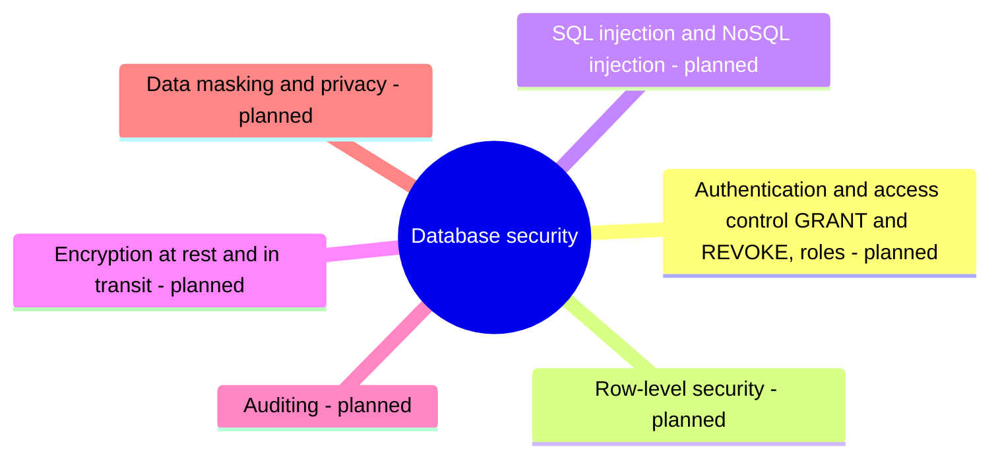

# Database security

Protecting databases and their data: access control, injection attacks, encryption and auditing.

This area corresponds to the ACM CCS 2012 concept *Security and privacy: database and storage security*. See [GUIDELINE.md](../GUIDELINE.md#311-placement-of-a-note) for what belongs here.

## Map

The map shows the parts of this section: written notes and subsections, and planned topics, which end with the word planned.

## Status

No notes have been written in this section yet. The planned topics below define its scope.

TODO: write the first notes of this section.

## Planned topics

- Authentication and access control (GRANT and REVOKE, roles)
- Row-level security
- SQL injection and NoSQL injection
- Encryption at rest and in transit
- Auditing
- Data masking and privacy
