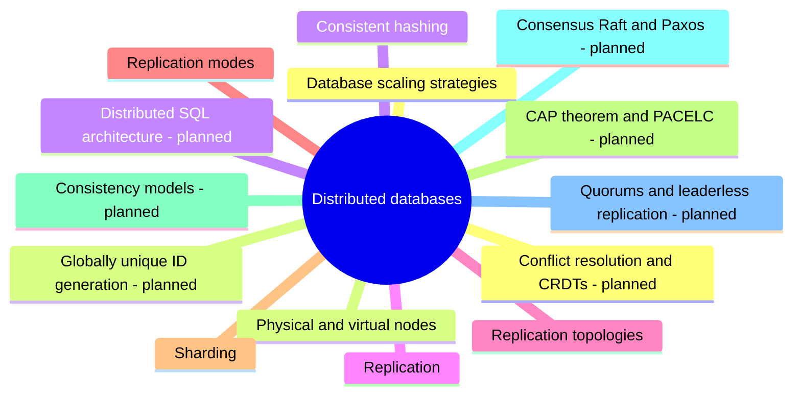

# Distributed databases

Databases that run on many machines: cluster layout, data partitioning with consistent hashing, replication, sharding and the strategies for scaling a database.

This area corresponds to the ACM CCS 2012 concept *DBMS engines: parallel and distributed DBMSs*. See [GUIDELINE.md](../GUIDELINE.md#311-placement-of-a-note) for what belongs here.

## Map

The map shows the parts of this section: written notes and subsections, and planned topics, which end with the word planned.

## Reading order

1. [Database scaling strategies](database-scaling-strategies.md): A database can be scaled with seven common strategies: indexing, materialized views, denormalization, vertical scaling, caching, replication and sharding.
2. [Physical and virtual nodes](physical-and-virtual-nodes.md): Distributed NoSQL stores run on a large number (hundreds or thousands) of cheap, commodity and individually unreliable machines connected through a network.
3. [Consistent hashing](consistent-hashing.md): Consistent hashing is a way to assign keys to the nodes of a cluster so that adding or removing a node moves only a small share of the keys.
4. [Replication](replication.md): Replication keeps copies of the same data on several database servers.
5. [Replication topologies](replication-topologies.md): A replication topology says which servers accept writes and how changes flow between them.
6. [Replication modes](replication-modes.md): The replication mode decides when a write counts as committed relative to its copies.
7. [Sharding](sharding.md): Sharding (horizontal partitioning across servers) splits one logical dataset into parts called shards and stores each shard on a different database server, so that each server manages only a subset of the data.

## Planned topics

- CAP theorem and PACELC
- Consistency models
- Consensus: Raft and Paxos
- Quorums and leaderless replication
- Conflict resolution and CRDTs
- Globally unique ID generation
- Distributed SQL architecture
