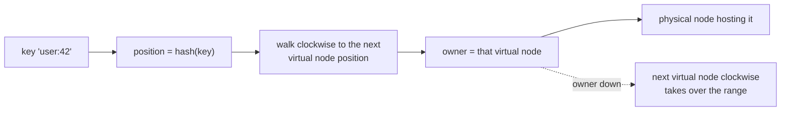
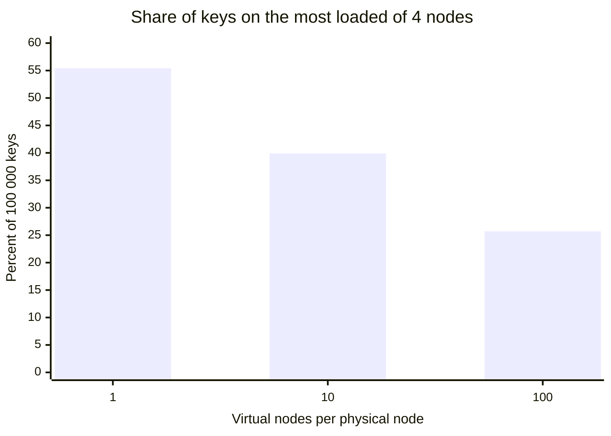
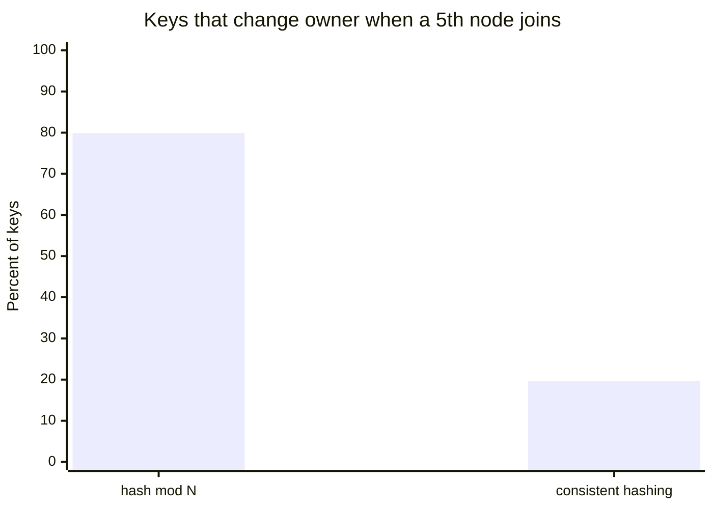

# Consistent hashing

## Summary

Consistent hashing is a way to assign keys to the nodes of a cluster so that adding or removing a node moves only a small share of the keys. Keys and nodes are both hashed onto the same circular key space (a ring), and each key belongs to the first node found walking clockwise from the key's position. When a node leaves, only its keys move to its clockwise neighbor; when a node joins, it takes keys only from one neighbor. With N nodes, about 1/N of the keys move, instead of almost all of them with the naive `hash(key) mod N`. Virtual nodes (many ring positions per physical node) even out the load. Dynamo, Cassandra, Riak and many caches use it.

## Prerequisites

- [Physical and virtual nodes](physical-and-virtual-nodes.md) for the cluster layout.
- Basic idea of a hash function: it maps any input to a number that looks uniformly random.

## Core concepts

### The problem with key mod N

The overall hash table is distributed across many virtual nodes (VNs), so the store needs a way to map each key to the VN that owns it. One way is:

```text
partition = hash(key) mod (total_VNs)
```

The disadvantage of this scheme appears when the number of VNs changes: the owner of almost every existing key changes, which requires redistributing nearly all data. Going from 4 to 5 nodes, a key keeps its owner only if `hash mod 4 = hash mod 5`, which is true for about one key in five; about 80 percent of keys move (the [worked example](#worked-example) measures 79.9 percent). Most large-scale stores therefore use *consistent hashing*, which minimizes the number of ownership changes.

### The ring

In the consistent hashing scheme (Karger et al., 1997), the key space is finite and lies on the circumference of a ring: positions from 0 to 2^m - 1, with the largest position followed by 0. Virtual node IDs are allocated from the same key space, by hashing the node's name. For any key, the owner is the first virtual node encountered when walking clockwise from the key's position.

If the owner node crashes, all the keys it owns are adopted by its clockwise neighbor. Key redistribution happens only between the crashed node and its neighbor; all other nodes keep the same set of keys.

The figure shows five virtual nodes A to E on a ring. Each node owns the key range between its counterclockwise neighbor and itself. When B crashes, the range B owned is adopted by C, which now owns both ranges.


The same ownership rule as a flowchart:



*Analogy.* Picture a round table with guests seated at fixed seats and plates of food placed around the edge. Each plate belongs to the next guest clockwise. When a guest leaves, only their plates pass to the next guest; nobody else's plates move. With key mod N, by contrast, the host renumbers everyone and redistributes every plate whenever a guest arrives. The analogy breaks on balance: real guests sit evenly spaced, while hashed node positions are random, which is why virtual nodes are needed.

### Virtual nodes and balance

With one position per physical node, random positions create very unequal arcs: one node may own half the ring. The fix is to give each physical node many positions (*virtual nodes*, also *vnodes* or *tokens*). More positions per node average out the arc lengths, and a more powerful machine can host more virtual nodes and so own a larger share. When a node fails, its many small ranges spread over many neighbors instead of overloading one.

The chart uses the numbers measured in the worked example: the share of keys on the most loaded of four nodes, as the number of virtual nodes per physical node grows (perfect balance is 25 percent).



Cassandra assigns each node a number of tokens (`num_tokens`, default 16 since Cassandra 4.0 with an allocation algorithm that balances them, 256 before). Checked against the Cassandra documentation, 2026-11.

### Replication on the ring

Consistent hashing also defines where replicas go: a key is stored on its owner and on the next N - 1 distinct physical nodes clockwise (the *preference list* in Dynamo). This is covered in [replication](replication.md#replication-on-a-hash-ring).

### Variants

- **Rendezvous hashing** (highest random weight): for each key, compute a score with every node and pick the highest. No ring, same minimal movement, O(N) per lookup.
- **Jump consistent hash** (Google, 2014): constant memory, very fast, but nodes can only be added or removed at the end of a numbered list.
- **Fixed partitions** (Riak, Couchbase vBuckets, Redis Cluster's 16 384 hash slots, Elasticsearch shards): the key space is cut into many fixed partitions up front, and whole partitions move between nodes. This is a ring with a fixed number of virtual nodes, assigned by a map rather than by hashing node names.

## Worked example

Tested with Python 3.10.12. The script places 100 000 keys on four nodes A to D, adds node E, and counts how many keys change owner with `mod N` and with a ring of 100 virtual nodes per physical node. It then shows how the number of virtual nodes affects balance.

```python
import bisect, hashlib

def h(s: str) -> int:
    # 64-bit position on the ring, from MD5 (any uniform hash works)
    return int.from_bytes(hashlib.md5(s.encode()).digest()[:8], "big")

class Ring:
    def __init__(self, nodes, vnodes=100):
        self.points = sorted((h(f"{n}#{i}"), n) for n in nodes for i in range(vnodes))
        self.keys = [p for p, _ in self.points]

    def owner(self, key: str) -> str:
        # first virtual node clockwise from the key, wrapping around
        i = bisect.bisect(self.keys, h(key)) % len(self.points)
        return self.points[i][1]

keys = [f"user:{i}" for i in range(100_000)]
nodes4, nodes5 = ["A", "B", "C", "D"], ["A", "B", "C", "D", "E"]

mod_moved = sum(h(k) % 4 != h(k) % 5 for k in keys)
r4, r5 = Ring(nodes4), Ring(nodes5)
ring_moved = sum(r4.owner(k) != r5.owner(k) for k in keys)
print(f"mod N, 4 -> 5 nodes:           {mod_moved / len(keys):.1%} of keys move")
print(f"consistent hashing, 4 -> 5:    {ring_moved / len(keys):.1%} of keys move")

for v in (1, 10, 100):
    r = Ring(nodes4, vnodes=v)
    counts = {n: 0 for n in nodes4}
    for k in keys:
        counts[r.owner(k)] += 1
    print(f"vnodes={v:>3}: keys per node {sorted(counts.values())}")
```

Output:

```text
mod N, 4 -> 5 nodes:           79.9% of keys move
consistent hashing, 4 -> 5:    19.6% of keys move
vnodes=  1: keys per node [1332, 3057, 40206, 55405]
vnodes= 10: keys per node [11983, 21795, 26279, 39943]
vnodes=100: keys per node [24281, 24845, 25154, 25720]
```

The ring moved 19.6 percent of the keys, close to the ideal 1/5 (the keys the new node E must own), while `mod N` moved 79.9 percent. With one position per node, one node held 55 percent of the keys and another 1.3 percent; with 100 virtual nodes, every node held between 24.3 and 25.7 percent.



## Trade offs and when to use it

- **Use** when nodes join and leave often (caches, Dynamo-style stores, peer-to-peer systems) and data movement is expensive.
- **Costs.** Range queries are impossible across a hashed key space (adjacent keys land on different nodes); balance needs virtual nodes or fixed partitions; the ring membership must be agreed on by all clients and nodes (gossip or a coordinator).
- **Alternatives.** Range partitioning when range scans matter (HBase, Bigtable, Spanner); a directory or fixed partition map when you want explicit control of placement (see [sharding](sharding.md)).

## Common mistakes

- **One position per node.** Load is very uneven. Fix: virtual nodes or fixed partitions.
- **Using `hashCode()` of a language runtime.** It may differ between processes or versions. Fix: a stable hash (MD5, Murmur3, xxHash).
- **Assuming consistent hashing balances hot keys.** It balances the number of keys, not the traffic per key. Fix: detect hot keys and replicate or split them.

## Practice

1. Why does `hash(key) mod N` move about 80 percent of keys when N grows from 4 to 5?
2. On a ring, which keys move when node B crashes, and to which node?
3. What two problems do virtual nodes solve?
4. Why is consistent hashing a poor fit for range queries?

Hints:

1. A key stays only if its hash gives the same remainder modulo 4 and modulo 5, which holds for about one key in five.
2. Only B's range, to its clockwise neighbor.
3. Uneven arc sizes (load balance) and the burden on a single neighbor when a node fails; they also let bigger machines own more.
4. Hashing scatters adjacent keys across the ring.

## Further reading

- David Karger et al., "Consistent Hashing and Random Trees", STOC 1997. https://doi.org/10.1145/258533.258660 - The original algorithm.
- Giuseppe DeCandia et al., "Dynamo: Amazon's Highly Available Key-value Store", SOSP 2007, section 4.2. https://www.allthingsdistributed.com/files/amazon-dynamo-sosp2007.pdf - Virtual nodes and preference lists in production.
- Ricky Ho, "NOSQL Patterns", 2009. https://horicky.blogspot.com/2009/11/nosql-patterns.html - The ring figures and the mod N argument.
- John Lamping, Eric Veach, "A Fast, Minimal Memory, Consistent Hash Algorithm", 2014. https://arxiv.org/abs/1406.2294 - Jump consistent hash.
