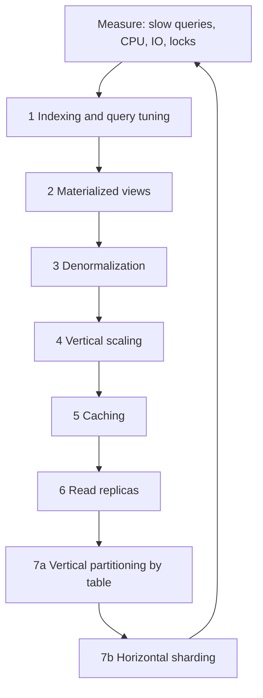

# Database scaling strategies

## Summary

A database can be scaled with seven common strategies: indexing, materialized views, denormalization, vertical scaling, caching, replication and sharding. The first three make each query cheaper, vertical scaling buys a bigger machine, caching and replication spread reads, and sharding is the only one of the seven that spreads writes. They are ordered roughly by cost and risk, and a sound approach applies the cheap ones first and moves down the list only when measurements show that the current step is exhausted. This note is a map: each strategy has its own home note with the details.

## Prerequisites

- [SQL versus NoSQL](../foundations/sql-vs-nosql.md#scaling) for why scaling differs between the families.

## Core concepts

### The seven strategies

| Strategy | What it does | Scales | Home note |
| --- | --- | --- | --- |
| Indexing | Check the query patterns of the application and create the right indexes. | Reads (and writes that search) | [SQL tuning](../query-processing-and-optimization/sql-tuning.md#index-optimization) |
| Materialized views | Precompute complex query results and store them for faster access. | Expensive reads | [Denormalization](../database-design-and-models/relational/denormalization.md#materialized-views) |
| Denormalization | Reduce complex joins to improve query performance. | Reads | [Denormalization](../database-design-and-models/relational/denormalization.md) |
| Vertical scaling | Make the database server bigger: more CPU, RAM or storage. | Everything, up to the largest machine | This note |
| Caching | Store frequently accessed data in a faster storage layer to reduce database load. | Reads | [Key-value stores](../database-design-and-models/nosql/key-value-stores.md#use-cases) |
| Replication | Create replicas of the primary database on other servers to scale reads. | Reads, availability | [Replication](replication.md) |
| Sharding | Split tables into smaller pieces and spread them across servers. | Writes, reads and storage | [Sharding](sharding.md) |

The flowchart shows the usual order of escalation. Each step is taken only when the previous ones no longer suffice.

Vertical partitioning (moving groups of tables to separate databases) is not in the original seven, but it is the usual step before sharding, as the [Figma case study](../case-studies/figma-database-scaling.md) shows.

*Analogy.* Scaling a database is like handling a growing queue at a shop. First, organize the shelves so that each customer is served faster (indexes, materialized views, denormalization). Then hire a faster cashier (vertical scaling). Then put the most popular items in a quick self-service rack by the door (caching) and open more checkouts for customers who only look and ask (replicas). Only when the stockroom itself is the bottleneck do you open a second shop and split the stock (sharding). The analogy breaks at the last step: customers of two shops do not need to see the same stock count at the same moment, while transactions across shards often do.

### Vertical scaling

*Vertical scaling* (scale up) means moving the database to a server with more CPU, RAM, faster storage or network. It needs no change in the application and keeps all the guarantees of a single node (joins, transactions, constraints). Its limits:

- **A ceiling.** The largest machine has a maximum (the largest instance types of cloud providers, or the IOPS limit of a storage volume, which Figma reached).
- **Cost curve.** Price grows faster than capacity near the top end.
- **Downtime.** Resizing usually needs a failover or restart.
- **No fault isolation.** One machine is still one failure domain.

### Caching

A cache keeps the results of frequent reads in a faster layer, usually an in-memory key-value store such as Redis or Memcached, so that the database serves only cache misses. The common pattern is *cache-aside*: the application reads the cache; on a miss it reads the database and writes the result into the cache with a TTL; on a write it updates the database and deletes the cache entry. Caching scales reads very cheaply but introduces staleness and invalidation problems, and a cold or failed cache sends the full load to the database at once (a *cache stampede*).

### Original figure

The cheatsheet below shows the seven strategies around a wheel. Credit: ByteByteGo, "Database Scaling Cheatsheet". (Its text for sharding reads "Load resources that the page will need before they are needed", which is a copy error in the original; the strategy is splitting tables into shards, as described above.)

## Worked example

An e-commerce database on one PostgreSQL server reaches 85 percent CPU at peak. The team applies the strategies in order and measures after each step.

| Step | Change | Effect |
| --- | --- | --- |
| 1 | `EXPLAIN ANALYZE` on the top 10 queries by total time; add two composite indexes | Peak CPU drops to 60 percent |
| 2 | Materialized view for the dashboard aggregates, refreshed every 5 minutes | Dashboard queries go from 4 s to 20 ms |
| 3 | Cache product pages in Redis for 60 seconds (cache-aside) | 70 percent of product reads never reach the database |
| 4 | Two read replicas for search and reporting | Primary handles only writes and read-your-writes reads |
| 5 | Write rate keeps growing; the `events` table is moved to its own database (vertical partitioning) | Primary write load halves |

Sharding was not needed yet. The numbers are an illustrative scenario, not measurements.

## Trade offs and when to use it

- Every step down the list adds a new failure mode: stale materialized views, cache invalidation, replication lag, cross-shard queries.
- Steps 1 to 3 change only the data model or queries; steps 4 to 7 change the infrastructure; step 7 changes the application.
- Managed services make vertical scaling and replicas cheap to try, which makes them attractive before any redesign.

## Common mistakes

- **Sharding first.** A team shards before adding a missing index. Fix: measure and follow the order.
- **Scaling reads when the problem is writes.** Replicas and caches do not help a write-bound primary. Fix: identify whether CPU and IO go to reads or writes (Figma found writes dominated).
- **Caching without an invalidation plan.** Fix: define TTLs and invalidation on write before adding a cache.

## Practice

1. Which of the seven strategies scales writes?
2. Why is vertical scaling usually tried before replication and sharding?
3. What new problem does each of caching, replication and sharding introduce?
4. Where does vertical partitioning fit in the order, and why?

Hints:

1. Sharding (vertical scaling raises the ceiling of one node but does not spread writes).
2. No application changes and all single-node guarantees are kept.
3. Staleness and invalidation; replication lag; cross-shard queries and rebalancing.
4. Before horizontal sharding: it removes load without splitting tables, but it is limited by the largest table.

## Further reading

- ByteByteGo, "Database Scaling Cheatsheet" (infographic). https://bytebytego.com/ - The seven strategies.
- Donne Martin, "The System Design Primer: Database" and "Cache" (GitHub). https://github.com/donnemartin/system-design-primer#database - Replication, federation, sharding, denormalization and caching patterns.
- Martin Kleppmann, *Designing Data-Intensive Applications*, chapter 1 "Scalability", O'Reilly, 2017. https://dataintensive.net/ - Describing load and the scale-up versus scale-out choice.
