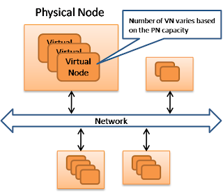
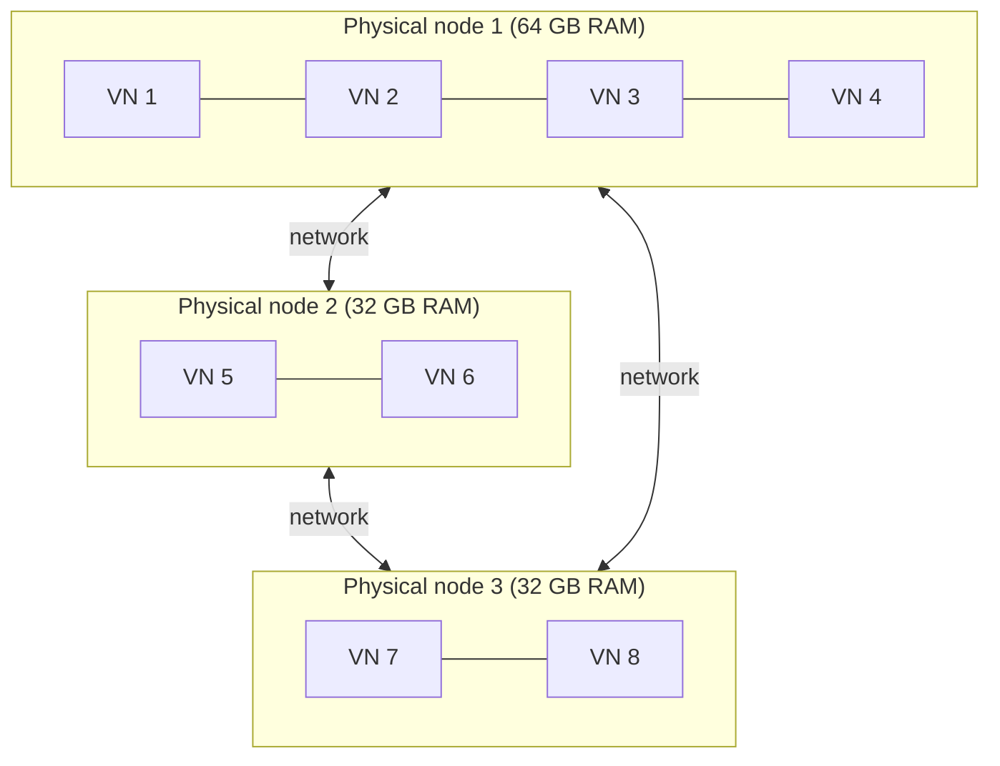

# Physical and virtual nodes

## Summary

Distributed NoSQL stores run on a large number (hundreds or thousands) of cheap, commodity and individually unreliable machines connected through a network. Each machine is a physical node (PN) with the same software configuration but possibly different CPU, memory and disk capacity. Inside each physical node runs a variable number of virtual nodes (VNs), and the virtual node, not the machine, is the unit that owns data and moves between machines. Sizing the number of virtual nodes by capacity balances load across unequal hardware, and moving virtual nodes is how the cluster rebalances when machines join, leave or fail.

## Prerequisites

- [NoSQL overview](../database-design-and-models/nosql/nosql-overview.md) for why these systems are distributed.

## Core concepts

### Definition

A *physical node* (PN) is one machine in the cluster. A *virtual node* (VN) is a logical unit of data ownership: a slice of the key space with its own data files, hosted by one physical node at a time. The cluster's key space is divided among virtual nodes, and virtual nodes are assigned to physical nodes.

The figure shows physical nodes connected by a network, each containing a stack of virtual nodes; the number of VNs varies with the capacity of the PN.

The same layout as a diagram, with a large machine hosting more virtual nodes than two smaller ones:

### Why two levels

- **Heterogeneous hardware.** A machine with twice the capacity hosts twice as many virtual nodes and therefore owns about twice the data and traffic.
- **Fine-grained rebalancing.** Moving a few small virtual nodes from a busy machine to a new one is cheaper and more even than splitting one large range.
- **Faster recovery.** When a machine fails, its virtual nodes are spread over many survivors, so the extra load and the re-replication traffic are shared instead of hitting one neighbor.
- **Failure assumptions.** Commodity machines fail regularly. The design assumes failure as normal and relies on [replication](replication.md) of each virtual node's data to other physical nodes.

How a key finds its virtual node is described in [consistent hashing](consistent-hashing.md).

*Analogy.* Physical nodes are warehouses, virtual nodes are shipping containers. Goods are assigned to containers, and containers are placed in warehouses. A large warehouse holds more containers. When a warehouse closes, its containers are trucked to several other warehouses; nobody repacks individual goods. The analogy breaks in one place: in a database a copy of each container already sits in other warehouses (replicas), so a closed warehouse usually loses nothing, and moving containers is about restoring the number of copies.

### In current engines

| Engine | Unit of ownership | How it maps to machines |
| --- | --- | --- |
| Apache Cassandra | Tokens (vnodes) on a hash ring | `num_tokens` per node |
| Riak KV | Fixed number of ring partitions (vnodes) | Claimed by nodes, moved on join or leave |
| Couchbase | 1 024 vBuckets | A cluster map assigns vBuckets to nodes |
| Redis Cluster | 16 384 hash slots | Slots assigned to primaries, moved with `CLUSTER SETSLOT` and `MIGRATE` |
| Elasticsearch | Shards of an index | The master allocates shards to data nodes |

Checked against the engine documentation, 2026-11.

## Worked example

A cluster has three machines: P1 with 64 GB of RAM, P2 and P3 with 32 GB each, and 256 virtual nodes in total. Assign virtual nodes in proportion to memory:

- P1: 256 x 64 / 128 = 128 virtual nodes,
- P2 and P3: 64 virtual nodes each.

A fourth 32 GB machine P4 joins. The new total capacity is 160 GB, so the targets become P1 102, P2 51, P3 51, P4 51 (rounded). P4 receives 26 virtual nodes from P1 and 13 each from P2 and P3. Only those 52 virtual nodes (about 20 percent of the data) are copied; the other 204 stay where they are.

## Trade offs and when to use it

- **Benefits.** Even load on uneven hardware, small units of movement, parallel recovery.
- **Costs.** More units to track in metadata; each virtual node has fixed overhead (files, memory structures, repair sessions); too many virtual nodes per machine slows operations such as repair in Cassandra, which is why Cassandra lowered its default from 256 to 16 tokens.
- **Alternative.** One range per machine with dynamic splitting (HBase regions, Bigtable tablets): ranges split when they grow and a master reassigns them.

## Common mistakes

- **Equal virtual node counts on unequal machines.** The smallest machine becomes the bottleneck. Fix: weight by capacity.
- **Placing replicas on virtual nodes of the same physical node or rack.** One failure loses all copies. Fix: replica placement must skip virtual nodes on the same machine and should be rack and zone aware.
- **Too many virtual nodes.** Fix: follow the engine's current recommended default.

## Practice

1. What is the difference between a physical node and a virtual node?
2. Why does a cluster with virtual nodes recover from a machine failure faster?
3. In the worked example, how many virtual nodes move when P4 joins, and why not more?

Hints:

1. A machine versus a logical slice of the key space that a machine hosts.
2. The failed machine's many small ranges are taken over and re-replicated by many machines in parallel.
3. About 52; only enough to bring each machine to its new target.

## Further reading

- Ricky Ho, "NOSQL Patterns", 2009. https://horicky.blogspot.com/2009/11/nosql-patterns.html - The physical and virtual node layout.
- Giuseppe DeCandia et al., "Dynamo: Amazon's Highly Available Key-value Store", SOSP 2007, section 4.2. https://www.allthingsdistributed.com/files/amazon-dynamo-sosp2007.pdf - Virtual nodes and heterogeneity.
- Apache Software Foundation, "Dynamo", Apache Cassandra documentation (architecture). https://cassandra.apache.org/doc/latest/cassandra/architecture/dynamo.html - Tokens and vnodes in Cassandra.
