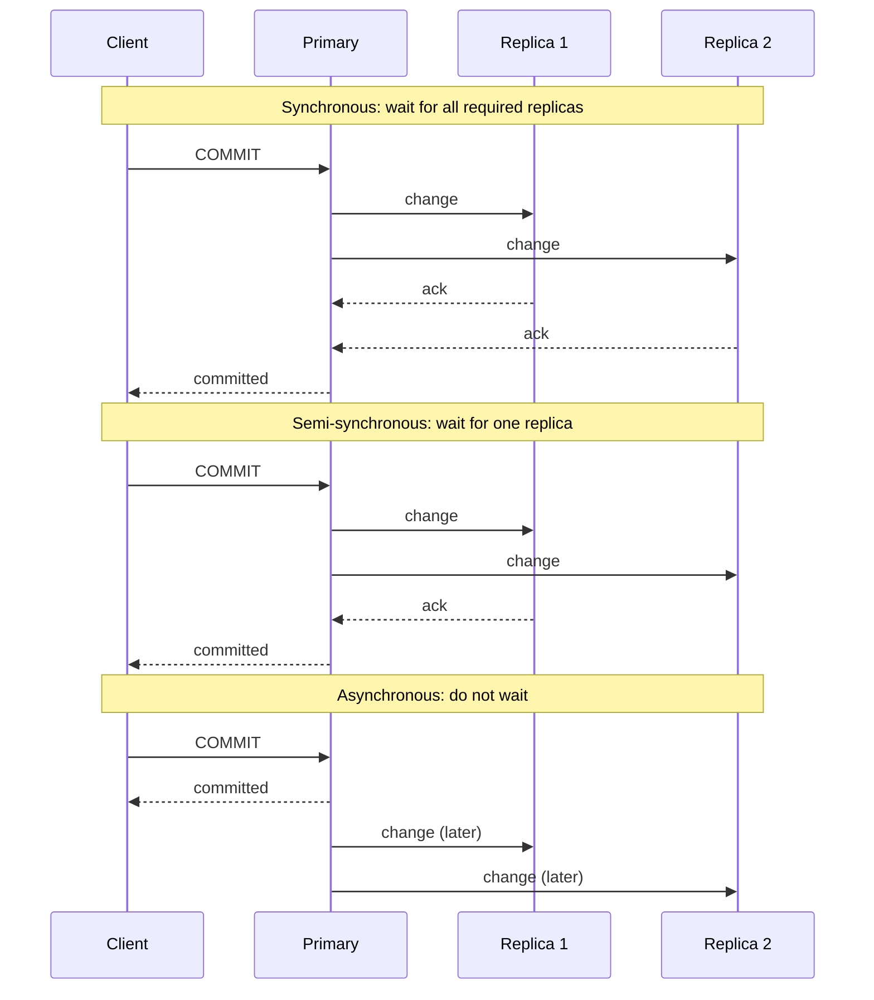
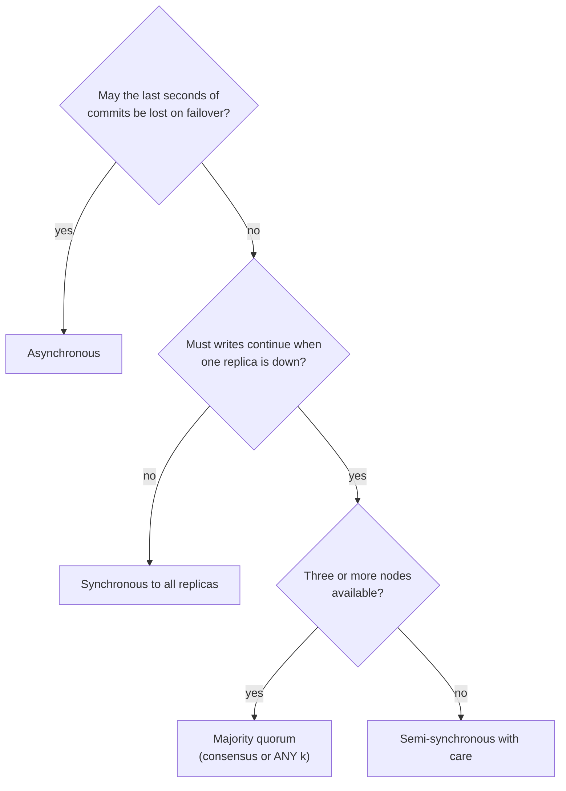
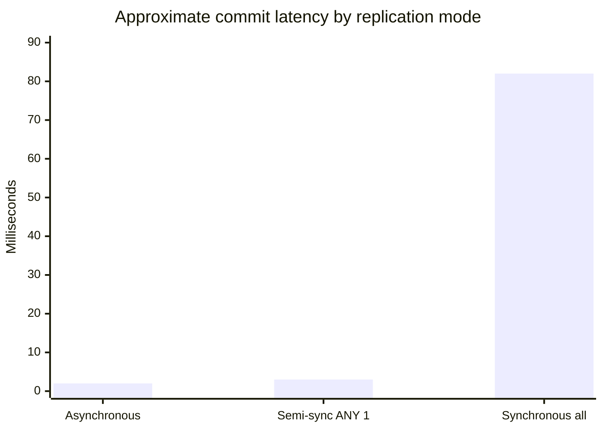

# Replication modes

## Summary

The replication mode decides when a write counts as committed relative to its copies. In synchronous replication, the primary waits until replicas confirm the change, so no committed data is lost on failover, at the cost of write latency and of availability when a replica is slow. In asynchronous replication, the primary commits immediately and ships changes afterward: fast, but the latest commits can be lost if the primary dies. Semi-synchronous replication waits for at least one replica, which bounds loss at a moderate latency cost. Multi-master and cluster replication combine these modes with several writers or a group of nodes acting as one system. The choice is a trade between write latency, durability on failover and write availability.

## Prerequisites

- [Replication](replication.md) and [replication topologies](replication-topologies.md).
- [Transactions and ACID](../transactions-and-concurrency/transactions-and-acid.md) for commit and durability.

## Core concepts

### The decision: when is a write done

The sequence diagram shows the acknowledgment path of the three basic modes for one commit.

*Analogy.* Sending a contract by mail: asynchronous is dropping it in the mailbox and leaving; you are fast, but if the letter is lost you will not know. Synchronous is waiting at the counter until the recipient signs for it; nothing is lost, but you wait as long as the slowest recipient. Semi-synchronous is waiting until at least one of several recipients has signed. The analogy breaks because a database replica's "signature" may mean different things: received, written to disk, or already applied and visible, and each costs more time.

### Synchronous replication

- **Definition.** Data is copied to the replica or replicas at the same time it is written to the primary; the transaction is complete only when the replicas confirm.
- **Advantages.** Consistency and reliability: the confirmed replicas are always up to date, and failover loses no committed transaction (recovery point objective of zero).
- **Disadvantages.** Latency: every commit waits for at least one network round trip plus the replica's disk flush. If a required replica is slow or unreachable, commits stall, so synchronous replication trades availability for durability.
- **Use cases.** Financial transactions and other systems that require strong consistency and no data loss.

### Asynchronous replication

- **Definition.** Data is copied to the replicas after the transaction has completed on the primary.
- **Advantages.** Lowest write latency, since the primary does not wait for replicas; replicas can be far away.
- **Disadvantages.** Risk of data loss if the primary fails before replication completes; replicas serve stale data while they lag.
- **Use cases.** Web applications, content distribution, read replicas, cross-region disaster recovery where some loss is acceptable.

### Semi-synchronous replication

- **Definition.** A compromise between synchronous and asynchronous replication: the primary waits for acknowledgment from at least one replica before considering a transaction complete.
- **Advantages.** Balances latency and safety: better performance than fully synchronous replication while reducing the risk of data loss.
- **Disadvantages.** Slightly higher latency than asynchronous replication; MySQL's implementation falls back to asynchronous after a timeout (`rpl_semi_sync_source_timeout`, 10 seconds by default), during which the guarantee is gone.
- **Use cases.** Systems that need a balance between performance and data safety.

PostgreSQL implements the same idea as *quorum commit*: `synchronous_standby_names = 'ANY 1 (r1, r2)'` waits for any one of two standbys. Its `synchronous_commit` setting decides what the replica must confirm: `remote_write` (received by the replica's operating system), `on` (flushed to the replica's disk) or `remote_apply` (applied and visible to queries on the replica). Checked against PostgreSQL 17 and MySQL 8.4 documentation, 2026-11.

### Multi-master replication

- **Definition.** Several databases act as primaries, and each accepts write operations (see [replication topologies](replication-topologies.md#multi-leader-replication-master-master)).
- **Advantages.** Better write availability and load distribution.
- **Disadvantages.** Conflict resolution when the same data is modified on different primaries.
- **Use cases.** Distributed applications, collaborative platforms.

Multi-master is a topology rather than a timing mode; it is usually combined with asynchronous propagation between leaders, because synchronous propagation would make every write wait for every region.

### Cluster replication

- **Definition.** A group of databases works together as a single system, often combining synchronous replication inside the group (or a consensus protocol) with asynchronous replication to other sites.
- **Advantages.** High availability, load balancing and fault tolerance.
- **Disadvantages.** Complex setup and maintenance; more latency because of coordination.
- **Use cases.** High-traffic websites and large enterprise applications.

Modern clusters reach agreement with a consensus protocol (Raft or Paxos): a write is committed when a majority of nodes has it. Examples: MongoDB replica sets with `writeConcern: "majority"`, MySQL InnoDB Cluster (Group Replication), Galera Cluster, CockroachDB and etcd (Raft), Google Spanner (Paxos). A majority quorum is synchronous replication that tolerates a minority of slow or failed nodes without stalling.

### Comparison

| Mode | Write latency | Loss on primary failure | Write availability when replicas fail | Typical setting |
| --- | --- | --- | --- | --- |
| Asynchronous | Lowest | Last commits not yet shipped | Unaffected | Read replicas, cross-region DR |
| Semi-synchronous | One round trip to the nearest replica | None, while not degraded | Degrades to async after timeout | MySQL HA in one region |
| Synchronous (all) | Round trip to the slowest replica | None | Stalls if any required replica fails | Rare; small, local clusters |
| Majority quorum | Round trip to the median replica | None | Survives a minority failing | Consensus clusters |

The flowchart condenses the choice.

## Worked example

A primary in zone A, replica R1 in zone B (round trip 1 ms), replica R2 in another region (round trip 80 ms). A commit's local work takes 2 ms. Approximate commit latency per mode, ignoring disk flush on the replicas:

| Mode | Waits for | Commit latency |
| --- | --- | --- |
| Asynchronous | nobody | about 2 ms |
| Semi-synchronous, ANY 1 | R1 (fastest) | about 3 ms |
| Synchronous to all | R2 (slowest) | about 82 ms |

The commit latency of each mode, from the table:

These are illustrative numbers derived from the stated round trip times, not measurements. They show why the usual production setup is a synchronous or quorum replica in the same region (no loss for a zone failure, low cost) plus an asynchronous replica in another region (bounded loss for a region failure, no latency cost).

## Trade offs and when to use it

- Durability on failover and write latency trade directly against each other; geography sets the price.
- Synchronous replication to a single replica makes that replica a dependency of every write; use a quorum of two or more candidates.
- What "acknowledged" means (received, flushed, applied) decides both latency and whether replicas can serve read-your-writes.

## Common mistakes

- **Synchronous replication to one replica without fallback planning.** When it fails, the primary stops committing. Fix: quorum commit over several replicas.
- **Believing semi-synchronous means no loss.** After the timeout it silently runs asynchronously. Fix: alert when it degrades.
- **Reading from a "synchronous" replica and expecting fresh data.** `on` means flushed, not applied. Fix: `remote_apply` if replica reads must see the commit.

## Practice

1. Define synchronous, asynchronous and semi-synchronous replication in one sentence each.
2. Why can synchronous replication reduce availability?
3. What is the recovery point objective of asynchronous replication, and how do you estimate it?
4. Why is a majority quorum a better form of synchronous replication for three nodes?

Hints:

1. Wait for all required replicas; do not wait; wait for at least one.
2. If a required replica is unreachable, commits stall.
3. Not zero: roughly the replication lag at the moment of failure.
4. It waits only for the fastest majority and tolerates one failed node.

## Further reading

- PostgreSQL Global Development Group, "Synchronous Replication", PostgreSQL 17 documentation, section 26.2.8. https://www.postgresql.org/docs/17/warm-standby.html#SYNCHRONOUS-REPLICATION - Quorum commit and `synchronous_commit` levels.
- Oracle, "Semisynchronous Replication", MySQL 8.4 Reference Manual. https://dev.mysql.com/doc/refman/8.4/en/replication-semisync.html - Behavior and timeout fallback.
- Diego Ongaro, John Ousterhout, "In Search of an Understandable Consensus Algorithm (Raft)", USENIX ATC 2014. https://raft.github.io/raft.pdf - Majority-based replication.
- Martin Kleppmann, *Designing Data-Intensive Applications*, chapter 5 "Synchronous Versus Asynchronous Replication", O'Reilly, 2017. https://dataintensive.net/
