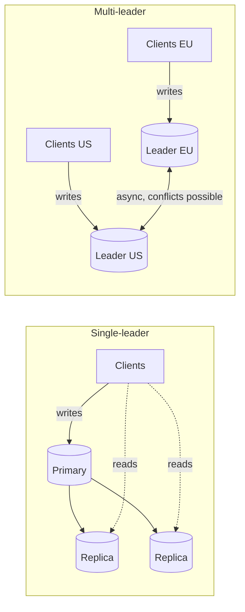

# Replication topologies

## Summary

A replication topology says which servers accept writes and how changes flow between them. In single-leader replication (historically "master-slave"), one primary accepts all writes and replicas copy from it and serve reads: simple and free of write conflicts, but writes are limited to one server and the primary is a failure point until a replica is promoted. In multi-leader replication ("master-master"), several servers accept writes and exchange changes: writes can happen locally in several regions and survive the loss of one leader, but concurrent writes to the same data conflict and must be resolved. A third family, leaderless replication, lets clients write to several replicas directly with quorums. The arrangement of the copies (star, chain, ring) is a second layer of the topology.

## Prerequisites

- [Replication](replication.md) for definitions, lag and failover.

## Core concepts

### Single-leader replication (master-slave)

One database server, the *primary* (master, leader), is the source of truth. All write operations are performed on the primary, and the data is replicated to one or more secondary servers, the *replicas* (slaves, followers), which are read-only.

How it works:

- **Writes.** All data modifications (inserts, updates, deletes) are done on the primary.
- **Reads.** Read operations can be distributed across the replicas to balance load and improve performance.
- **Replication.** Changes on the primary are copied to the replicas, asynchronously or synchronously.

Advantages:

- **Simplicity.** Easy to set up and maintain; there is one order of writes, so no write conflicts.
- **Read scalability.** Reads can be distributed among many replicas.
- **Data protection.** Replicas provide redundancy and help disaster recovery.

Disadvantages:

- **Write bottleneck.** All writes are centralized on the primary, which can become a performance bottleneck.
- **Data lag.** With asynchronous replication there is a delay before changes reach replicas, so replicas are temporarily inconsistent.
- **Single point of failure.** If the primary goes down, no writes can be performed until a failover mechanism promotes a replica.

Use cases:

- **Read-heavy applications** with many reads and fewer writes.
- **Backup and redundancy:** systems that need redundant copies and easy failover.

### Multi-leader replication (master-master)

In multi-leader replication, several database servers act as primaries. Each accepts reads and writes, and changes are synchronized across all of them.

How it works:

- **Writes.** Write operations can be performed on any primary.
- **Reads.** Reads can be distributed across any of the primaries.
- **Replication.** Changes made on one primary are propagated to the others, usually asynchronously to keep write latency low.

Advantages:

- **Write scalability.** Writes can be distributed among several primaries, avoiding a single bottleneck. This holds only if the same rows are not written everywhere, because every primary must still apply every write.
- **High availability.** If one primary fails, the others continue to handle reads and writes.
- **Load balancing.** Both read and write load can be balanced across servers.

Disadvantages:

- **Conflict resolution.** Concurrent writes on different primaries lead to conflicts that must be resolved, which adds complexity.
- **Data consistency.** Keeping all primaries consistent is hard, especially with asynchronous replication.
- **Complexity.** More complex to set up and manage than single-leader replication; auto-increment keys, unique constraints and triggers all need special care.

Use cases:

- **Highly available systems** that cannot afford write downtime.
- **Distributed applications** across several regions where local writes are required.
- **Collaborative environments** where many users update data at the same time, such as collaborative editors and offline-capable apps (each device is effectively a leader).

### Comparing the two

The diagram contrasts the write paths.

| Aspect | Single-leader | Multi-leader |
| --- | --- | --- |
| Write conflicts | None (one order of writes) | Possible, must be resolved |
| Write availability on leader failure | Lost until failover | Kept on other leaders |
| Write scaling | No | Limited (each leader applies all writes) |
| Consistency | Replicas lag but converge to one history | Leaders may diverge until conflicts are resolved |
| Typical products | PostgreSQL, MySQL, MongoDB replica sets, Redis | MySQL Group Replication (multi-primary mode), BDR or pgEdge for PostgreSQL, CouchDB, Cosmos DB multi-region writes |

*Analogy.* Single-leader replication is a meeting with one minute-taker: everyone else gets a copy of the minutes later, and the minutes never contradict themselves. Multi-leader replication is two minute-takers in two rooms of a split meeting: both can record decisions immediately, but when the rooms decide different things about the same topic, someone must reconcile the minutes afterward. The analogy breaks in timing: databases reconcile in milliseconds and automatically, often with a rule as blunt as "the later timestamp wins".

### Conflict resolution

| Strategy | How it works | Risk |
| --- | --- | --- |
| Last write wins (LWW) | Keep the write with the latest timestamp. | Silently drops the other write; depends on clock accuracy. |
| Conflict avoidance | Route all writes for a given record to the same leader (by user's home region). | Breaks when the home leader fails. |
| Merge by data type | CRDTs (counters, sets, maps that merge deterministically). | Only for data that fits a CRDT. |
| Application callback | Store both versions (siblings) and let code or the user resolve. | Complexity in the application. |

### Leaderless replication

Dynamo-style systems (Cassandra, Riak, ScyllaDB, DynamoDB internally) have no leader at all. The client, or a coordinator node acting for it, writes to all N replicas and waits for W acknowledgments; reads ask R replicas. Stale replicas are repaired by read repair and anti-entropy processes. See [replication on a hash ring](replication.md#replication-on-a-hash-ring).

### Arrangement: star, chain and ring

| Arrangement | Shape | Use |
| --- | --- | --- |
| Star | All replicas copy directly from the primary. | Default; simplest; primary sends N streams. |
| Chain (cascading) | Replica A copies from the primary, replica B from A. | Offloads the primary; lag adds up along the chain. |
| Ring | Each multi-leader node forwards to the next. | Old MySQL circular replication; one broken link stops propagation. |
| All-to-all | Every leader sends to every other leader. | Multi-leader default today; messages can arrive out of order. |

### Key considerations

- **Latency and consistency.** Single-leader setups can suffer from replication lag, while multi-leader configurations need careful conflict resolution to keep data consistent.
- **Failover and recovery.** Single-leader replication needs a failover mechanism that promotes a replica when the primary fails. Multi-leader replication tolerates the loss of a leader for writes, but needs careful conflict management afterward.
- **Application requirements.** The choice depends on the application: read versus write intensity, tolerance for latency and stale data, and the required availability.

## Worked example

A note-taking app has users in Europe and the United States and must keep accepting edits if one region is offline.

1. **Single-leader in Europe.** US users write across the Atlantic (about 90 ms per round trip); a European outage stops all writes until a US replica is promoted. Simple and conflict free.
2. **Multi-leader with conflict avoidance.** Each user's notes have a home region; writes go to that region's leader, and the other region holds a replica. Conflicts happen only during a failover, when a user is temporarily served by the other region.
3. **Multi-leader with merge.** Notes are stored as CRDT documents, so concurrent edits from both regions (or from offline devices) merge automatically.

For most apps option 2 gives the best balance: local writes for almost all users, and conflict handling only in the rare failover window.

## Trade offs and when to use it

- Default to single-leader. Choose multi-leader only for multi-region write availability or offline clients, and only with a clear conflict strategy.
- Leaderless replication fits high write availability with tunable consistency, at the cost of quorum reads and repair processes.

## Common mistakes

- **Multi-leader for write scaling.** Every leader still applies every write. Fix: shard for write scaling.
- **Auto-increment primary keys in multi-leader setups.** Leaders generate the same IDs. Fix: UUIDs, or offset sequences per leader.
- **Last write wins without understanding it.** Edits are lost silently. Fix: choose resolution per data type.
- **Long replication chains.** Lag accumulates. Fix: keep cascades shallow.

## Practice

1. List the advantages and disadvantages of single-leader replication.
2. Why does multi-leader replication not increase total write throughput for the same rows?
3. Name three conflict resolution strategies and the risk of each.
4. What is the difference between multi-leader and leaderless replication?

Hints:

1. Simplicity, read scaling, protection; write bottleneck, lag, single point of failure.
2. Every write must be applied on every leader.
3. Last write wins (lost writes), conflict avoidance (failover gaps), application callbacks (complexity).
4. Multi-leader: several nodes each accept writes and forward them. Leaderless: clients write to several replicas directly with quorums.

## Further reading

- Donne Martin, "The System Design Primer: Master-slave and master-master replication" (GitHub). https://github.com/donnemartin/system-design-primer#master-slave-replication - Short comparison.
- Martin Kleppmann, *Designing Data-Intensive Applications*, chapter 5, sections "Leaders and Followers", "Multi-Leader Replication" and "Leaderless Replication", O'Reilly, 2017. https://dataintensive.net/ - Topologies and conflict handling in depth.
- Oracle, "Group Replication", MySQL 8.4 Reference Manual. https://dev.mysql.com/doc/refman/8.4/en/group-replication.html - Single-primary and multi-primary modes.
- Marc Shapiro et al., "Conflict-free Replicated Data Types", SSS 2011. https://doi.org/10.1007/978-3-642-24550-3_29 - CRDTs.
