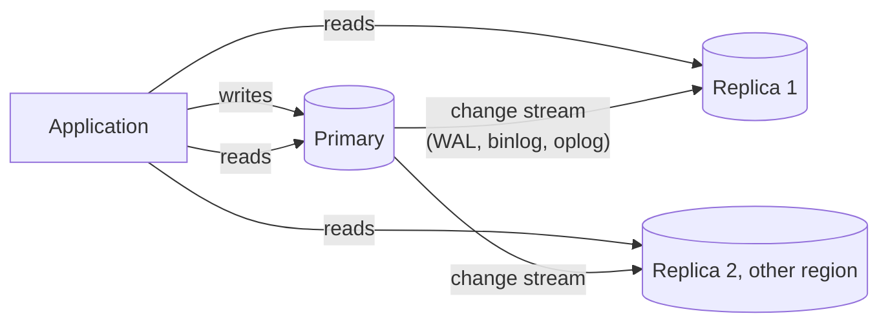
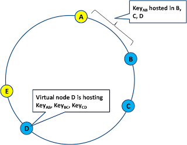

# Replication

## Summary

Replication keeps copies of the same data on several database servers. Changes made on one server are copied to the others, so that the data stays available when a server fails, reads can be spread over several copies, and copies can sit close to users or in another region for disaster recovery. The price is complexity and a consistency problem: copies that are updated asynchronously lag behind, and copies that all accept writes can conflict. Replication is described along two axes: the topology (who accepts writes: one primary or several, see [replication topologies](replication-topologies.md)) and the mode (when a write counts as done: synchronous, asynchronous or in between, see [replication modes](replication-modes.md)).

## Prerequisites

- [Transactions and ACID](../transactions-and-concurrency/transactions-and-acid.md), in particular durability.
- For NoSQL clusters, [consistent hashing](consistent-hashing.md).

## Core concepts

### Definition

*Replication* is the process of copying data from one database to another. Database replication duplicates data from a primary database to secondary databases, so that data is synchronized across several locations, which supports consistency and availability. It is used to increase the availability and scalability of databases. The two classic configurations are master-slave and master-master; this repository uses the current terms *primary* and *replica* (or *leader* and *follower*), and *single-leader* and *multi-leader*.

The diagram shows the basic flow: writes go to the primary, which ships a stream of changes to replicas; reads may go to any copy.



### What is replicated

| Method | What is shipped | Examples | Notes |
| --- | --- | --- | --- |
| Statement-based | The SQL statements | Early MySQL | Non-deterministic functions (`now()`, `rand()`) diverge. |
| Physical (log shipping) | Byte-level changes of the write-ahead log | PostgreSQL streaming replication | Exact copy of the whole instance; same major version required. |
| Logical (row-based) | Row changes per table | PostgreSQL logical replication, MySQL row-based binlog, MongoDB oplog | Subsets of tables, across versions, into other systems. |
| Trigger-based | Changes captured by triggers into a queue | Older tools (Slony, Bucardo) | Flexible but slow. |

The PostgreSQL choice between physical and logical replication is described in [PostgreSQL streaming and logical replication](../engines/postgresql/streaming-and-logical-replication.md).

*Analogy.* Replication is a newspaper with several printing plants. The editorial office (primary) writes the edition and sends the pages to the plants (replicas), which print local copies so that readers everywhere get the paper quickly and one burning plant does not stop the news. If pages are sent by truck (asynchronous), a distant plant prints yesterday's news for a while. The analogy breaks for multi-leader setups, where several editorial offices could edit the same article at once, which no newspaper allows without an editor deciding.

### Advantages

- **High availability.** Data stays available if one of the databases fails; a replica can be promoted.
- **Load balancing.** Read operations are distributed across several replicas, which improves performance.
- **Disaster recovery.** Copies in other locations provide redundancy to recover from failures.
- **Geographic distribution.** Data closer to users reduces latency and improves access speed.

### Disadvantages

- **Complexity.** Setting up and maintaining replication can be complex and requires careful planning.
- **Data consistency.** Keeping replicas consistent, especially with asynchronous replication, is hard.
- **Latency.** Synchronous replication adds latency to writes.
- **Conflict resolution.** In multi-leader replication, resolving conflicts when the same data is modified in different locations is difficult.

### Use cases

- **Disaster recovery and backup.** Data is replicated to remote locations for backup and recovery. A replica is not a backup on its own: a `DROP TABLE` replicates too, so point-in-time backups are still needed.
- **Scalability.** The load of read-heavy applications is spread by sending read queries to replicas.
- **High availability systems.** Critical applications that require continuous uptime, such as financial systems or online transaction processing (OLTP).
- **Geographically distributed applications.** Applications serving users in several regions reduce latency with local replicas.

### Common problems

1. **Network latency.** Affects the speed and reliability of replication, especially across regions.
2. **Data inconsistency.** Replicas can differ from the primary, particularly with asynchronous replication.
3. **Conflict resolution.** In multi-leader replication, the same data can be modified in different locations.
4. **Hardware failures.** If the primary fails before changes are replicated, those changes are lost.
5. **Replication lag.** The delay between the primary and its replicas affects how fresh the data on replicas is.
6. **Configuration and maintenance.** Replication needs careful configuration and ongoing maintenance (monitoring lag, replication slots, failover testing).

### Relevant concepts

- **Replication lag.** The delay between a change on the primary and its appearance on a replica. Measured in time or in bytes of log not yet applied.
- **Eventual consistency.** The principle that, in distributed systems, replicas become consistent over time, even if they are not synchronized immediately.
- **Failover.** Switching to a replica when the primary fails: detect the failure, choose the most up-to-date replica, promote it, redirect clients, and fence the old primary so that it cannot accept writes again (avoiding *split brain*).
- **Replication topologies.** The arrangement of databases in replication, such as star, chain (cascading) and ring topologies; see [replication topologies](replication-topologies.md).
- **Read-your-writes consistency.** A user who just wrote must see the write on the next read, even if that read goes to a lagging replica. Typical fixes: read your own recent data from the primary, or wait until the replica has replayed up to the write's log position.

### Replication on a hash ring

In Dynamo-style NoSQL stores there is no single primary. To provide high reliability from individually unreliable machines, each data partition is replicated: a key is stored on its owner on the [consistent hashing](consistent-hashing.md) ring and on the next distinct nodes clockwise. Replication not only improves reliability, it also helps performance by spreading the workload over several replicas.

The figure shows a ring where the key range between A and B is hosted on B, C and D (three replicas), so virtual node D hosts the ranges AB, BC and CD.



Reads and writes then use *quorums*: with N replicas, a write waits for W acknowledgments and a read asks R replicas. If R + W > N, every read overlaps with the latest successful write on at least one replica. Cassandra exposes this per request as consistency levels (`ONE`, `QUORUM`, `ALL`, `LOCAL_QUORUM`).

## Worked example

A PostgreSQL primary in Frankfurt has two asynchronous replicas: one in the same region for read scaling and one in Virginia for disaster recovery. Assume a write rate that produces 5 MB of WAL per second.

- The local replica normally replays within milliseconds. A user who updates their profile and immediately reloads the page may still hit it before the replay; the application routes "read after own write" to the primary for 2 seconds after a write.
- The Virginia replica sits about 90 ms away. During a network slowdown its lag grows to 20 seconds, which is 100 MB of WAL. If Frankfurt is lost at that moment, failing over to Virginia loses about 20 seconds of committed transactions. That is the *recovery point objective* (RPO) of an asynchronous setup: not zero.
- To guarantee zero loss for a region failure, the primary would have to wait for Virginia on every commit, adding at least one 90 ms round trip to each commit. The [replication modes](replication-modes.md) note compares these options.

Lag on a PostgreSQL primary is visible with (untested here; columns as in PostgreSQL 17):

```sql
SELECT application_name, state, sync_state, write_lag, flush_lag, replay_lag
FROM pg_stat_replication;
```

## Trade offs and when to use it

- **Always** run at least one replica for production databases that must survive a server failure, and test failover.
- **Read replicas** scale reads, not writes; write throughput is still limited by one primary. For write scaling, see [sharding](sharding.md).
- **Strong consistency** across replicas costs write latency; **low latency** costs possible data loss on failover and stale reads.
- Replication complements backups; it does not replace them.

## Common mistakes

- **Reading from replicas without handling lag.** Users see their own changes disappear. Fix: read-your-writes routing or lag-aware reads.
- **Untested failover.** Fix: rehearse promotion and client redirection regularly.
- **Treating replicas as backups.** Fix: keep point-in-time recovery backups.
- **Unmonitored replication slots** (PostgreSQL). A dead consumer keeps WAL forever and fills the disk. Fix: alert on slot lag and set `max_slot_wal_keep_size`.

## Practice

1. Name four advantages and four disadvantages of replication.
2. What is replication lag, and which user-visible bug does it cause?
3. Why does replication not scale writes in a single-leader setup?
4. With N = 3 replicas, which values of R and W guarantee that a read sees the latest acknowledged write?

Hints:

1. Availability, read scaling, disaster recovery, locality; complexity, consistency, latency, conflicts.
2. The delay before a replica applies a change; users do not see their own recent writes.
3. Every write must still be applied by the one primary (and by every replica).
4. Any with R + W > 3, for example R = 2 and W = 2.

## Further reading

- Donne Martin, "The System Design Primer: Replication" (GitHub). https://github.com/donnemartin/system-design-primer#replication - Master-slave and master-master in brief.
- Martin Kleppmann, *Designing Data-Intensive Applications*, chapter 5 "Replication", O'Reilly, 2017. https://dataintensive.net/ - The definitive treatment of leaders, lag and quorums.
- PostgreSQL Global Development Group, "High Availability, Load Balancing, and Replication", PostgreSQL 17 documentation, chapter 26. https://www.postgresql.org/docs/17/high-availability.html - Options compared by the PostgreSQL project.
- Ricky Ho, "NOSQL Patterns", 2009. https://horicky.blogspot.com/2009/11/nosql-patterns.html - Replication on the ring.
