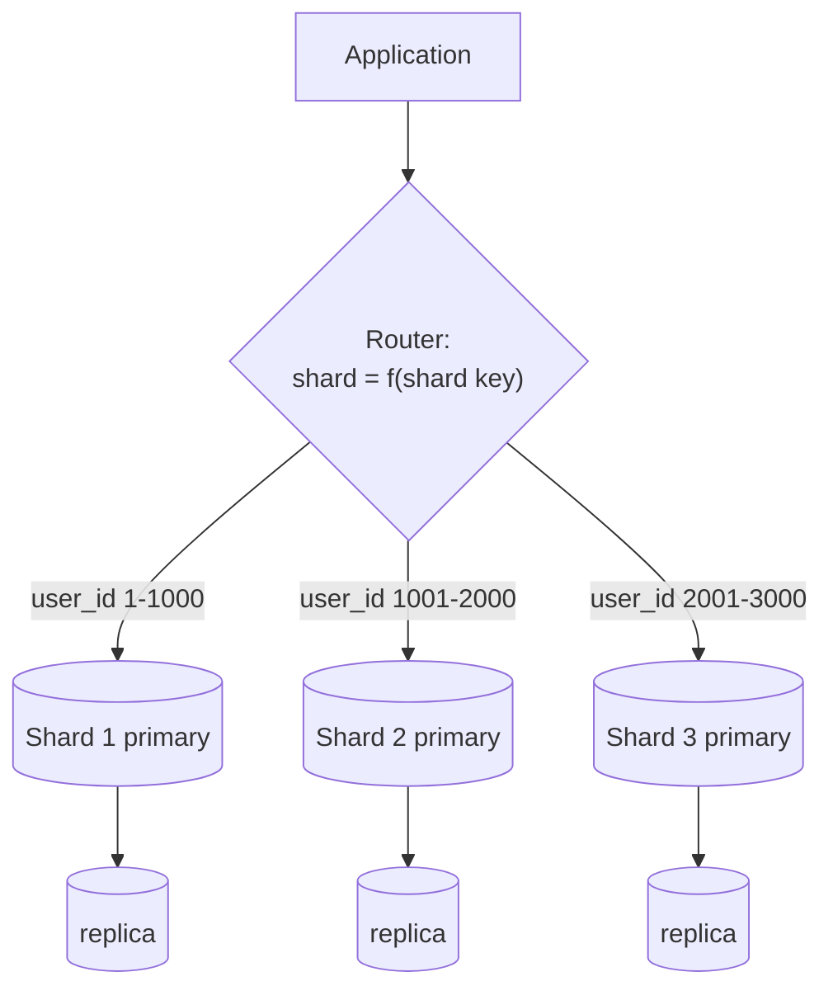

# Sharding

## Summary

Sharding (horizontal partitioning across servers) splits one logical dataset into parts called shards and stores each shard on a different database server, so that each server manages only a subset of the data. Each row belongs to exactly one shard, chosen by the value of a shard key through a range, a hash or a lookup directory. Sharding is the main way to scale writes and storage beyond one machine: each shard handles less traffic, has smaller indexes and fits more of its data in cache. The cost is complexity: queries that do not include the shard key must ask every shard, joins and transactions across shards become hard, and moving data between shards (rebalancing) is an operation in its own right.

## Prerequisites

- [Replication](replication.md), because every shard is normally replicated.
- [Consistent hashing](consistent-hashing.md), one of the ways to map keys to shards.

## Core concepts

### Definition

*Sharding* distributes data across different databases such that each database manages only a subset of the data. Taking a users database as an example: as the number of users grows, more shards are added to the cluster.

Like [federation](../information-integration/database-federation.md), sharding results in less read and write traffic per server, less replication per server and more cache hits. Index size is also reduced, which generally improves performance with faster queries. If one shard goes down, the other shards are still operational, although some form of replication is needed to avoid data loss. Like federation, there is no single central primary serializing writes, so writes proceed in parallel with higher total throughput.

*Partitioning* is the general term for splitting data; sharding usually means partitioning across servers, while *table partitioning* splits a table inside one server. *Vertical partitioning* (moving whole tables to separate databases) differs from sharding, which splits the rows of one table. The [Figma case study](../case-studies/figma-database-scaling.md) used both, one after the other.

The diagram shows a router that sends each query to the shard that owns its key; each shard is a small replicated cluster.

*Analogy.* A library whose collection outgrows its building opens branch libraries. Books by authors A to F go to the north branch, G to M to the east branch, and so on. Each branch is smaller, quieter and faster to search, and a fire in one branch does not close the others. A reader who wants "all books about gardening, any author" now has to visit every branch. The analogy breaks for rebalancing: moving half the G to M shelf to a new branch while readers keep borrowing is far harder in a database, where writes continue during the move.

### Shard key

The *shard key* (partition key) is the column or columns whose value decides which shard stores a row. It is the most consequential decision in a sharded design, because:

- queries that include the shard key go to one shard; all others go to all shards (scatter-gather),
- data that shares a shard key value is stored together and can be joined and updated in one local transaction,
- the key's cardinality and distribution decide whether load is even.

A good shard key has high cardinality, spreads writes evenly, appears in most queries, and groups data that is used together (for example `tenant_id` in a multi-tenant SaaS, `user_id` in a social app).

### Advantages

1. **Scalability.** The database scales horizontally by adding shards to handle more data and load.
2. **Performance.** The workload is distributed across servers, reducing contention and improving query performance; indexes and working sets per shard are smaller.
3. **Availability.** Fault isolation: if one shard goes down, the others remain available.
4. **Maintenance.** Each shard can be maintained (backed up, vacuumed, upgraded) independently and in parallel.

### Disadvantages

1. **Complexity.** The database architecture and the application logic become more complex.
2. **Data distribution.** Uneven distribution creates hotspots where some shards handle much more load than others.
3. **Cross-shard queries.** Queries that need data from several shards are complex and slow and need extra coordination.
4. **Rebalancing.** Adding or removing shards requires moving data, which is complex and time-consuming.

### Types

| Type | Definition | Explanation | Example |
| --- | --- | --- | --- |
| Range-based | Data is divided into ranges of a criterion, typically a numeric or date value. | Each shard owns a continuous range of values. | Shard 1 holds users with IDs 1-1000, shard 2 holds 1001-2000, and so on. |
| Hash-based | Data is distributed with a hash function applied to the shard key. | The hash spreads keys evenly; the hash value determines the shard. | Hash user IDs and assign each hash to a shard (often via [consistent hashing](consistent-hashing.md) or fixed hash slots). |
| Directory-based | A lookup table (directory) records which shard holds each key or key group. | The directory maps each key to a specific shard. | A central directory that tracks which user IDs live on which shards. |

Trade offs of each type:

| Type | Range scans | Even load | Rebalancing | Risk |
| --- | --- | --- | --- | --- |
| Range | Efficient, on one or few shards | Poor with monotonic keys (all new rows go to the last range) | Split a range | Hot last shard for timestamps or sequences |
| Hash | Impossible across shards | Good | Move hash slots or ring ranges | Scatter-gather for any range query |
| Directory | Depends on mapping | Controllable | Update the directory, move data | Directory is a bottleneck and a single point of failure unless replicated and cached |

Engines combine them: MongoDB supports range and hashed shard keys with zones; Vitess uses a lookup service (vindexes) over hashed keyspace ranges; Citus distributes tables by hash of a distribution column.

### Use cases

- **Large-scale applications.** Social media platforms and e-commerce sites that handle large volumes of user data and transactions.
- **High-volume data ingestion.** IoT applications and log management systems that ingest and process massive streams of data.
- **Geographically distributed applications.** Global services that store data close to users, sharding by region to reduce latency and to keep data in a jurisdiction.

### Common problems

| Problem | Issue | Solution |
| --- | --- | --- |
| Shard key selection | An inappropriate shard key leads to uneven data distribution and performance problems. | Analyze access patterns and data distribution before choosing; test with production-like traffic. |
| Rebalancing shards | Moving data across shards when scaling up or down is difficult. | Plan for dynamic sharding (many small logical shards mapped to fewer physical servers) and use tools that support online rebalancing. |
| Cross-shard transactions | Keeping ACID properties across shards is hard. | Use distributed transaction protocols, or design the application to minimize cross-shard transactions. |
| Operational overhead | Many shards increase administrative work. | Automate shard management and prefer database systems with built-in sharding. |

### Cross-shard transactions

A transaction that writes to two shards needs both to commit or both to abort. Options, from strongest to weakest:

- **Two-phase commit (2PC).** A coordinator asks all shards to prepare, then to commit. Correct, but adds round trips and blocks if the coordinator fails between phases.
- **Distributed SQL engines** (Spanner, CockroachDB, YugabyteDB) run consensus-replicated 2PC internally, so the application sees normal transactions at a latency cost.
- **Sagas.** A sequence of local transactions, each with a compensating action if a later step fails. No isolation between steps.
- **Avoidance.** Choose the shard key so that every transaction stays in one shard (all data of one tenant, or one Figma "colo").

### Logical and physical shards

Many systems create many more *logical shards* than servers (for example 4 096 logical shards on 16 servers). Rebalancing then moves whole logical shards between servers without re-splitting data, and the application addresses logical shards that never change. Redis Cluster's 16 384 hash slots, Vitess keyspace ranges and Figma's logical shards are examples.

### Supporting databases

| Database | Sharding support | Use cases |
| --- | --- | --- |
| [MongoDB](../engines/mongodb/mongodb-overview.md) | Automatic sharding: data is distributed across shards by a range or hashed shard key, with a balancer moving chunks. | Web applications, real-time analytics, content management systems. |
| [Cassandra](../engines/cassandra/cassandra-overview.md) | Consistent hashing distributes partitions across all nodes; no separate shard concept. | Distributed applications, IoT data storage, large-scale data storage. |
| HBase | Tables are automatically split into regions (key ranges) and distributed across region servers. | Big data applications, time series, log processing. |
| PostgreSQL (with Citus) and MySQL (with Vitess) | Sharding by extension or middleware. | Scaling existing relational applications. |

## Worked example

A multi-tenant invoicing SaaS has 20 000 tenants and one table of invoices growing by 50 million rows per month. The largest tenant has 3 percent of all invoices.

1. **Shard key.** `tenant_id`: every query is per tenant, all of a tenant's data is used together, and transactions stay inside one tenant. Cardinality is high (20 000).
2. **Type.** Hash of `tenant_id` into 1 024 logical shards, mapped to 8 physical servers (128 logical shards each). A directory override pins the largest tenant to its own server, because 3 percent of the data on one hashed logical shard would make it a hotspot.
3. **Queries.** "Invoices of tenant 42 in November" goes to one shard. "Total revenue of all tenants" is a scatter-gather over 8 servers and runs in the analytics warehouse instead.
4. **Growth.** When the servers fill, 4 new servers take 64 logical shards each from the existing 8. Data moves in units of logical shards; no row changes its logical shard.

## Trade offs and when to use it

- **Shard last.** Before sharding, exhaust cheaper options: indexes, query tuning, caching, read replicas, vertical scaling and vertical partitioning (see [database scaling strategies](database-scaling-strategies.md)).
- **Shard** when write throughput, storage or maintenance (such as vacuum of very large tables) exceeds one server, and the access pattern has a natural key.
- **Prefer built-in sharding** (distributed SQL, MongoDB, Cassandra) over hand-built sharding in the application, unless constraints like Figma's make a custom approach cheaper.

## Common mistakes

- **Monotonic shard key with range sharding** (timestamp, auto-increment ID). All inserts hit the last shard. Fix: hash the key or prefix it.
- **Low-cardinality shard key** (country). A few shards get most of the data. Fix: higher-cardinality key or compound key.
- **Shard key missing from most queries.** Every query fans out. Fix: choose the key from the query patterns; add lookup tables for secondary access paths.
- **Global uniqueness assumed.** Unique constraints and sequences are per shard. Fix: globally unique IDs (UUIDv7, Snowflake-style IDs) and uniqueness enforced via the shard key.

## Practice

1. What is the difference between sharding and replication?
2. Compare range, hash and directory sharding on range queries, balance and rebalancing.
3. Why do logical shards make rebalancing easier?
4. Give two ways to handle a transaction that touches two shards.

Hints:

1. Sharding splits data so each server holds a part; replication copies the same data to several servers.
2. See the trade off table above.
3. Data moves in whole units between servers; the key-to-logical-shard mapping never changes.
4. Two-phase commit or a distributed SQL engine; a saga with compensation; or redesign the key to avoid it.

## Further reading

- Donne Martin, "The System Design Primer: Sharding" (GitHub). https://github.com/donnemartin/system-design-primer#sharding - Benefits and disadvantages in brief.
- Martin Kleppmann, *Designing Data-Intensive Applications*, chapter 6 "Partitioning", O'Reilly, 2017. https://dataintensive.net/ - Partitioning by range and hash, rebalancing, request routing.
- MongoDB, "Sharding", MongoDB Manual. https://www.mongodb.com/docs/manual/sharding/ - Shard keys, chunks and the balancer.
- Vitess, "Sharding" (documentation). https://vitess.io/docs/reference/features/sharding/ - Sharding MySQL with vindexes.
