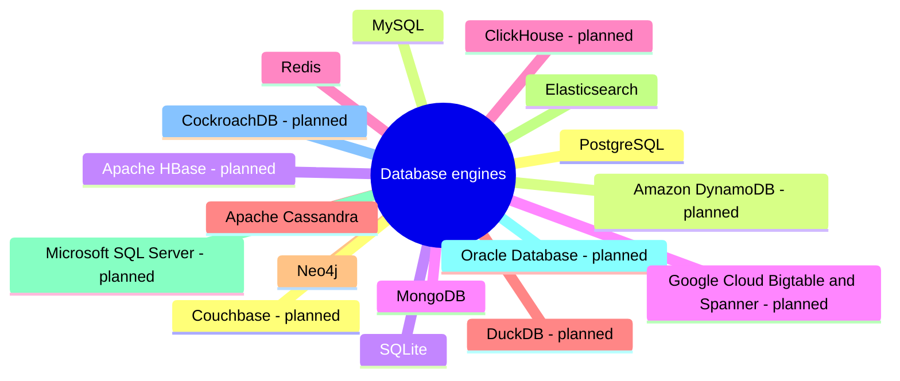

# Database engines

Material specific to one database engine: architecture, features, versions, licenses, tooling and engine-specific mechanisms. Concepts that hold for every engine live in the other areas.

## Map

The map shows the parts of this section: written notes and subsections, and planned topics, which end with the word planned.

## Reading order

1. [PostgreSQL](postgresql/README.md): PostgreSQL, the open source object-relational database: architecture, features, tooling, replication and vacuum.
2. [MySQL](mysql/README.md): MySQL and its fork MariaDB: InnoDB, replication and tooling.
3. [SQLite](sqlite/README.md): SQLite, the embedded relational database in a single file.
4. [MongoDB](mongodb/README.md): MongoDB, the document database: replica sets, sharded clusters, transactions and the aggregation pipeline.
5. [Redis](redis/README.md): Redis, the in-memory data structure store: data types, persistence, replication, cluster and licensing.
6. [Apache Cassandra](cassandra/README.md): Apache Cassandra, the distributed wide-column database: ring, tunable consistency and query-first modeling.
7. [Neo4j](neo4j/README.md): Neo4j, the native property graph database with Cypher.
8. [Elasticsearch](elasticsearch/README.md): Elasticsearch, the distributed search and analytics engine built on Lucene.

## Planned topics

- Microsoft SQL Server
- Oracle Database
- CockroachDB
- Couchbase
- Amazon DynamoDB
- Apache HBase
- Google Cloud Bigtable and Spanner
- ClickHouse
- DuckDB
