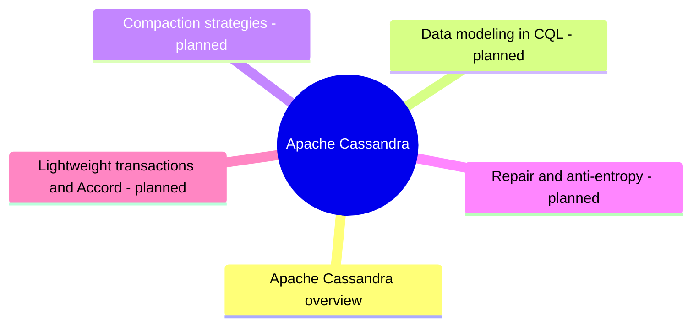

# Apache Cassandra

Apache Cassandra, the distributed wide-column database: ring, tunable consistency and query-first modeling.

## Map

The map shows the parts of this section: written notes and subsections, and planned topics, which end with the word planned.

## Reading order

1. [Apache Cassandra overview](cassandra-overview.md): Apache Cassandra is a distributed wide-column database designed for high availability, fault tolerance and very high write throughput across many nodes and data centers.

## Planned topics

- Data modeling in CQL
- Compaction strategies
- Repair and anti-entropy
- Lightweight transactions and Accord
