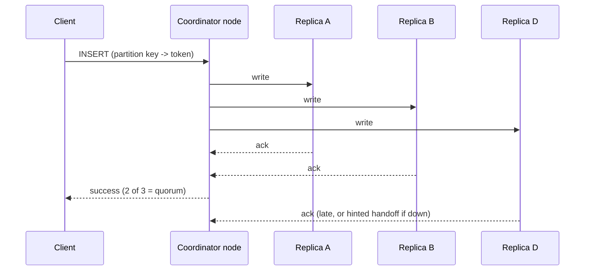

# Apache Cassandra overview

## Summary

Apache Cassandra is a distributed wide-column database designed for high availability, fault tolerance and very high write throughput across many nodes and data centers. It was originally developed at Facebook (for inbox search) and open sourced in 2008, and combines Amazon Dynamo's distribution design (a leaderless hash ring with consistent hashing and tunable consistency) with Google Bigtable's data model and log-structured storage. Every node is equal, there is no primary to fail over, and each request chooses its consistency level. Data is modeled per query with CQL, a SQL-like language without joins. It is licensed under Apache License 2.0.

## Prerequisites

- [Wide-column stores](../../database-design-and-models/nosql/wide-column-stores.md), which explains the data model and contains a CQL example.
- [Consistent hashing](../../distributed-databases/consistent-hashing.md) and [replication](../../distributed-databases/replication.md#replication-on-a-hash-ring).

## Core concepts

### Profile

| Property | Apache Cassandra |
| --- | --- |
| Model | Wide-column (partitioned rows with clustering columns), queried with CQL |
| Distribution | Leaderless ring; consistent hashing with virtual nodes (tokens); gossip for membership |
| Replication | Replication factor per keyspace and per data center (`NetworkTopologyStrategy`) |
| Consistency | Tunable per request: `ONE`, `QUORUM`, `LOCAL_QUORUM`, `ALL` and others |
| Storage | LSM tree: commit log, memtable, immutable SSTables, compaction |
| Transactions | Lightweight transactions (compare-and-set via Paxos) on one partition; general ACID transactions (Accord) are being added in Cassandra 5.x and later (TODO: verify release status) |
| License | Apache License 2.0 |

Checked against cassandra.apache.org, 2026-11.

### Write and read path across the cluster

Cassandra uses consistent hashing to spread data across nodes. Any node can coordinate a request. The sequence diagram shows a write at `QUORUM` with replication factor 3.



With RF = 3, `QUORUM` writes and `QUORUM` reads (2 + 2 > 3) always overlap on at least one replica, so a read sees the latest acknowledged write. `ONE` is faster and more available but may return stale data, which background read repair and anti-entropy repair fix over time.

*Analogy.* A Cassandra cluster is a group of equally ranked notaries, each holding copies of some of the files. You can walk into any office; that notary forwards your document to the three offices responsible for it and tells you "done" once two of them have stamped it. If one office is closed, the others take a note to bring it up to date later. The analogy breaks for consistency: a real notary would never give you an outdated copy, while a Cassandra read at `ONE` may, by design.

### Data modeling

- Design one table per query; denormalize freely.
- The partition key decides the node; clustering columns sort rows inside a partition.
- Keep partitions bounded (time buckets) and avoid hot partitions.
- No joins, no foreign keys, limited secondary indexes (storage-attached indexes, SAI, since 5.0).

### Use cases

Distributed applications that must stay writable through node and data center failures, IoT and time-series data storage, messaging and activity feeds, and large-scale data storage with high write rates.

## Worked example

The time-series table in [wide-column stores](../../database-design-and-models/nosql/wide-column-stores.md#worked-example) is a Cassandra example. A keyspace for two data centers with three replicas each (untested here; CQL as in Cassandra 5.0):

```sql
-- Cassandra CQL, untested
CREATE KEYSPACE telemetry
  WITH replication = {'class': 'NetworkTopologyStrategy', 'eu_west': 3, 'us_east': 3};

CONSISTENCY LOCAL_QUORUM;   -- cqlsh: wait for 2 of 3 replicas in the local data center
```

With `LOCAL_QUORUM`, a write waits for two replicas in the local data center only, so cross-ocean latency does not slow it down, and the remote data center receives the write asynchronously. A full data center outage leaves the other one readable and writable.

## Trade offs and when to use it

- **Use** for write-heavy workloads at large scale, multi-region active-active deployments and data with known query patterns.
- **Avoid** for ad hoc queries, joins, aggregations, small datasets, and multi-partition transactions.
- **Alternatives.** ScyllaDB (Cassandra-compatible, C++), Amazon Keyspaces and Azure Cosmos DB Cassandra API (managed), HBase or Bigtable for strongly consistent per-row access, a relational database below the scale where Cassandra pays off.

## Common mistakes

- **Relational modeling.** Fix: one table per query.
- **Large or unbounded partitions.** Fix: time bucketing in the partition key.
- **Using `ALLOW FILTERING` in production queries.** It scans. Fix: a table designed for the query.
- **Skipping repairs.** Replicas diverge and deleted data can reappear after `gc_grace_seconds`. Fix: schedule regular repairs.

## Practice

1. Which two systems' designs does Cassandra combine, and which part comes from each?
2. Why is there no failover in Cassandra?
3. With RF = 3, which read and write consistency levels guarantee reading the latest acknowledged write?

Hints:

1. Dynamo: ring, consistent hashing, tunable consistency. Bigtable: wide-column model and LSM storage.
2. It is leaderless; any replica can serve any request.
3. Any combination with R + W > 3, such as `QUORUM` and `QUORUM`.

## Further reading

- Avinash Lakshman, Prashant Malik, "Cassandra: A Decentralized Structured Storage System", *ACM SIGOPS Operating Systems Review* 44(2), 2010. https://doi.org/10.1145/1773912.1773922 - The original design from Facebook.
- Apache Software Foundation, "Apache Cassandra documentation". https://cassandra.apache.org/doc/latest/ - Architecture, CQL, operations.
- Apache Software Foundation, "Dynamo" (architecture section). https://cassandra.apache.org/doc/latest/cassandra/architecture/dynamo.html - Consistent hashing, replication and tunable consistency in Cassandra.
