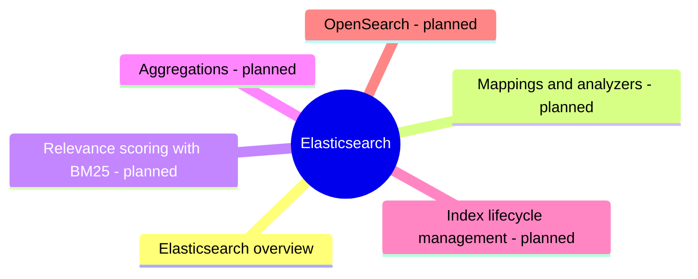

# Elasticsearch

Elasticsearch, the distributed search and analytics engine built on Lucene.

## Map

The map shows the parts of this section: written notes and subsections, and planned topics, which end with the word planned.

## Reading order

1. [Elasticsearch overview](elasticsearch-overview.md): Elasticsearch is a distributed search and analytics engine built on Apache Lucene.

## Planned topics

- Mappings and analyzers
- Relevance scoring with BM25
- Aggregations
- Index lifecycle management
- OpenSearch
