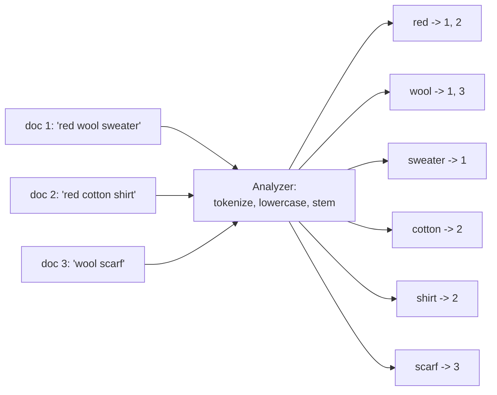

# Elasticsearch overview

## Summary

Elasticsearch is a distributed search and analytics engine built on Apache Lucene. It stores JSON documents in indexes that are split into shards and replicated across a cluster, and builds an *inverted index* over their text, which maps each term to the documents that contain it. This makes full-text search with relevance ranking fast, and its aggregations and columnar doc values make it a near real-time analytics engine for logs, metrics and events. It is the "E" of the ELK stack (Elasticsearch, Logstash, Kibana). Elasticsearch is usually a secondary store fed from a system of record, not the primary database. Its license changed from Apache 2.0 to SSPL and the Elastic License in 2021, and AGPLv3 was added as an option in 2024; the OpenSearch fork continues under Apache 2.0.

## Prerequisites

- [Document stores](../../database-design-and-models/nosql/document-stores.md) for the JSON document model.
- [Sharding](../../distributed-databases/sharding.md) and [replication](../../distributed-databases/replication.md).

## Core concepts

### What it is

*Elasticsearch* is a document-oriented, distributed engine for search and analytics. Each document belongs to an *index* (comparable to a collection); each index is divided into *primary shards* (each a Lucene index) with *replica shards* on other nodes. Documents become searchable after a *refresh* (every second by default), so search is near real time, not immediate.

| Property | Elasticsearch |
| --- | --- |
| Model | JSON documents in indexes, with mappings (field types) |
| Core structure | Lucene inverted index per shard, plus doc values (columnar) for sorting and aggregations, BKD trees for numbers and geo, vector indexes (HNSW) |
| Query | Query DSL (JSON), ES\|QL, SQL (limited) |
| Distribution | Primary and replica shards allocated across nodes by the master |
| Consistency | Near real time search (refresh interval); single-document operations; no multi-document transactions |
| License (checked 2026-11) | SSPL, Elastic License 2.0 or AGPLv3 (since 2024, version 8.16 onward); Apache 2.0 up to 7.10 |
| Fork | OpenSearch (Linux Foundation, Apache 2.0), forked from 7.10.2 in 2021 |

TODO: verify the exact version from which AGPLv3 applies.

### The inverted index

The diagram shows how three documents become an inverted index: each term points to the documents that contain it, so a search looks up terms instead of scanning documents.



A query for "red wool" looks up both terms, combines the posting lists, and ranks the documents with BM25 (term frequency and inverse document frequency): document 1 matches both terms and ranks first.

*Analogy.* An inverted index is the index at the back of a book: to find every page that mentions "replication", you look up the word, not read the book. Elasticsearch builds such an index for every text field of every document, and spreads the book over many shelves (shards). The analogy breaks for freshness: a printed index is fixed, while Elasticsearch adds new pages to its index every second.

### Use cases

Elasticsearch is widely used for its search capabilities and analytics.

- **Full-text search.** Fast, scalable search with relevance ranking, fuzzy matching, highlighting and complex queries with near real time responses: site search, product search, document search.
- **Real-time analytics.** Aggregations over fresh data suit dashboards that track live data such as user activity, transactions or sensor output.
- **Machine learning.** The machine learning features (originally part of the X-Pack extension, now part of the Elastic Stack subscriptions) automatically detect anomalies, patterns and trends in time series data.
- **Geo-data applications.** Geospatial indexing and search (geo points, shapes, distance and bounding box queries) for mapping and location-based services.
- **Log and event data analysis.** Organizations aggregate, monitor and analyze logs and events from many sources. Elasticsearch is the core of the ELK stack (Elasticsearch, Logstash, Kibana; with Beats now the Elastic Stack), widely used to manage system and application logs, find problems and monitor system health.
- **Security information and event management (SIEM).** Analyzing security events in real time; Elastic Security is a SIEM built on it.
- **Vector and hybrid search.** Dense vector fields with approximate nearest neighbor search, combined with keyword search, for semantic search and retrieval augmented generation.

## Worked example

Index two products and search with relevance ranking (untested here; REST API as in Elasticsearch 8.x, issued with `curl` against a local single-node cluster):

```bash
# untested
curl -X PUT 'localhost:9200/products/_doc/1' -H 'Content-Type: application/json' \
  -d '{"name": "Red wool sweater", "price": 79.0}'
curl -X PUT 'localhost:9200/products/_doc/2' -H 'Content-Type: application/json' \
  -d '{"name": "Red cotton shirt", "price": 29.0}'
curl -X POST 'localhost:9200/products/_refresh'
curl -X GET 'localhost:9200/products/_search' -H 'Content-Type: application/json' \
  -d '{"query": {"match": {"name": "red wool"}}}'
```

Expected result: both documents match `red`, but document 1 also matches `wool`, so it has the higher `_score` and is returned first. Without the explicit `_refresh`, a search right after indexing might not see the documents yet, which is the near real time behavior.

## Trade offs and when to use it

- **Use** for search boxes, log and event analytics, observability and security analytics, and hybrid keyword and vector search.
- **Avoid** as the system of record for transactional data: no multi-document transactions, eventual visibility, and reindexing is needed for many mapping changes.
- **Typical architecture.** The source of truth stays in a database (for example PostgreSQL); changes flow to Elasticsearch through change data capture or the application, as in [choosing a database](../../foundations/choosing-a-database.md#worked-example).
- **Alternatives.** OpenSearch (Apache 2.0 fork), PostgreSQL full-text search for modest needs, Apache Solr (also Lucene based), specialized engines (Meilisearch, Typesense) for simple site search.

## Common mistakes

- **Too many small shards.** Each shard has fixed overhead. Fix: size shards in the tens of gigabytes and use index lifecycle management.
- **Dynamic mapping in production.** Field types are guessed and "mapping explosions" follow. Fix: explicit mappings.
- **Expecting immediate visibility.** Fix: design for near real time, or refresh deliberately for tests.
- **Using it as the primary store.** Fix: keep a source of truth and make the index rebuildable.

## Practice

1. What is an inverted index, and why does it make full-text search fast?
2. What does "near real time" mean in Elasticsearch?
3. Why is Elasticsearch usually fed from another database?
4. Name four use cases.

Hints:

1. A map from each term to the documents containing it; search looks up terms instead of scanning.
2. Documents become searchable after a refresh, every second by default.
3. It lacks multi-document transactions and needs reindexing for many schema changes.
4. Full-text search, log analysis, real-time analytics, SIEM (also geo and vector search).

## Further reading

- Elastic, "Elasticsearch Guide". https://www.elastic.co/guide/en/elasticsearch/reference/current/index.html - Reference for indexes, mappings, queries and aggregations.
- Clinton Gormley, Zachary Tong, *Elasticsearch: The Definitive Guide*, O'Reilly, 2015. https://www.elastic.co/guide/en/elasticsearch/guide/current/index.html - Older but clear explanation of inverted indexes and relevance.
- Elastic, "Elastic License FAQ" and the 2024 AGPL announcement. https://www.elastic.co/pricing/faq/licensing - License history.
- OpenSearch project. https://opensearch.org/ - The Apache 2.0 fork.
