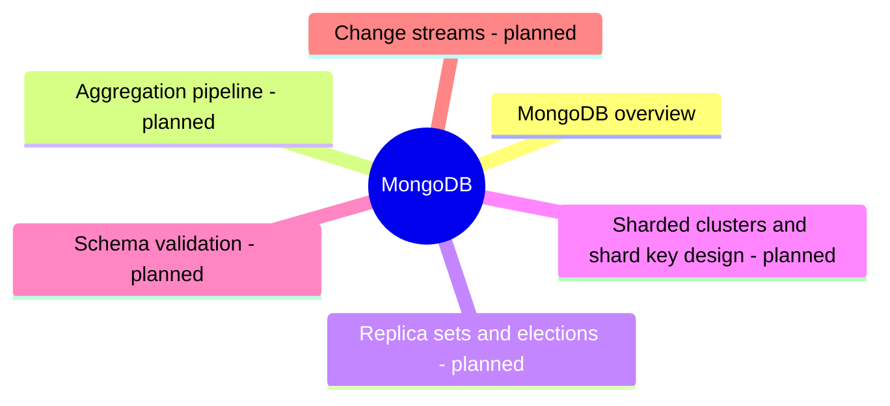

# MongoDB

MongoDB, the document database: replica sets, sharded clusters, transactions and the aggregation pipeline.

## Map

The map shows the parts of this section: written notes and subsections, and planned topics, which end with the word planned.

## Reading order

1. [MongoDB overview](mongodb-overview.md): MongoDB is a document database that stores data as BSON documents (a binary form of JSON) in collections, with a flexible schema, secondary indexes on any field including nested fields and arrays, and an aggregation pipeline for analytics.

## Planned topics

- Aggregation pipeline
- Replica sets and elections
- Sharded clusters and shard key design
- Schema validation
- Change streams
