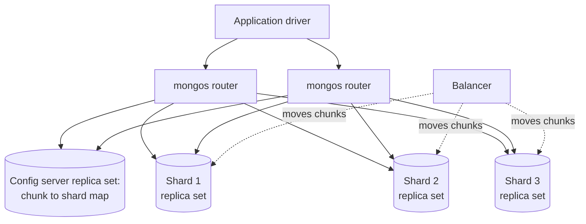

# MongoDB overview

## Summary

MongoDB is a document database that stores data as BSON documents (a binary form of JSON) in collections, with a flexible schema, secondary indexes on any field including nested fields and arrays, and an aggregation pipeline for analytics. It is designed for high-volume data and horizontal scale: a *replica set* provides high availability with automatic failover, and a *sharded cluster* distributes collections across shards by a shard key with automatic balancing. Single-document operations are atomic; multi-document ACID transactions exist since version 4.0 but require a replica set or sharded cluster. MongoDB started as open source and moved to the source-available Server Side Public License (SSPL) in 2018.

## Prerequisites

- [Document stores](../../database-design-and-models/nosql/document-stores.md), which contains a tested MongoDB example of the document model.
- [Sharding](../../distributed-databases/sharding.md) and [replication](../../distributed-databases/replication.md).

## Core concepts

### Profile

| Property | MongoDB |
| --- | --- |
| Model | Document (BSON), collections, flexible schema with optional JSON Schema validation |
| Query | MongoDB Query API (`find`, `aggregate`), aggregation pipeline, `$lookup` joins |
| Storage engine | WiredTiger (B-tree based, document-level concurrency, compression) |
| Availability | Replica set: one primary, secondaries, automatic election |
| Scaling | Sharded cluster: `mongos` routers, config servers, shards; range, hashed and zone sharding |
| Transactions | Single document atomic; multi-document ACID since 4.0 (replica sets) and 4.2 (sharded) |
| License (checked 2026-11) | SSPL (Community Server) since October 2018; commercial Enterprise; managed MongoDB Atlas |
| Version used here | 8.0.34 (Docker image `mongo:8.0`) |

### Sharded cluster architecture

MongoDB supports automatic sharding, distributing data across multiple servers. The diagram shows the components.



- Each shard is itself a replica set (primary plus secondaries).
- Data of a sharded collection is split into *chunks* (ranges of shard key values); the balancer moves chunks to keep shards even.
- `mongos` routes a query to the shards that own the shard key values in its filter, or to all shards (scatter-gather) if the filter has no shard key.

*Analogy.* A sharded MongoDB cluster is a chain of warehouses with a central dispatch office. Dispatch (`mongos` with the config servers) knows which warehouse stores which range of product codes; a truck driver asks dispatch and drives straight to the right warehouse. A night shift (the balancer) moves pallets between warehouses when one gets too full. The analogy breaks for a question without a product code: dispatch must phone every warehouse and wait for all answers.

### Write and read concerns

A *write concern* says how many replica set members must acknowledge a write (`w: 1`, `w: "majority"`), and a *read concern* says what consistency a read sees (`local`, `majority`, `linearizable`). Since MongoDB 5.0 the default write concern is `majority`, so acknowledged writes survive a failover. Checked against the MongoDB 8.0 manual, 2026-11.

### Use cases

Content management, mobile apps, real-time analytics, IoT data, catalogs and user profiles; together with automatic sharding, web applications, real-time analytics and content management systems at scale.

## Worked example

Tested on MongoDB 8.0.34, a standalone server (no replica set). An aggregation pipeline computes revenue per customer from paid orders; then a multi-document transaction is attempted.

```javascript
db.orders.insertMany([
  { _id: 1, customer: "ada",  status: "paid",      total: 59.9, lines: [{ sku: "SKU-1", qty: 1 }] },
  { _id: 2, customer: "ada",  status: "paid",      total: 12.5, lines: [{ sku: "SKU-2", qty: 1 }] },
  { _id: 3, customer: "alan", status: "paid",      total: 99.0, lines: [{ sku: "SKU-1", qty: 2 }] },
  { _id: 4, customer: "alan", status: "cancelled", total: 20.0, lines: [] }
]);
printjson(db.orders.aggregate([
  { $match: { status: "paid" } },                                     // like WHERE
  { $group: { _id: "$customer", orders: { $sum: 1 }, revenue: { $sum: "$total" } } },  // like GROUP BY
  { $sort: { revenue: -1 } }                                          // like ORDER BY
]).toArray());

const s = db.getMongo().startSession();
try {
  s.startTransaction();
  s.getDatabase("test").orders.updateOne({ _id: 1 }, { $set: { status: "refunded" } });
  s.commitTransaction();
} catch (e) { print("transaction error:", e.message); }
```

Output:

```text
[
  { _id: 'alan', orders: 1, revenue: 99 },
  { _id: 'ada', orders: 2, revenue: 72.4 }
]
transaction error: This MongoDB deployment does not support retryable writes. Please add retryWrites=false to your connection string.
```

The pipeline stages map to SQL clauses. The transaction fails because a standalone server has no oplog, which retryable writes and multi-document transactions both need; on a replica set (even a single-member one started with `--replSet`) the same code commits.

## Trade offs and when to use it

- **Use** for aggregate-oriented data with varied fields, high write volume that needs automatic sharding, and teams that model data around queries.
- **Avoid** for heavily relational data with many-to-many joins and cross-entity invariants, or when the SSPL is unacceptable for your distribution model.
- **Alternatives.** PostgreSQL with `jsonb` for documents plus relational integrity; Amazon DocumentDB or Azure Cosmos DB (MongoDB API) for managed compatibility; Couchbase for built-in mobile sync and caching.

## Common mistakes

- **Running production on a standalone server.** No failover, no transactions. Fix: at least a three-member replica set.
- **A monotonically increasing shard key** (ObjectId, timestamp) with range sharding. All inserts go to one shard. Fix: hashed shard key or a compound key.
- **Queries without the shard key on large sharded collections.** Fix: include the shard key or design a different access path.
- **Unbounded arrays in documents.** Fix: bucket or reference (see [document stores](../../database-design-and-models/nosql/document-stores.md#embedding-versus-referencing)).

## Practice

1. What are the three components of a sharded cluster and their roles?
2. Why does a multi-document transaction fail on a standalone server?
3. What does `writeConcern: "majority"` guarantee?
4. Map the stages `$match`, `$group` and `$sort` to SQL clauses.

Hints:

1. `mongos` routes, config servers store metadata, shards store data (each a replica set).
2. Transactions need the replica set oplog and session infrastructure.
3. The write is acknowledged only after a majority of members have it, so it survives a failover.
4. `WHERE`, `GROUP BY`, `ORDER BY`.

## Further reading

- MongoDB, "MongoDB Manual". https://www.mongodb.com/docs/manual/ - Reference for the model, replication, sharding and transactions.
- MongoDB, "Sharding". https://www.mongodb.com/docs/manual/sharding/ - Shard keys, chunks, balancer.
- MongoDB, "Replication". https://www.mongodb.com/docs/manual/replication/ - Replica sets, elections, write concern.
- MongoDB, "Server Side Public License FAQ". https://www.mongodb.com/legal/licensing/server-side-public-license/faq - The license change.
