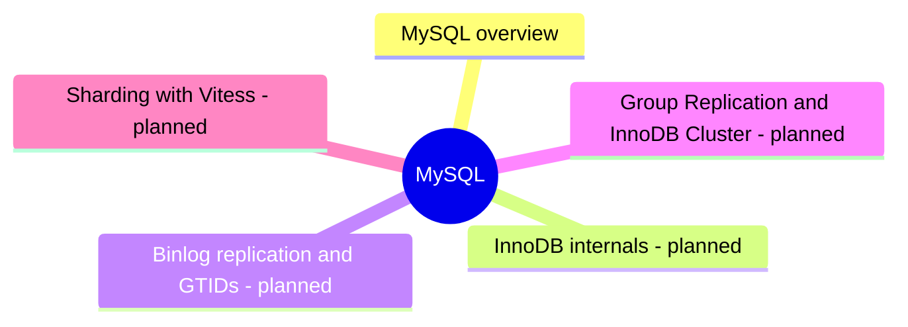

# MySQL

MySQL and its fork MariaDB: InnoDB, replication and tooling.

## Map

The map shows the parts of this section: written notes and subsections, and planned topics, which end with the word planned.

## Reading order

1. [MySQL overview](mysql-overview.md): MySQL is the most widely adopted open source relational database, created in 1995, owned by Oracle since 2010, and the "M" of the LAMP stack that built much of the web.

## Planned topics

- InnoDB internals
- Binlog replication and GTIDs
- Group Replication and InnoDB Cluster
- Sharding with Vitess
