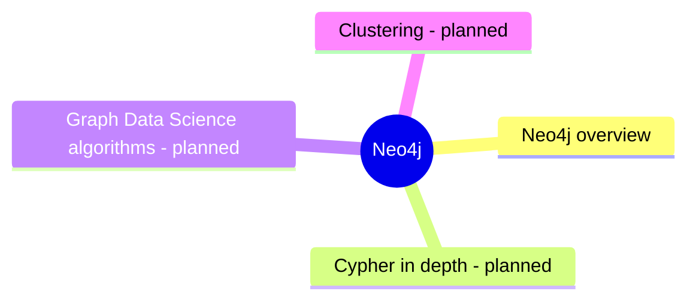

# Neo4j

Neo4j, the native property graph database with Cypher.

## Map

The map shows the parts of this section: written notes and subsections, and planned topics, which end with the word planned.

## Reading order

1. [Neo4j overview](neo4j-overview.md): Neo4j is a native property graph database: it stores nodes, relationships and their properties with direct references between connected records, so traversals follow pointers instead of searching indexes.

## Planned topics

- Cypher in depth
- Graph Data Science algorithms
- Clustering
