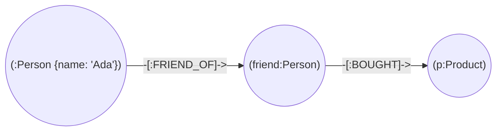

# Neo4j overview

## Summary

Neo4j is a native property graph database: it stores nodes, relationships and their properties with direct references between connected records, so traversals follow pointers instead of searching indexes. It is ACID compliant, is queried with Cypher (and increasingly with the ISO GQL standard that grew out of Cypher), and ships graph algorithms through its Graph Data Science library. It is one of the most widely used graph databases, applied to recommendations, fraud detection, network and IT operations and knowledge graphs, including retrieval for generative AI applications. The Community Edition is GPLv3; the Enterprise Edition, with clustering and advanced security, is commercial.

## Prerequisites

- [Graph databases](../../database-design-and-models/nosql/graph-databases.md), which explains the model and contains a tested Cypher example.

## Core concepts

### Profile

| Property | Neo4j |
| --- | --- |
| Model | Labeled property graph |
| Storage | Native graph storage with index-free adjacency |
| Query languages | Cypher; GQL conformance in progress |
| Transactions | ACID |
| Clustering | Enterprise: primary servers with Raft-based consensus for writes, secondaries for read scaling |
| License (checked 2026-11) | Community Edition GPLv3; Enterprise Edition commercial; managed AuraDB |
| Version used here | 5.26.32 (Docker image `neo4j:5`) |

### Cypher in one picture

Cypher patterns read like the diagram you would draw on a whiteboard.



The pattern above is written `MATCH (:Person {name: 'Ada'})-[:FRIEND_OF]->(friend:Person)-[:BOUGHT]->(p:Product) RETURN p`.

*Analogy.* Neo4j is a city map where every intersection lists the streets that leave it. To find a route you stand at an intersection and follow streets, never consulting a street index for the whole city. The analogy breaks for "how many intersections does the city have": that question needs a full count, and a graph database is no faster at it than any other database.

### Key features

- **Schema optional.** Labels and relationship types are created on use; constraints (uniqueness, existence, types) and indexes are added explicitly.
- **Graph Data Science.** Algorithms such as PageRank, community detection, shortest paths and node embeddings run on in-memory projections of the graph.
- **Vector indexes.** Similarity search on embeddings, combined with graph traversal for retrieval augmented generation (GraphRAG).

### Use cases

Social networks, recommendation engines, fraud detection, knowledge graphs, network and IT operations (dependency and impact analysis), supply chain management, and generative AI applications that ground answers in a knowledge graph.

## Worked example

The fraud ring query in [graph databases](../../database-design-and-models/nosql/graph-databases.md#worked-example) was tested on Neo4j 5.26.32. A uniqueness constraint that a production graph would add before loading data (untested here; Cypher 5 syntax):

```cypher
// untested, Neo4j 5
CREATE CONSTRAINT person_name_unique IF NOT EXISTS
FOR (p:Person) REQUIRE p.name IS UNIQUE;
```

The constraint also creates an index, so `MATCH (p:Person {name: 'Ada'})` finds the starting node by index lookup, after which traversal follows relationships directly.

## Trade offs and when to use it

- **Use** when the questions are about connections of variable depth and the graph fits the engine's clustering model.
- **Avoid** as a general-purpose store for tabular data or for bulk analytics over all records.
- **Alternatives.** Amazon Neptune (managed, property graph and RDF), Memgraph (Cypher compatible, in memory), PostgreSQL with recursive CTEs or Apache AGE for occasional graph queries.

## Common mistakes

- **Missing constraints and indexes on lookup properties.** Starting points are found by full label scans. Fix: create constraints before loading.
- **Supernodes.** Fix: model high-degree attributes as properties or split by type.
- **Unbounded variable-length patterns.** Fix: bound the depth.

## Practice

1. What does "native graph storage" mean for traversal cost?
2. Which features differ between the Community and Enterprise editions?
3. How does a vector index combine with graph traversal in a GraphRAG application?

Hints:

1. Following a relationship is a pointer lookup independent of the graph's size.
2. Clustering, advanced security and some operational features are Enterprise only.
3. Vector search finds starting nodes by similarity; traversal then collects connected context.

## Further reading

- Neo4j, "Neo4j documentation" and "Cypher Manual". https://neo4j.com/docs/ - Reference.
- Ian Robinson, Jim Webber, Emil Eifrem, *Graph Databases*, 2nd edition, O'Reilly, 2015. https://neo4j.com/graph-databases-book/ - Modeling and internals.
- Neo4j, "Licensing". https://neo4j.com/licensing/ - Edition licenses.
