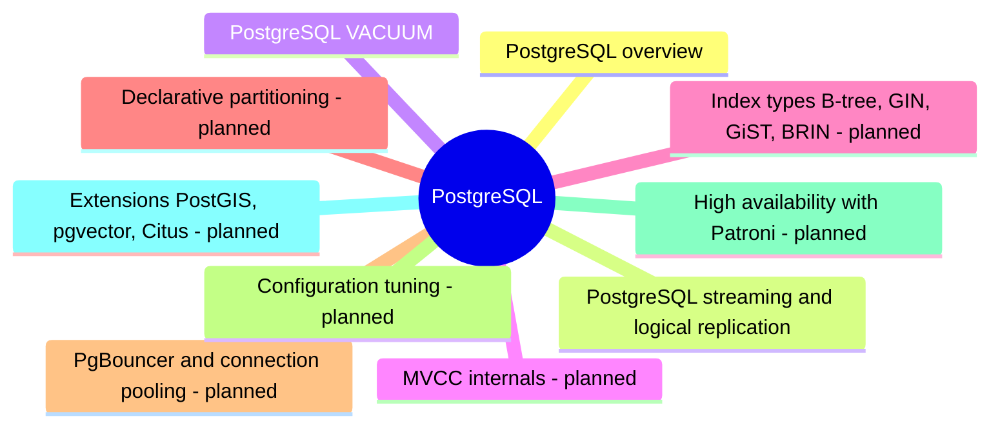

# PostgreSQL

PostgreSQL, the open source object-relational database: architecture, features, tooling, replication and vacuum.

## Map

The map shows the parts of this section: written notes and subsections, and planned topics, which end with the word planned.

## Reading order

1. [PostgreSQL overview](postgresql-overview.md): PostgreSQL is an open source object-relational database system with full RDBMS features: ACID transactions, a rich and standards-conforming SQL dialect, multi-version concurrency control (MVCC), and an extension system that adds data types, index types, languages and foreign data wrappers.
2. [PostgreSQL streaming and logical replication](streaming-and-logical-replication.md): PostgreSQL has two built-in replication mechanisms.
3. [PostgreSQL VACUUM](vacuum.md): VACUUM is PostgreSQL's background cleanup process.

## Planned topics

- MVCC internals
- Index types (B-tree, GIN, GiST, BRIN)
- Declarative partitioning
- PgBouncer and connection pooling
- Configuration tuning
- High availability with Patroni
- Extensions: PostGIS, pgvector, Citus
