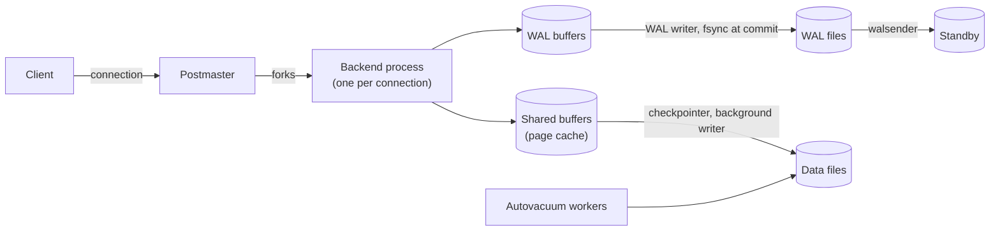

# PostgreSQL overview

## Summary

PostgreSQL is an open source object-relational database system with full RDBMS features: ACID transactions, a rich and standards-conforming SQL dialect, multi-version concurrency control (MVCC), and an extension system that adds data types, index types, languages and foreign data wrappers. It runs as a single primary per cluster with physical (streaming) or logical replication to other servers, and scales out through extensions or external tools rather than natively. It is released under the permissive PostgreSQL License, ships one major version per year, and is one of the two most widely used open source relational databases, alongside MySQL.

## Prerequisites

- [Relational model](../../database-design-and-models/relational/relational-model.md) and [transactions and ACID](../../transactions-and-concurrency/transactions-and-acid.md).

## Core concepts

### Profile

| Property | PostgreSQL |
| --- | --- |
| Model | Object-relational (tables, plus user-defined types, inheritance, arrays, JSON) |
| License | PostgreSQL License (permissive, similar to BSD or MIT) |
| Origin | POSTGRES project at UC Berkeley (Michael Stonebraker, 1986); SQL added 1995; renamed PostgreSQL 1996 |
| Release cycle | One major version per year (September or October), five years of support per major version |
| Versions used here | 17 (tested examples, 17.11); 18 was released in September 2025 |
| Concurrency control | MVCC with snapshot isolation; serializable via serializable snapshot isolation (SSI) |
| Process model | One operating system process per connection |
| Replication | Physical streaming replication, logical replication |
| Typical use | General purpose OLTP, geospatial (PostGIS), JSON documents, moderate analytics |

Checked against postgresql.org, 2026-11.

### Architecture in one picture

The diagram shows the main parts a query and a write pass through.



- Every connection is a separate process with its own memory, which makes connections expensive (memory, fork time) and is the reason connection poolers such as PgBouncer are standard in front of busy PostgreSQL servers.
- Durability comes from the write-ahead log: a commit is durable when its WAL record is flushed; data pages are written later by the checkpointer.
- MVCC keeps old row versions in the table itself; autovacuum removes them (see [VACUUM](vacuum.md)).

*Analogy.* PostgreSQL is a well-equipped workshop with a strict foreman. Every customer gets a personal craftsman (a backend process), which is great service but limits how many customers fit in the room, hence the receptionist at the door (a connection pooler) who lets customers share craftsmen. The workshop keeps every draft of every piece (row versions) until a cleaner (autovacuum) is sure nobody looks at old drafts anymore. The analogy breaks for extensions: no real workshop lets you install a new kind of machine without stopping work, while `CREATE EXTENSION` does exactly that.

### Notable features

- **Rich types and indexes.** `jsonb` with GIN indexes, arrays, ranges, full-text search, B-tree, hash, GiST, SP-GiST, GIN and BRIN indexes, partial and expression indexes.
- **Extensions.** PostGIS (geospatial), pgvector (vector similarity search), TimescaleDB (time series), Citus (sharding), `pg_stat_statements` (query statistics), `postgres_fdw` (federation).
- **Procedural languages.** PL/pgSQL, plus PL/Python, PL/Perl and others; see [stored procedures](../../query-languages/sql/stored-procedures.md) and [triggers](../../query-languages/sql/triggers.md), including event triggers on DDL and, since 17, on login.
- **Declarative partitioning** by range, list or hash.
- **Replication.** Streaming (physical) and logical; see [streaming and logical replication](streaming-and-logical-replication.md).

### Federation with foreign data wrappers

PostgreSQL supports *foreign data wrappers* (FDW, an implementation of the SQL/MED standard) to connect to and query external data sources as if they were local tables. `postgres_fdw` connects to other PostgreSQL servers; other wrappers connect to MySQL, Oracle, SQL Server, MongoDB, files and more. This is the PostgreSQL form of [database federation](../../information-integration/database-federation.md).

Tested on PostgreSQL 17.11 in one container with two databases, `crm` (customers) and `shop` (orders):

```sql
-- in database crm
CREATE TABLE customers (customer_id int PRIMARY KEY, name text, city text);
INSERT INTO customers VALUES (1, 'Ada', 'London'), (2, 'Alan', 'Paris'), (3, 'Grace', 'New York');

-- in database shop
CREATE EXTENSION postgres_fdw;
CREATE SERVER crm_server FOREIGN DATA WRAPPER postgres_fdw OPTIONS (host 'localhost', dbname 'crm');
CREATE USER MAPPING FOR CURRENT_USER SERVER crm_server OPTIONS (user 'postgres', password '<PASSWORD>');
CREATE SCHEMA crm;
IMPORT FOREIGN SCHEMA public LIMIT TO (customers) FROM SERVER crm_server INTO crm;
CREATE TABLE orders (order_id int PRIMARY KEY, customer_id int, total numeric(10, 2));
INSERT INTO orders VALUES (100, 1, 59.90), (101, 2, 99.00);

SELECT o.order_id, c.name, c.city, o.total
FROM orders o JOIN crm.customers c ON c.customer_id = o.customer_id
ORDER BY o.order_id;

EXPLAIN (VERBOSE, COSTS OFF) SELECT name FROM crm.customers WHERE city = 'Paris';
```

Output:

```text
 order_id | name |  city  | total
----------+------+--------+-------
      100 | Ada  | London | 59.90
      101 | Alan | Paris  | 99.00
(2 rows)

                                QUERY PLAN
--------------------------------------------------------------------------
 Foreign Scan on crm.customers
   Output: name
   Remote SQL: SELECT name FROM public.customers WHERE ((city = 'Paris'))
(3 rows)
```

The `Remote SQL` line shows push-down: the filter runs on the remote server, and only matching rows travel.

### Tooling

| Tool | Purpose |
| --- | --- |
| `psql` | The command line client. |
| pgAdmin | Graphical administration and query tool. |
| `EXPLAIN ANALYZE` | Actual execution plans with timings and buffer counts (see [SQL tuning](../../query-processing-and-optimization/sql-tuning.md)). |
| `pg_stat_statements` | Extension that aggregates statistics per normalized query: calls, total time, rows. |
| PgHero | Dashboard for slow queries, unused and missing indexes, bloat. |
| `auto_explain` | Logs plans of slow queries automatically. |
| PgBouncer | Lightweight connection pooler; transaction pooling lets thousands of client connections share a few dozen server connections. |
| `pg_dump`, `pg_basebackup`, pgBackRest | Logical dumps, physical base backups, backup and point-in-time recovery management. |
| Patroni | High availability: automatic failover with a consensus store (etcd, Consul). |

### Scaling PostgreSQL

PostgreSQL has a single writable primary. The scaling path is the one in [database scaling strategies](../../distributed-databases/database-scaling-strategies.md): tuning, vertical scaling, PgBouncer, read replicas, vertical partitioning, then sharding with Citus or in the application. The [Figma case study](../../case-studies/figma-database-scaling.md) follows that path on Amazon RDS for PostgreSQL to custom horizontal sharding.

## Worked example

The federation example above is the worked example of this note. A second, small check of the version and settings that matter for tuning:

```sql
SELECT version();
SHOW shared_buffers;
SHOW max_connections;
```

On the `postgres:17-alpine` image the output was `PostgreSQL 17.11 on x86_64-pc-linux-musl ...`, `128MB` and `100`. These are the conservative defaults; production servers typically set `shared_buffers` to about 25 percent of RAM and keep `max_connections` low, with PgBouncer in front.

## Trade offs and when to use it

- **Use** as the default relational database for new OLTP systems, especially when you value correctness, standard SQL, extensions (PostGIS, pgvector) and a permissive license.
- **Weaknesses.** Connection-per-process model needs pooling; MVCC needs vacuum tuning for write-heavy tables; no native multi-primary or sharding in core; major version upgrades need `pg_upgrade` or logical replication.
- **Alternatives.** MySQL for very simple web workloads with existing MySQL expertise; distributed SQL (CockroachDB, YugabyteDB, which speaks the PostgreSQL protocol) for native horizontal scale; managed variants (Amazon Aurora PostgreSQL, Google AlloyDB, Cloud SQL) for operations.

## Common mistakes

- **Hundreds of direct connections.** Memory and context switching explode. Fix: PgBouncer and a small pool.
- **Disabling or starving autovacuum.** Bloat and transaction ID wraparound follow. Fix: tune it per table (see [VACUUM](vacuum.md)).
- **Long idle transactions.** They hold back vacuum and locks. Fix: `idle_in_transaction_session_timeout`.
- **Forgetting to index foreign keys.** PostgreSQL does not create them automatically. Fix: index referencing columns.

## Practice

1. Why is a connection pooler almost always used with PostgreSQL in production?
2. What is a foreign data wrapper, and what does `Remote SQL` in a plan show?
3. Name four extensions and what they add.
4. Which component makes a commit durable before data pages are written?

Hints:

1. Each connection is a separate process with its own memory.
2. A connector that exposes an external source as tables; the SQL actually sent to the remote source.
3. PostGIS, pgvector, TimescaleDB, Citus (or `pg_stat_statements`, `postgres_fdw`).
4. The write-ahead log, flushed at commit.

## Further reading

- PostgreSQL Global Development Group, "PostgreSQL 17 Documentation". https://www.postgresql.org/docs/17/ - The reference for everything in this note.
- PostgreSQL Global Development Group, "Versioning Policy". https://www.postgresql.org/support/versioning/ - Release cycle and support periods.
- Michael Stonebraker, Lawrence A. Rowe, "The Design of POSTGRES", SIGMOD 1986. https://dl.acm.org/doi/10.1145/16894.16888 - The origin of the system.
- PgBouncer documentation. https://www.pgbouncer.org/ - Pooling modes and their limits.
- Hironobu Suzuki, *The Internals of PostgreSQL*. https://www.interdb.jp/pg/ - Free, detailed description of processes, MVCC, WAL and vacuum.
