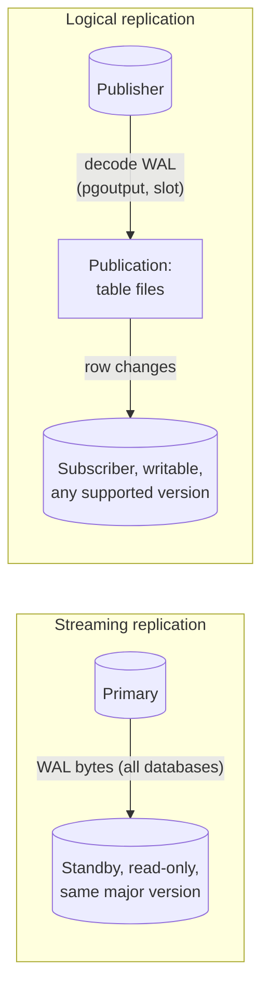

# PostgreSQL streaming and logical replication

## Summary

PostgreSQL has two built-in replication mechanisms. Streaming replication ships the physical write-ahead log (WAL) byte for byte to standby servers, which become exact read-only copies of the whole cluster: simple, complete and the basis of high availability, but tied to the same major version and all-or-nothing. Logical replication decodes the WAL into row changes per table and applies them on a subscriber through a publish and subscribe model: it can copy a subset of tables, cross major versions and feed writable databases, at the cost of more setup, no DDL replication and a slow initial copy. Figma chose logical replication to move tables between databases because of exactly those three properties.

## Prerequisites

- [Replication](../../distributed-databases/replication.md) and [replication modes](../../distributed-databases/replication-modes.md) for the general concepts.
- [PostgreSQL overview](postgresql-overview.md) for WAL and the process model.

## Core concepts

### Streaming (physical) replication

A primary's `walsender` process streams WAL records to a `walreceiver` on each standby, which replays them into its own data files. The standby is a block-level copy of the entire instance (every database, every table, every index). It can serve read-only queries (*hot standby*) and can be promoted to primary on failover. Streaming replication can be asynchronous or synchronous (`synchronous_standby_names`, quorum commit).

### Logical replication

The primary (the *publisher*) decodes WAL into logical row changes with an output plugin (`pgoutput`) and sends them through a *replication slot* to a *subscriber*, which applies them as ordinary inserts, updates and deletes. Objects:

- a **publication** on the publisher: the set of tables (or all tables, or tables in a schema) whose changes are published, optionally with row filters and column lists (PostgreSQL 15 and later);
- a **subscription** on the subscriber: connection details plus the publications to receive; creating it copies the existing data of each table (the *initial synchronization*) and then streams changes.

The diagram compares the two data paths.



*Analogy.* Streaming replication is photocopying every page of a book as it is printed: you get an exact duplicate of the whole book, in the same binding and format. Logical replication is a reporter who reads each new page and dictates only the articles you subscribed to, in sentences: you can write them into any notebook, even one with a different layout, but the reporter does not describe changes to the book's structure (DDL), and dictating the back catalog at the start takes a long time.

### Comparison

| Aspect | Streaming (physical) | Logical |
| --- | --- | --- |
| Unit | Whole instance | Selected tables (row filters, column lists) |
| Target | Read-only standby | Writable database, can have its own tables and indexes |
| Versions | Same major version | Across major versions (used for upgrades) |
| DDL | Replicated (it is in the WAL) | Not replicated; schema must be created and changed on both sides |
| Sequences | Replicated | Not replicated (PostgreSQL 17); must be synced at cutover |
| Initial copy | Base backup (`pg_basebackup`), fast block copy | Table copy through `COPY`, with indexes maintained row by row |
| Failover | Standard HA mechanism | Possible, but slot failover needs PostgreSQL 17 `failover` slots or external tooling |
| Reverse direction | Not possible | Possible: replicate back to roll back a migration |

Checked against PostgreSQL 17 documentation, 2026-11.

### Why Figma chose logical replication

When Figma moved groups of tables from its main database into new databases (vertical partitioning, see the [case study](../../case-studies/figma-database-scaling.md)), it had two options in PostgreSQL: streaming replication or logical replication. It chose logical replication for three reasons:

- **Subset of tables.** Logical replication copies only the tables being moved, so the destination starts with a much smaller storage footprint.
- **Different major version.** It can replicate into a database running a different PostgreSQL major version.
- **Reverse replication.** It allows setting up replication in the opposite direction, so that the operation can be rolled back.

### The slow initial copy and the index fix

Logical replication was slow: the initial data copy could take days or even weeks for large tables. Figma wanted to avoid this, both to shorten the window in which replication could fail and to reduce the cost of restarting if something went wrong.

The cause was how PostgreSQL maintains indexes in the destination database during the copy: rows are copied in bulk, but every index is updated one row at a time. By removing the indexes in the destination database and rebuilding them after the data copy, Figma reduced the copy time to a matter of hours. Building a B-tree index once over sorted data is far cheaper than millions of individual insertions into an existing tree.

## Worked example

Tested with a PostgreSQL 17.11 publisher (`wal_level = logical`) and a PostgreSQL 16.15 subscriber in two Docker containers on one network: one of two tables is replicated across major versions.

```sql
-- publisher (PostgreSQL 17)
CREATE TABLE files (file_id bigint PRIMARY KEY, name text NOT NULL, owner_id int NOT NULL);
CREATE TABLE comments (comment_id bigint PRIMARY KEY, file_id bigint, body text);
INSERT INTO files SELECT g, 'file-' || g, g % 1000 FROM generate_series(1, 100000) g;
CREATE PUBLICATION files_pub FOR TABLE files;

-- subscriber (PostgreSQL 16): the schema must exist first
CREATE TABLE files (file_id bigint PRIMARY KEY, name text NOT NULL, owner_id int NOT NULL);
CREATE SUBSCRIPTION files_sub
  CONNECTION 'host=dbk-pub dbname=postgres user=postgres password=<PASSWORD>'
  PUBLICATION files_pub;

-- publisher: new changes after the initial copy
UPDATE files SET name = 'renamed' WHERE file_id = 42;
INSERT INTO files VALUES (100001, 'new', 7);

-- subscriber
SELECT count(*) AS rows, max(file_id) FROM files;
SELECT name FROM files WHERE file_id = 42;
-- publisher
SELECT slot_name, plugin, slot_type, active FROM pg_replication_slots;
```

Output:

```text
NOTICE:  created replication slot "files_sub" on publisher
CREATE SUBSCRIPTION

  rows  |  max
--------+--------
 100001 | 100001
(1 row)

  name
---------
 renamed
(1 row)

 slot_name |  plugin  | slot_type | active
-----------+----------+-----------+--------
 files_sub | pgoutput | logical   | t
(1 row)
```

The subscriber received the initial 100 000 rows and then the update and the insert, across major versions, and holds only `files`, not `comments`. The replication slot on the publisher retains WAL until the subscriber confirms it; if the subscriber disappears, WAL accumulates, which is why slots must be monitored.

## Trade offs and when to use it

- **Streaming** for high availability, read replicas and disaster recovery of a whole instance.
- **Logical** for moving tables between databases, zero-downtime major version upgrades, feeding other systems (change data capture tools such as Debezium use the same decoding), and consolidating or splitting databases.
- Logical replication needs primary keys (or a `REPLICA IDENTITY`) on replicated tables for updates and deletes, and a cutover plan for sequences and DDL.

## Common mistakes

- **Leaving an unused slot.** WAL grows until the disk is full. Fix: drop unused slots; set `max_slot_wal_keep_size`; alert on slot lag.
- **Applying DDL only on the publisher.** Replication breaks when the new column arrives. Fix: apply compatible schema changes on the subscriber first.
- **Indexes during a huge initial copy.** Fix: create the subscriber tables without secondary indexes, copy, then build indexes (as Figma did).
- **Forgetting sequences at cutover.** Fix: set sequences on the new primary above the old maximum before switching writes.

## Practice

1. Give three reasons to choose logical over streaming replication.
2. Why was Figma's initial logical copy slow, and how did they fix it?
3. What happens on the publisher if a subscriber is offline for a day?
4. Why can streaming replication not upgrade a major version?

Hints:

1. Subset of tables, cross-version, reverse direction (also: writable target).
2. Indexes were maintained row by row during the copy; drop them and rebuild after.
3. The slot retains all WAL since the subscriber's last confirmed position.
4. It ships physical WAL whose on-disk format belongs to one major version.

## Further reading

- PostgreSQL Global Development Group, "Logical Replication", PostgreSQL 17 documentation, chapter 29. https://www.postgresql.org/docs/17/logical-replication.html - Publications, subscriptions, restrictions.
- PostgreSQL Global Development Group, "Log-Shipping Standby Servers", PostgreSQL 17 documentation, section 26.2. https://www.postgresql.org/docs/17/warm-standby.html - Streaming replication.
- Tim Liang, "The growing pains of database architecture", Figma blog, 2023. https://www.figma.com/blog/how-figma-scaled-to-multiple-databases/ - Why Figma chose logical replication and the index rebuild trick.
