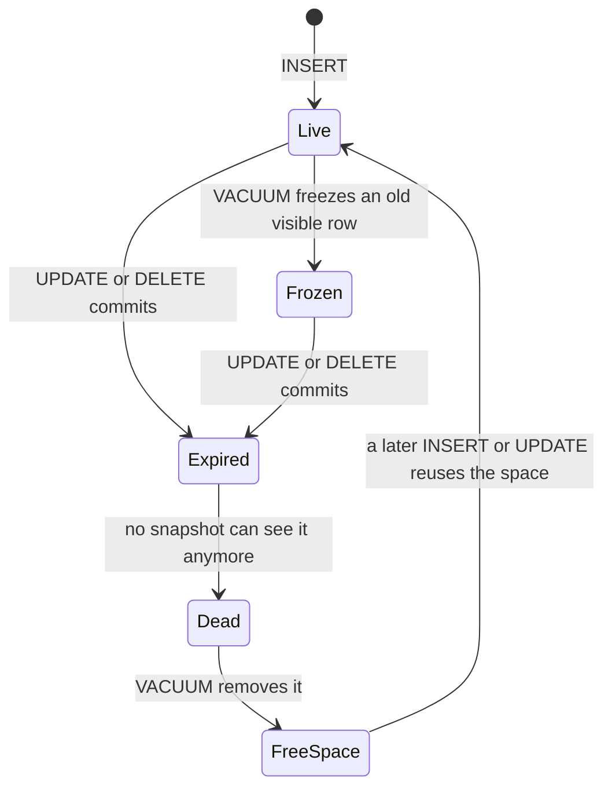

# PostgreSQL VACUUM

## Summary

VACUUM is PostgreSQL's background cleanup process. Because PostgreSQL implements MVCC by keeping old row versions in the table, every update and delete leaves a dead row version behind; VACUUM finds versions that no transaction can see anymore and makes their space reusable. It also has a second, critical job: *freezing* old rows so that PostgreSQL's 32-bit transaction IDs can wrap around safely. Without regular vacuuming, tables bloat, queries slow down, and eventually the database stops accepting writes to protect itself from transaction ID wraparound. On very large tables vacuum is resource-intensive, which is one of the problems that pushed Figma toward horizontal sharding.

## Prerequisites

- [Transactions and ACID](../../transactions-and-concurrency/transactions-and-acid.md), in particular MVCC.
- [PostgreSQL overview](postgresql-overview.md).

## Core concepts

### Why dead rows exist

In PostgreSQL's MVCC, an `UPDATE` does not overwrite a row: it writes a new version (*tuple*) and marks the old one as expired by the updating transaction's ID. A `DELETE` only marks the tuple as expired. Old versions stay in the table so that transactions with older snapshots can still read them. Once no running transaction can see an old version, it is a *dead tuple*: it occupies space and is still scanned by sequential scans and referenced by indexes.

*Vacuuming* is the essential background process that reclaims the storage occupied by deleted or obsolete rows. Plain `VACUUM` marks the space as free for reuse within the same table files (it does not normally shrink the files); `VACUUM FULL` rewrites the table compactly but takes an exclusive lock for the whole time.

The state diagram shows the life of a row version.



*Analogy.* A PostgreSQL table is a whiteboard on which nobody erases: to change a sentence you cross it out and write the new one below, because someone may still be reading the old one. VACUUM is the person who wipes crossed-out sentences once everybody has left the room, so the space can be written on again. If nobody ever wipes, the board fills up and reading it takes longer and longer. The analogy breaks for freezing: there is no whiteboard equivalent of renumbering very old sentences so that the clock on the wall can safely start again from zero.

### Transaction ID wraparound

Every transaction that writes gets a 32-bit transaction ID (XID). Visibility compares XIDs modulo 2^32: roughly 2 billion XIDs are "in the past" and 2 billion "in the future" of any given XID. A row written long ago would, after about 2 billion further transactions, suddenly appear to be in the future and become invisible: data loss.

To prevent this, VACUUM *freezes* rows whose XID is old enough, marking them as visible to every transaction regardless of XID arithmetic. PostgreSQL tracks the oldest unfrozen XID per table (`relfrozenxid`) and per database (`datfrozenxid`). Autovacuum forces an anti-wraparound vacuum when the age passes `autovacuum_freeze_max_age` (200 million by default). If the age approaches the limit anyway (because vacuum is blocked or too slow), PostgreSQL warns and, about 3 million transactions before wraparound, refuses to assign new XIDs, so the database stops accepting writes until a vacuum completes. Without regular vacuuming, the database would eventually run out of transaction IDs and grind to a halt. Checked against PostgreSQL 17 documentation, 2026-11.

### Autovacuum

The autovacuum launcher starts workers that vacuum and analyze tables when enough rows have changed: by default when dead tuples exceed `autovacuum_vacuum_threshold` (50) plus `autovacuum_vacuum_scale_factor` (0.2, that is 20 percent) of the table's rows. On a table of 1 billion rows, that means waiting for 200 million dead tuples, which is why large tables need per-table settings.

### Why vacuum hurts on very large tables

Vacuuming large tables is resource-intensive: it reads the table, scans every index for dead entries, and writes WAL. On multi-terabyte tables it can run for hours or days, compete with production I/O, and cause performance problems; an anti-wraparound vacuum cannot be skipped. Anything that holds an old snapshot (a long transaction, an abandoned replication slot, a standby with `hot_standby_feedback`) prevents vacuum from removing dead tuples at all. Figma listed the vacuum issue on its largest tables, together with the IOPS limit of its storage, as the reason vertical partitioning was no longer enough (see the [case study](../../case-studies/figma-database-scaling.md)). Splitting a huge table into many shards turns one huge vacuum into many small ones that run in parallel.

## Worked example

Tested on PostgreSQL 17.11. Autovacuum is disabled for the table so that the effect is visible. 100 000 rows are each updated twice, then vacuumed, then 100 000 new rows are inserted.

```sql
CREATE TABLE counters (id int PRIMARY KEY, hits int NOT NULL) WITH (autovacuum_enabled = off);
INSERT INTO counters SELECT g, 0 FROM generate_series(1, 100000) g;
UPDATE counters SET hits = hits + 1;
UPDATE counters SET hits = hits + 1;
ANALYZE counters;
SELECT n_live_tup, n_dead_tup, pg_size_pretty(pg_relation_size('counters')) AS size
FROM pg_stat_user_tables WHERE relname = 'counters';

VACUUM (VERBOSE) counters;
SELECT n_live_tup, n_dead_tup, pg_size_pretty(pg_relation_size('counters')) AS size
FROM pg_stat_user_tables WHERE relname = 'counters';

INSERT INTO counters SELECT g, 0 FROM generate_series(100001, 200000) g;
SELECT pg_size_pretty(pg_relation_size('counters')) AS size_after_insert;

SELECT datname, age(datfrozenxid) AS xid_age FROM pg_database WHERE datname = current_database();
```

Output (VACUUM VERBOSE shortened):

```text
 n_live_tup | n_dead_tup | size
------------+------------+-------
     100000 |     200000 | 10 MB
(1 row)

INFO:  finished vacuuming "t14.public.counters": index scans: 1
pages: 0 removed, 1328 remain, 1328 scanned (100.00% of total)
tuples: 100000 removed, 100000 remain, 0 are dead but not yet removable
index scan needed: 885 pages from table (66.64% of total) had 199935 dead item identifiers removed

 n_live_tup | n_dead_tup | size
------------+------------+-------
     100000 |          0 | 10 MB
(1 row)

 size_after_insert
-------------------
 10 MB
(1 row)

 datname | xid_age
---------+---------
 t14     |    163
(1 row)
```

Two updates left 200 000 dead tuples next to 100 000 live ones, so the table was three times larger than its live data. (VACUUM reports 100 000 tuples removed because heap-only tuple pruning during the updates had already cleared part of them; the index still had 199 935 dead entries.) Vacuum did not shrink the file (still 10 MB), but the next 100 000 inserted rows fit into the freed space, so the file did not grow. The database's oldest unfrozen XID is 163 transactions old, far from any limit; monitoring this number in production is the guard against wraparound.

## Trade offs and when to use it

- Let autovacuum run, and make it more aggressive on large, write-heavy tables (lower scale factor, higher cost limit) rather than less.
- `VACUUM FULL` reclaims disk space but locks the table; `pg_repack` does the same online.
- Design to reduce vacuum work: avoid updating wide rows frequently, use partitioning so old data is dropped as whole partitions, set `fillfactor` below 100 on update-heavy tables to enable heap-only tuple updates.

## Common mistakes

- **Turning autovacuum off** because it "uses resources". Fix: tune it; never disable it globally.
- **Long-running or idle-in-transaction sessions.** They pin the oldest snapshot. Fix: `idle_in_transaction_session_timeout`, statement timeouts, monitoring of `pg_stat_activity`.
- **Forgotten replication slots.** They hold back the XID horizon and WAL. Fix: monitor `pg_replication_slots`.
- **Not monitoring XID age.** Fix: alert when `age(datfrozenxid)` passes a fraction (for example 50 percent) of the hard limit.

## Practice

1. Why does an `UPDATE` in PostgreSQL leave a dead tuple?
2. What does plain `VACUUM` do with the reclaimed space, and how does `VACUUM FULL` differ?
3. Explain transaction ID wraparound and how freezing prevents it.
4. Why do very large tables make vacuum a scaling problem?

Hints:

1. MVCC writes a new version and keeps the old one for older snapshots.
2. Marks it reusable in place; `VACUUM FULL` rewrites the table smaller under an exclusive lock.
3. 32-bit XIDs compared modulo 2^32 would make old rows look like future ones; frozen rows are visible to all regardless of XID.
4. Vacuum time and I/O grow with table and index size, and anti-wraparound vacuum cannot be skipped.

## Further reading

- PostgreSQL Global Development Group, "Routine Vacuuming", PostgreSQL 17 documentation, section 24.1. https://www.postgresql.org/docs/17/routine-vacuuming.html - Dead tuples, freezing and wraparound.
- PostgreSQL Global Development Group, "Automatic Vacuuming", PostgreSQL 17 documentation. https://www.postgresql.org/docs/17/runtime-config-autovacuum.html - Autovacuum settings.
- Sammy Steele, "How Figma's databases team lived to tell the scale", Figma blog, 2024. https://www.figma.com/blog/how-figmas-databases-team-lived-to-tell-the-scale/ - Vacuum as a scaling limit.
- Hironobu Suzuki, *The Internals of PostgreSQL*, chapter 6 "Vacuum Processing". https://www.interdb.jp/pg/pgsql06.html - Internals of vacuum and freezing.
