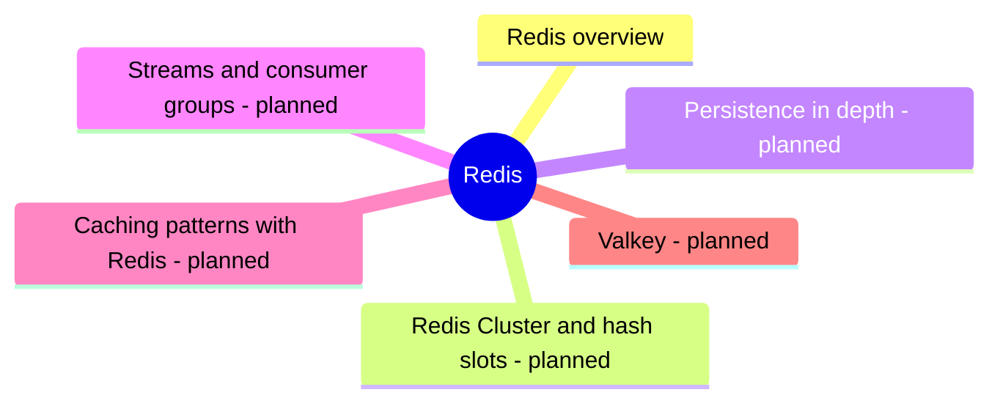

# Redis

Redis, the in-memory data structure store: data types, persistence, replication, cluster and licensing.

## Map

The map shows the parts of this section: written notes and subsections, and planned topics, which end with the word planned.

## Reading order

1. [Redis overview](redis-overview.md): Redis is an in-memory data structure store used as a database, cache and message broker.

## Planned topics

- Redis Cluster and hash slots
- Persistence in depth
- Streams and consumer groups
- Caching patterns with Redis
- Valkey
