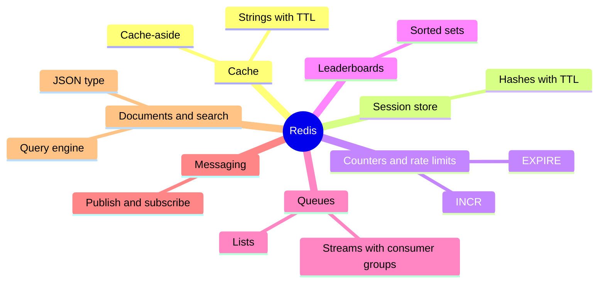

# Redis overview

## Summary

Redis is an in-memory data structure store used as a database, cache and message broker. It keeps all data in RAM and serves commands on typed values (strings, hashes, lists, sets, sorted sets, streams, JSON and more) with sub-millisecond latency, executing each command atomically on a mostly single-threaded event loop. Persistence to disk is optional (snapshots and an append-only file), replication is asynchronous, and Redis Cluster shards data over 16 384 hash slots. Its typical roles are a cache in front of a database, a session store, counters and rate limiters, leaderboards, queues and publish/subscribe messaging. Redis changed from the BSD license to source-available licenses in 2024 and added AGPLv3 as an option in 2025; the Valkey fork continues under BSD.

## Prerequisites

- [Key-value stores](../../database-design-and-models/nosql/key-value-stores.md), which contains the main Redis worked example.

## Core concepts

### Profile

| Property | Redis |
| --- | --- |
| Model | Key-value with typed values (data structure server); JSON documents through the JSON type |
| Storage | In memory; optional RDB snapshots and AOF (append-only file) on disk |
| Execution | Single-threaded command execution (I/O threads optional), so each command is atomic |
| Replication | Asynchronous primary to replicas; Redis Sentinel for failover |
| Sharding | Redis Cluster: 16 384 hash slots assigned to primaries |
| License (checked 2026-11) | Redis 7.4 to 7.x: RSALv2 or SSPLv1; Redis 8 and later: RSALv2, SSPLv1 or AGPLv3; up to 7.2: BSD-3-Clause |
| Forks | Valkey (Linux Foundation, BSD), forked from Redis 7.2.4 in 2024 |
| Version used here | 7.2.17 (Docker image `redis:7.2-alpine`) |

### Roles

The mind map lists the common roles and the data type behind each.



*Analogy.* Redis is the whiteboard next to the team's desks, while the main database is the archive in the basement. Everything on the whiteboard is instantly visible and quick to change, and people write lists, tallies and rankings on it, not just notes. But a whiteboard can be wiped by accident, so anything that must survive is also filed in the archive. The analogy breaks for persistence: Redis can photograph the whiteboard regularly (RDB) or log every change (AOF), so it can be more durable than a whiteboard, but only if configured.

### Persistence and durability

| Mechanism | How it works | Data loss on crash |
| --- | --- | --- |
| None | Pure cache | Everything |
| RDB snapshots | Fork and write a point-in-time snapshot on a schedule (`save 3600 1 300 100 60 10000` by default) | Changes since the last snapshot |
| AOF | Log every write; `appendfsync everysec` by default | About one second |
| RDB and AOF | Both | About one second, faster restarts |

Replication is asynchronous, so a failover can lose acknowledged writes even with AOF on the primary. Redis is therefore usually not the system of record for data that must never be lost.

### Publish and subscribe, and streams

`PUBLISH` sends a message to all clients currently subscribed to a channel. Delivery is at most once: a subscriber that is disconnected misses messages. *Streams* (`XADD`, `XREADGROUP`) are an append-only log with consumer groups, acknowledgments and replay, for when messages must not be lost.

## Worked example

Tested on Redis 7.2.17. The default persistence settings, publish and subscribe, cache-aside with `SET ... NX`, and a stream.

```bash
CONFIG GET appendonly
CONFIG GET save
# terminal 1: SUBSCRIBE orders
PUBLISH orders '{"order_id":100,"status":"paid"}'
SET product:1 '{"name":"Keyboard","price":49.9}' EX 60 NX   # fill the cache only if empty
SET product:1 '{"name":"Other"}' EX 60 NX                   # second filler loses the race
GET product:1
XADD events * type order_paid order_id 100
XLEN events
```

Output:

```text
appendonly
no
save
3600 1 300 100 60 10000
1                                       # PUBLISH: delivered to 1 subscriber
message orders {"order_id":100,"status":"paid"}   # received by terminal 1
OK
(nil)                                   # NX: key already exists, not overwritten
{"name":"Keyboard","price":49.9}
1794239294123-0                         # stream entry ID: milliseconds-sequence
1
```

By default the container keeps RDB snapshots only and no AOF, so a crash could lose up to an hour of writes under low write rates. `SET ... NX` makes concurrent cache fillers safe: only the first one writes. More examples (sessions, counters, hashes, sorted sets) are in [key-value stores](../../database-design-and-models/nosql/key-value-stores.md#worked-example).

## Trade offs and when to use it

- **Use** as a cache, session store, rate limiter, leaderboard, lightweight queue, or for real-time counters and analytics.
- **Avoid** as the only store for critical data, for datasets larger than affordable RAM, or for queries by attribute (unless using the query engine features).
- **Alternatives.** Memcached for a pure, multi-threaded cache; Valkey or other compatible forks for a BSD license; a relational or document database for durable records; Kafka for durable, high-volume event streams.

## Common mistakes

- **Using `KEYS *` in production.** It blocks the single thread. Fix: `SCAN`.
- **No memory limit or eviction policy.** Fix: `maxmemory` and an eviction policy such as `allkeys-lru` for caches.
- **Treating pub/sub as reliable messaging.** Fix: streams with consumer groups.
- **Multi-key operations in a cluster.** They fail across hash slots. Fix: hash tags (`{user:42}:profile`) to co-locate related keys.

## Practice

1. Why is every Redis command atomic?
2. Compare RDB and AOF persistence in terms of data loss.
3. When would you use streams instead of pub/sub?
4. What changed in Redis licensing in 2024 and 2025?

Hints:

1. Commands are executed one at a time by a single thread.
2. RDB loses changes since the last snapshot; AOF with `everysec` loses about one second.
3. When messages must survive disconnects and be acknowledged.
4. 2024: from BSD to RSALv2 or SSPLv1; 2025: AGPLv3 added as an option in Redis 8.

## Further reading

- Redis Ltd., "Redis documentation". https://redis.io/docs/latest/ - Data types, persistence, replication and cluster.
- Redis Ltd., "Redis persistence". https://redis.io/docs/latest/operate/oss_and_stack/management/persistence/ - RDB and AOF trade offs.
- Redis Ltd., "Licenses". https://redis.io/legal/licenses/ - Current license terms.
- Valkey project. https://valkey.io/ - The BSD licensed fork.
