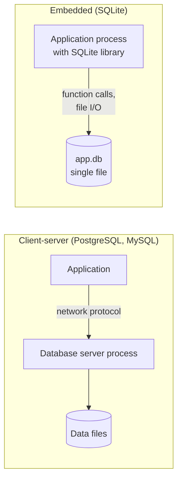

# SQLite overview

## Summary

SQLite is a lightweight, embedded relational database: a C library linked into the application, with no separate server process, that stores a whole database (tables, indexes, schema) in a single ordinary file on disk. It supports most of SQL with ACID transactions, needs no configuration or administration, and is in the public domain. It is the most widely deployed database engine, used in every mobile phone, in web browsers, in IoT devices and as an application file format. Its main limit is concurrency: one writer at a time per database file, which makes it a poor fit for servers with many concurrent writers.

## Prerequisites

- [Relational model](../../database-design-and-models/relational/relational-model.md).

## Core concepts

### Profile

| Property | SQLite |
| --- | --- |
| Model | Relational, embedded (in-process library) |
| License | Public domain |
| Storage | One cross-platform file per database (plus a journal or WAL file while writing) |
| Concurrency | Many readers, one writer at a time per file |
| Typing | Dynamic: a column has a type *affinity*, a value has its own type; `STRICT` tables (3.37 and later) enforce declared types |
| Typical use | Mobile apps (Android, iOS), web browsers, desktop applications, IoT devices, test databases, local caches, data files for analysis |
| Version used here | 3.37.2 (Python `sqlite3` module) |

Checked against sqlite.org, 2026-11.

### Embedded versus client-server

The diagram contrasts SQLite with a client-server database.



A query in SQLite is a function call inside the application's process, so there is no network round trip and no connection overhead; reading many small rows with many small queries is cheap, which is the opposite of client-server advice. Durability and atomicity still hold: SQLite uses a rollback journal or a write-ahead log (WAL mode) and file locking.

*Analogy.* A client-server database is a library with librarians: you send requests to the desk, and the librarians handle many readers and writers at once. SQLite is a notebook in your own bag: no queue and no desk, instant access, and you can hand the whole notebook to someone else as one object. Only one person can write in it at a time. The analogy breaks for readers: in WAL mode, others can read a consistent copy of the notebook while you write.

### Strengths and limits

- **Zero administration.** No server, no users, no configuration; the database is a file you can copy, email or version.
- **Speed for local workloads.** No network and no inter-process communication; for many read-heavy workloads it is faster than a client-server database on the same machine.
- **Reliability.** Extensive test suite; atomic commits survive power loss.
- **Single writer.** A write transaction locks the database for other writers; they wait (`busy_timeout`) or fail with "database is locked".
- **No network access.** Sharing one SQLite file over a network file system is unsafe because file locking is unreliable there.
- **Limited ALTER TABLE** and no stored procedures or user management.

## Worked example

Tested with Python 3.10.12 and SQLite 3.37.2. The script creates a database file in WAL mode, then shows that a second writer is refused while a first write transaction is open, while a reader still sees the committed data.

```python
import os, sqlite3, tempfile

path = os.path.join(tempfile.mkdtemp(), "app.db")
con = sqlite3.connect(path)
con.execute("PRAGMA journal_mode=WAL")
con.execute("CREATE TABLE notes (id INTEGER PRIMARY KEY, body TEXT NOT NULL, created TEXT DEFAULT CURRENT_TIMESTAMP)")
con.executemany("INSERT INTO notes (body) VALUES (?)", [("buy milk",), ("call Ada",)])
con.commit()
print(con.execute("SELECT id, body FROM notes ORDER BY id").fetchall())

w1 = sqlite3.connect(path, timeout=0.2)
w2 = sqlite3.connect(path, timeout=0.2)
w1.execute("BEGIN IMMEDIATE")                    # take the write lock
w1.execute("INSERT INTO notes (body) VALUES ('from writer 1')")
try:
    w2.execute("BEGIN IMMEDIATE")                # second writer
except sqlite3.OperationalError as e:
    print("writer 2:", e)
print("reader sees", con.execute("SELECT count(*) FROM notes").fetchone()[0], "committed rows")
w1.commit()
print("after commit", con.execute("SELECT count(*) FROM notes").fetchone()[0], "rows")
print("type affinity:", con.execute("SELECT typeof(?), typeof(CAST('42' AS INTEGER))", ("42",)).fetchone())
```

Output:

```text
[(1, 'buy milk'), (2, 'call Ada')]
writer 2: database is locked
reader sees 2 committed rows
after commit 3 rows
type affinity: ('text', 'integer')
```

The second writer waited 0.2 seconds (`timeout`) and failed, the reader was not blocked and saw only committed rows, and values keep their own types unless cast.

## Trade offs and when to use it

- **Use** for on-device storage, desktop and mobile apps, embedded systems, single-user tools, application file formats, tests, and read-heavy websites with low write concurrency.
- **Avoid** for many concurrent writers, multiple application servers sharing one database, or data that must be accessed over a network.
- **Alternatives.** PostgreSQL or MySQL for multi-user servers; DuckDB, an embedded columnar engine, for local analytics; replication layers such as LiteFS or Litestream when an SQLite-based server needs copies.

## Common mistakes

- **Default rollback journal under concurrent reads and writes.** Readers block the writer. Fix: `PRAGMA journal_mode=WAL`.
- **No busy timeout.** Concurrent writers fail immediately. Fix: set a busy timeout and keep write transactions short.
- **Relying on declared column types.** Any value can be stored in most columns. Fix: `STRICT` tables or `CHECK` constraints.
- **Database file on a network share.** Corruption risk. Fix: local disk only.

## Practice

1. Why does SQLite need no server process, and what does that save per query?
2. How many writers can write to one SQLite file at a time, and what happens to readers in WAL mode?
3. Name three places where SQLite is used by default.

Hints:

1. It is a library in the application process; it saves the network round trip and connection handling.
2. One; readers continue to read the last committed state.
3. Android and iOS apps, web browsers, many desktop applications and embedded devices.

## Further reading

- SQLite, "About SQLite" and "Appropriate Uses For SQLite". https://www.sqlite.org/whentouse.html - The project's own guidance on when to use it.
- SQLite, "Write-Ahead Logging". https://www.sqlite.org/wal.html - WAL mode and concurrency.
- SQLite, "Datatypes In SQLite" and "STRICT Tables". https://www.sqlite.org/datatype3.html - Type affinity.
