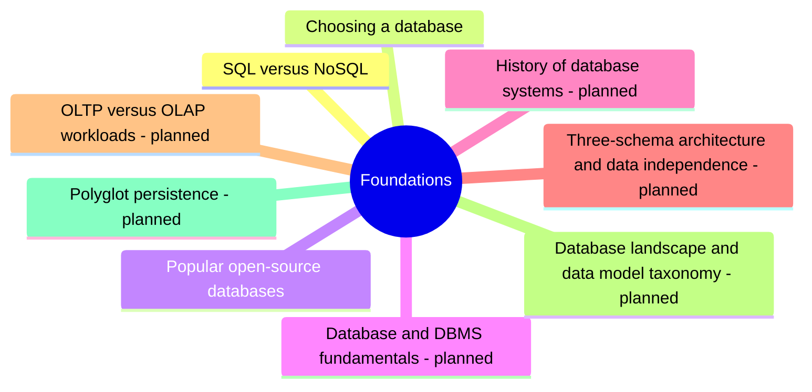

# Foundations

What every other area assumes: the two families of databases, how to choose one and which engines are popular.

## Map

The map shows the parts of this section: written notes and subsections, and planned topics, which end with the word planned.

## Reading order

1. [SQL versus NoSQL](sql-vs-nosql.md): SQL databases (relational databases such as PostgreSQL, MySQL, Oracle and Microsoft SQL Server) store data in tables with a fixed schema, enforce integrity rules and offer ACID transactions and expressive queries with joins.
2. [Choosing a database](choosing-a-database.md): Picking the database for a system is one of the decisions that is most expensive to reverse, because data outlives code and every query depends on the data model.
3. [Popular open-source databases](popular-open-source-databases.md): Ten database engines dominate open-source and source-available use: MySQL, PostgreSQL, MariaDB, Apache Cassandra, Neo4j, SQLite, CockroachDB, Redis, MongoDB and Couchbase.

## Planned topics

- Database and DBMS fundamentals
- History of database systems
- Three-schema architecture and data independence
- OLTP versus OLAP workloads
- Database landscape and data model taxonomy
- Polyglot persistence
