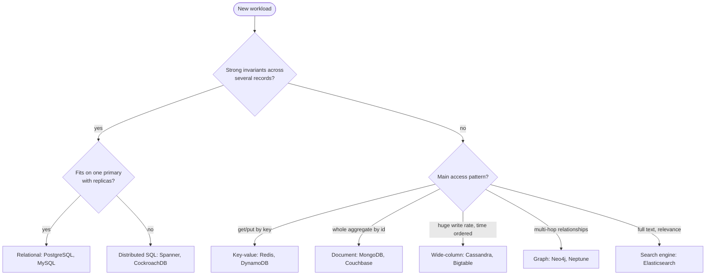

# Choosing a database

## Summary

Picking the database for a system is one of the decisions that is most expensive to reverse, because data outlives code and every query depends on the data model. The choice affects performance, scalability, how well data stays consistent and organized, how integrity is enforced and how easy the system is to support. A good choice starts from the access patterns and the consistency requirements of the workload, not from the popularity of an engine.

## Prerequisites

- [SQL versus NoSQL](sql-vs-nosql.md) for the two families and their data models.

## Core concepts

### Why the choice matters

Picking the right database has a large impact on the performance, scalability and overall success of a system. The key reasons:

- **Performance.** Different databases have different performance characteristics. The wrong one leads to poor performance and slow response times, for example a relational database used for a write-heavy time series of millions of events per second, or a key-value store used for ad hoc analytical queries.
- **Scalability.** As the system grows and the volume of data increases, the database must scale with it. Some databases handle large amounts of data or high write rates better than others.
- **Data modeling.** Different databases have different data modeling capabilities. The right model keeps data consistent and organized and makes the common queries simple.
- **Data integrity.** Databases differ in how they maintain integrity (constraints, foreign keys, transactions) and in their security features.
- **Support and maintenance.** Some databases have larger communities, better documentation, more managed offerings and more people who know them, which makes it easier to find help and to hire.

### The questions to answer first

*Analogy.* Choosing a database is like choosing a vehicle: first decide what you carry (passengers, a piano, forty tons of gravel), how far and how often, and only then compare models. A sports car is not a bad vehicle; it is a bad truck. The analogy breaks because a system can use several databases at once (polyglot persistence), while you usually drive one vehicle at a time.

| Question | Why it matters | Points toward |
| --- | --- | --- |
| What are the main read and write patterns (by key, by range, ad hoc, by relationship, full text)? | The data model must make the frequent queries cheap. | Key access: key-value. Aggregates: document. Ad hoc queries and joins: relational. Multi-hop relationships: graph. Full text: search engine. |
| How much data and how many writes per second, now and in three years? | Decides whether one node is enough. | One node: any RDBMS. Beyond one node: sharded or distributed engine. |
| Which invariants must never break (balances, stock, uniqueness)? | Needs transactions and constraints. | Relational or distributed SQL. |
| Can a reader see slightly stale data? | Decides the consistency model. | If yes, eventual consistency and async replicas are acceptable. |
| Does the schema change often or differ between records? | Flexible schema reduces migrations but moves validation to code. | Document store or `jsonb` columns. |
| Who will operate it (team skills, managed service, budget, license)? | Operations cost usually exceeds license cost. | An engine the team knows, or a managed service. |

### A decision flow

The flowchart condenses the table into a first decision. It is a starting point for a design discussion, not a rule.

### Common workload profiles

| Workload | Typical choice | Reason |
| --- | --- | --- |
| Online transaction processing (OLTP): orders, payments, accounts | Relational | Transactions, constraints, joins |
| Session store, cache, rate limiter | In-memory key-value | Sub-millisecond reads by key, TTL expiry |
| Product catalog, content management, user profiles | Document | Varied attributes, aggregate read in one request |
| Metrics, IoT telemetry, event logs | Wide-column or time series | High sequential write rate, range reads by time |
| Social graph, recommendations, fraud rings | Graph | Traversal cost depends on the neighborhood, not the table size |
| Search box, log analytics | Search engine | Inverted index, relevance scoring, aggregations |
| Analytics over billions of rows (OLAP) | Column-oriented warehouse | Column storage and compression; out of scope here except where linked |

## Worked example

A small marketplace needs: user accounts, orders with payments, a product catalog with very different attributes per category, a search box, and a "recently viewed" list per user.

1. Accounts, orders and payments carry invariants (an order is paid once, stock never goes negative). They go to **PostgreSQL**, with foreign keys and transactions.
2. Product attributes differ per category (screens have a resolution, shoes have a size). They stay in PostgreSQL in a `jsonb` column with a GIN index, because the team already operates PostgreSQL and the catalog is small. A separate document store would add operations cost for little gain.
3. The search box needs relevance ranking and typo tolerance. Products are copied to **Elasticsearch** through change data capture; PostgreSQL stays the source of truth.
4. "Recently viewed" is written on every page view and tolerates loss. It goes to **Redis** as a capped list per user with a TTL.

The result uses three engines, each for the access pattern it handles best, and only one of them holds data that must never be lost.

## Trade offs and when to use it

- **One database versus several.** Each additional engine adds backups, monitoring, upgrades, security patching and data synchronization. Add one only for an access pattern the current engine handles badly.
- **Familiar versus optimal.** A familiar engine operated well usually beats an optimal engine operated badly.
- **Managed versus self-hosted.** Managed services remove routine operations but limit configuration and extensions and tie you to a provider.
- **License.** Several engines moved from open source to source-available licenses (see [popular open-source databases](popular-open-source-databases.md)). Check the license for your use case, especially if you offer the database as a service.

## Common mistakes

- **Choosing by popularity or a conference talk.** Fix: start from the access patterns table above.
- **Planning for a scale the system will never reach.** A sharded cluster for 50 GB of data adds cost and complexity. Fix: estimate the data size and write rate for the next two to three years.
- **Ignoring the consistency requirement.** Eventually consistent stores for money or stock lead to oversell and double spend. Fix: identify invariants first.
- **Ignoring operations.** Fix: include backup, restore testing, monitoring and upgrades in the comparison.

## Practice

1. Name the five reasons why the choice of database matters.
2. A team stores 2 TB of sensor readings written at 200 000 rows per second and queried by device and time range. Which data model fits, and why?
3. When is adding Elasticsearch next to PostgreSQL justified, and what new problem does it create?
4. Why can "the team knows it" outweigh a better data model fit?

Hints:

1. Performance, scalability, data modeling, data integrity, support and maintenance.
2. Wide-column or time series: sequential writes partitioned by device, range reads by time.
3. When relevance ranking or full text matters; it creates a synchronization problem (the index lags the source of truth).
4. Operations quality dominates reliability: backups, tuning and incident response depend on skill.

## Further reading

- Martin Kleppmann, *Designing Data-Intensive Applications*, O'Reilly, 2017. https://dataintensive.net/ - Chapters 2 and 3 compare data models and storage engines by access pattern.
- Alex Petrov, *Database Internals*, O'Reilly, 2019. https://www.databass.dev/ - How storage engines differ underneath, which explains their performance profiles.
- DB-Engines, "DB-Engines Ranking". https://db-engines.com/en/ranking - Popularity by data model, useful to judge community size, not fitness.
