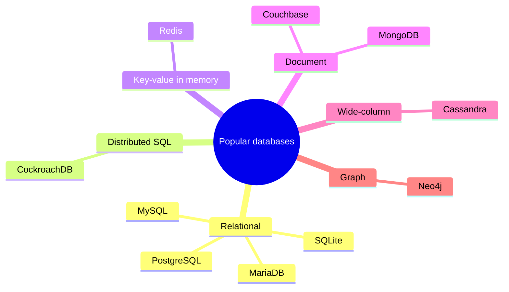
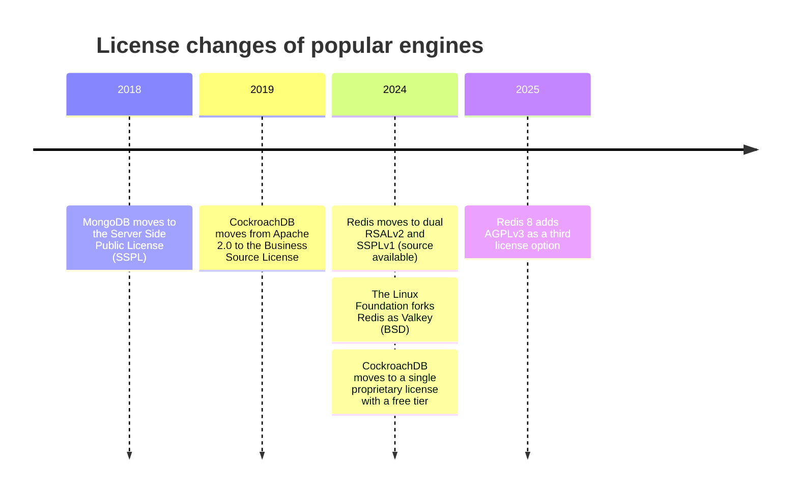
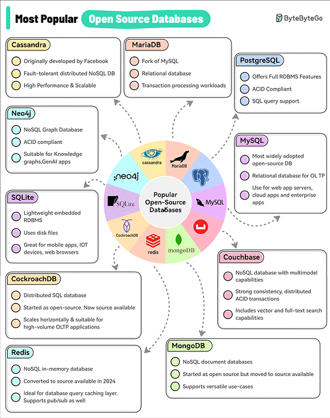

# Popular open-source databases

## Summary

Ten database engines dominate open-source and source-available use: MySQL, PostgreSQL, MariaDB, Apache Cassandra, Neo4j, SQLite, CockroachDB, Redis, MongoDB and Couchbase. They cover the relational, distributed SQL, key-value, document, wide-column and graph models. Several of them are no longer open source in the strict sense: MongoDB, CockroachDB and Redis changed to source-available licenses, so "popular open-source database" today often means "popular database whose source you can read". This note lists them with their model, key properties and license history; each engine's details live in its own home note under [engines](../engines/README.md).

## Prerequisites

- [SQL versus NoSQL](sql-vs-nosql.md) for the data models named here.

## Core concepts

### The list

The ranking below is based on adoption, industry impact and general awareness among developers. It is an ordering by reputation, not a measured benchmark.

1. MySQL
2. PostgreSQL
3. MariaDB
4. Apache Cassandra
5. Neo4j
6. SQLite
7. CockroachDB
8. Redis
9. MongoDB
10. Couchbase

The mind map groups the same ten engines by data model.

### Engine profiles

| Engine | Model | Key properties | Typical use |
| --- | --- | --- | --- |
| [MySQL](../engines/mysql/mysql-overview.md) | Relational | Most widely adopted open-source database; relational database for OLTP | Web application servers, cloud applications, enterprise applications |
| [PostgreSQL](../engines/postgresql/postgresql-overview.md) | Relational (object-relational) | Full RDBMS features, ACID compliant, rich SQL support, extensible | General purpose OLTP, geospatial, JSON, analytics on one node |
| MariaDB (see [MySQL](../engines/mysql/mysql-overview.md#mariadb)) | Relational | Fork of MySQL | Transaction processing workloads |
| [Apache Cassandra](../engines/cassandra/cassandra-overview.md) | Wide-column | Originally developed at Facebook; fault-tolerant distributed NoSQL database; high performance and scalable | High write rate, multi-datacenter data |
| [Neo4j](../engines/neo4j/neo4j-overview.md) | Graph | NoSQL graph database, ACID compliant | Knowledge graphs, generative AI applications (graph retrieval), recommendations |
| [SQLite](../engines/sqlite/sqlite-overview.md) | Relational, embedded | Lightweight embedded RDBMS, stores the database in a single disk file, no server | Mobile apps, IoT devices, web browsers, application file formats |
| CockroachDB | Distributed SQL | Distributed SQL database; scales horizontally; suitable for high-volume OLTP | Globally distributed OLTP |
| [Redis](../engines/redis/redis-overview.md) | Key-value, in memory | NoSQL in-memory database; also supports publish/subscribe | Database query caching layer, sessions, queues, leaderboards |
| [MongoDB](../engines/mongodb/mongodb-overview.md) | Document | NoSQL document database | Versatile: content, catalogs, mobile backends, real-time analytics |
| Couchbase | Document, multi-model | NoSQL database with multi-model capabilities; strong consistency and distributed ACID transactions; vector and full-text search | E-commerce, catalogs, profile stores, mobile sync |

### License history

The license decides whether you may run, modify and offer an engine as a service. The timeline shows the changes away from open source licenses, which were mostly motivated by cloud providers offering the engines as managed services.

| Engine | License (checked 2026-11) |
| --- | --- |
| MySQL | GPLv2 (Community Edition), commercial licenses from Oracle |
| PostgreSQL | PostgreSQL License (permissive, similar to MIT/BSD) |
| MariaDB Server | GPLv2 |
| Apache Cassandra | Apache License 2.0 |
| Neo4j | GPLv3 (Community Edition), commercial (Enterprise Edition) |
| SQLite | Public domain |
| CockroachDB | Proprietary CockroachDB Software License, free for smaller companies (source available) |
| Redis | RSALv2, SSPLv1 or AGPLv3 (since Redis 8) |
| MongoDB | SSPL (Community Server) |
| Couchbase Server | Business Source License for newer versions, Apache 2.0 for older ones |

TODO: verify the CockroachDB 2024 license terms and the Couchbase Server license per version against the vendor pages.

### Original figure

The figure below is the infographic the list above is based on. Credit: ByteByteGo, "Most Popular Open Source Databases".

## Worked example

A team needs a database for an offline-first mobile app that syncs to a server. The list narrows the candidates quickly:

- On the device: SQLite, because it is embedded, needs no server process and stores everything in one file that the app owns.
- On the server: PostgreSQL for accounts and billing (ACID, constraints), and either Couchbase (built-in mobile sync) or a custom sync API over PostgreSQL.
- License check: SQLite (public domain) and PostgreSQL (permissive) impose nothing; Couchbase must be checked for the version in use.

## Trade offs and when to use it

- A popular engine has more documentation, tools, hosting options and people who know it. That is often worth more than a small technical advantage of a niche engine.
- Popularity rankings mix very different engines. Compare within a data model.
- Source-available licenses usually allow internal use but restrict offering the engine as a service. Read the license if you build a platform.

## Common mistakes

- **Treating "open source" as permanent.** Licenses change between major versions. Fix: pin the license check to the version you deploy, and know the community forks (Valkey for Redis, OpenSearch for Elasticsearch).
- **Comparing engines across data models by rank.** Redis and PostgreSQL are not alternatives for the same job in most systems. Fix: choose the model first, see [choosing a database](choosing-a-database.md).

## Practice

1. Which three engines from the list changed from an open source license to a source-available one?
2. Why is SQLite not a replacement for PostgreSQL on a server with many concurrent writers?
3. Which engines in the list are distributed by design?

Hints:

1. MongoDB, CockroachDB and Redis.
2. SQLite allows one writer at a time per database file and runs in the application process.
3. Cassandra, CockroachDB, and to a large extent MongoDB and Couchbase (sharding and replication built in).

## Further reading

- ByteByteGo, "Most Popular Open Source Databases" (infographic). https://bytebytego.com/ - Source of the list and the property summaries.
- DB-Engines, "DB-Engines Ranking". https://db-engines.com/en/ranking - Monthly popularity ranking by search, jobs and discussion volume.
- Redis Ltd., "Redis is now available under the AGPLv3 open source license" (blog, 2025). https://redis.io/blog/agplv3/ - The 2025 license change.
- MongoDB Inc., "Server Side Public License FAQ". https://www.mongodb.com/legal/licensing/server-side-public-license/faq - Why MongoDB moved to SSPL.
- Valkey project. https://valkey.io/ - The BSD licensed fork of Redis.
