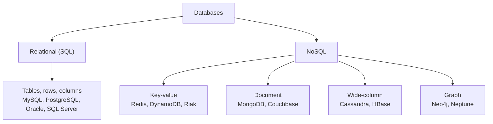
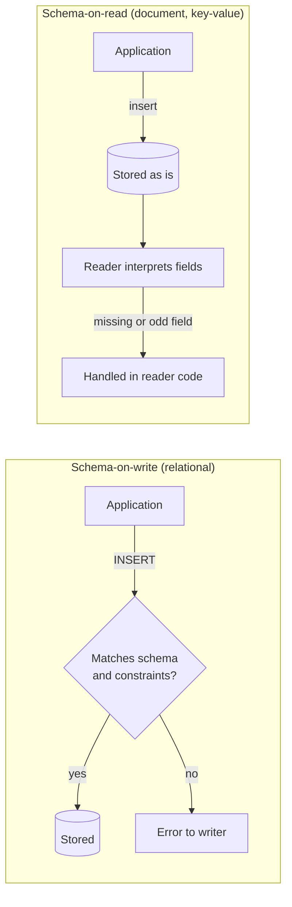

# SQL versus NoSQL

## Summary

SQL databases (relational databases such as PostgreSQL, MySQL, Oracle and Microsoft SQL Server) store data in tables with a fixed schema, enforce integrity rules and offer ACID transactions and expressive queries with joins. NoSQL databases (such as MongoDB, Cassandra, Redis and Couchbase) use other data models (document, key-value, wide-column or graph), usually with a flexible schema, and were built first for horizontal scale and high write throughput. Both families store and query data; they differ in where they put structure, integrity and the work of combining data. The classic contrasts ("SQL scales up, NoSQL scales out") are useful first approximations, not laws: modern engines borrow from each other.

## Prerequisites

- General idea of a table, a row and a query. The [relational model](../database-design-and-models/relational/relational-model.md) note defines them precisely.
- For the NoSQL side, the [NoSQL overview](../database-design-and-models/nosql/nosql-overview.md) gives the history and the BASE properties.

## Core concepts

### Two families

*SQL databases* (more precisely *relational database management systems*, RDBMS) are best suited for structured, relational data and use a fixed schema. They provide ACID transactions (Atomicity, Consistency, Isolation, Durability, see [transactions and ACID](../transactions-and-concurrency/transactions-and-acid.md)) and support complex queries and joins. The name comes from SQL (Structured Query Language), the standard language they share.

*NoSQL databases* ("not only SQL") are best suited for unstructured or semi-structured, non-relational data and use a flexible schema. They provide high scalability and performance for large amounts of data and are often used in big data and real-time web applications.

The map below shows how the NoSQL family splits into four data models, each with its own note.



The four NoSQL models are explained in [key-value stores](../database-design-and-models/nosql/key-value-stores.md), [document stores](../database-design-and-models/nosql/document-stores.md), [wide-column stores](../database-design-and-models/nosql/wide-column-stores.md) and [graph databases](../database-design-and-models/nosql/graph-databases.md).

*Analogy.* A relational database is a well-run office archive: every form has a fixed layout, a clerk checks each form before filing it, and a cross-reference index connects customers to their contracts. A document store is a set of folders where each folder holds everything about one customer, in whatever form it arrived. Finding everything about one customer is fast in the folder system; answering "which contracts across all customers expire in March" is easier in the archive. The analogy breaks at scale: real document stores do index fields inside documents, and real relational engines can store schemaless JSON.

### Differences

- **Structure.** SQL databases are structured and use tables with rows and columns. NoSQL databases can be document-oriented, key-value pairs, wide-column stores or graph databases.
- **Schema.** SQL requires a predefined schema for data. NoSQL has a dynamic schema for unstructured data.
- **Scalability.** SQL databases scale vertically, meaning you increase the power of a single server. NoSQL databases scale horizontally, by adding more servers to the pool.
- **Complexity.** SQL uses complex queries for data manipulation. NoSQL queries are often simpler and more direct.
- **ACID properties.** SQL databases strictly follow ACID properties. NoSQL databases may not strictly adhere to ACID properties and focus on flexibility and horizontal scalability.
- **Transactions.** SQL supports multi-row transactions. NoSQL may support limited transactions or none at all.
- **Examples.** SQL: MySQL, PostgreSQL, Oracle, Microsoft SQL Server. NoSQL: MongoDB, Cassandra, Redis, Couchbase.

### Comparison

| Feature | SQL databases | NoSQL databases |
| --- | --- | --- |
| Data structure | Tables with fixed rows and columns | Document, key-value, wide-column, graph |
| Schema | Predefined and strict | Dynamic and flexible |
| Scalability | Vertical (scale up) | Horizontal (scale out) |
| Complexity | Complex queries | Simple queries |
| ACID compliance | Strict adherence | Flexible, varies by database |
| Transactions | Multi-row support | Limited or no transaction support |
| Examples | MySQL, PostgreSQL, Oracle | MongoDB, Cassandra, Redis |

These rows describe the typical engine of each family around 2010 to 2015. The [section on where the contrasts break](#where-the-classic-contrasts-break) lists the exceptions that matter today.

### Schema and schemaless

In an SQL database, it is impossible to add data until you define tables and field types in what is called a *schema*. The schema optionally contains other information, such as:

- **primary keys**: unique identifiers, such as the ISBN of a book, which apply to a single record,
- **indexes**: commonly queried fields indexed to speed up searching,
- **relationships**: logical links between data fields (foreign keys),
- functionality such as **triggers** and **stored procedures** (see [triggers](../query-languages/sql/triggers.md) and [stored procedures](../query-languages/sql/stored-procedures.md)).

A NoSQL store is often called *schemaless*. The precise term is *schema-on-read*: the database does not check the structure when data is written, so the structure is interpreted by the code that reads it. A relational database is *schema-on-write*: the database checks every write against the declared schema and rejects what does not fit. The diagram shows where the check happens in each case.



Schemaless does not mean the data has no schema. It means the schema lives implicitly in application code, and every reader must cope with every shape that was ever written.

### Normalization and denormalization

Relational design usually *normalizes* data (one fact in one place, related by keys), while NoSQL design usually *denormalizes* it (data that is read together is stored together, even if it is repeated). The full comparison, with advantages, disadvantages and a comparison table, is in [normalization](../database-design-and-models/relational/normalization.md) and [denormalization](../database-design-and-models/relational/denormalization.md).

### Transactions

In SQL databases, two or more updates can be executed in a *transaction*, an all-or-nothing wrapper that guarantees success or failure. Placing the two updates in one transaction ensures that either both succeed or both fail.

In a NoSQL document database, modification of a single document is atomic. If you update three values within a document, either all three are updated or the document remains unchanged. Historically there was no transaction for updates to several documents, and transaction-like behavior had to be implemented in application code (for example with two-phase commit patterns or compensating updates).

That statement is now outdated for several engines: MongoDB has supported multi-document ACID transactions on replica sets since version 4.0 (2018) and on sharded clusters since 4.2 (2019). They cost more than single-document writes, and the MongoDB documentation still recommends modeling data so that most operations touch one document. Checked against the MongoDB manual, 2026-11.

### CRUD syntax

Creating, reading, updating and deleting data (CRUD) is the basis of all database systems.

- SQL is a lightweight declarative language. It is deceptively powerful and has become an international standard (ISO/IEC 9075), although most systems implement subtly different dialects. See the [SQL language overview](../query-languages/sql/sql-language-overview.md).
- NoSQL databases use their own APIs. Document stores such as MongoDB use JavaScript-like queries with JSON-like arguments. Basic operations are simple, but nested JSON can become hard to read for complex queries.

The same read in both styles:

```sql
-- SQL (standard)
SELECT title FROM books WHERE author_id = 1 ORDER BY title;
```

```javascript
// MongoDB Query API (mongosh), untested
db.books.find({ "author.id": 1 }, { title: 1, _id: 0 }).sort({ title: 1 })
```

### Performance

NoSQL is regularly quoted as being faster than SQL. The reason is design, not magic: a denormalized store can return all information about an item in a single request, without joins. Project design and data access patterns have far more impact than the family. A well-designed SQL database will almost certainly perform better than a badly designed NoSQL equivalent, and vice versa.

### Scaling

As data grows, it may become necessary to distribute the load among several servers. This is hard for SQL-based systems: how do you allocate related data so that joins and transactions still work? Clustering, where several servers access the same central store, is possibly the simplest option, but it has its own limits. NoSQL's simpler data models make distribution easier, and many NoSQL engines were built with partitioning and replication from the start. See [replication](../distributed-databases/replication.md), [sharding](../distributed-databases/sharding.md) and [database scaling strategies](../distributed-databases/database-scaling-strategies.md).

### Where the classic contrasts break

| Classic claim | What is true today |
| --- | --- |
| SQL scales only vertically | Distributed SQL engines (Google Spanner, CockroachDB, YugabyteDB, TiDB) shard and replicate automatically while keeping SQL and ACID. Read replicas and manual sharding scale classic RDBMSs too (see the [Figma case study](../case-studies/figma-database-scaling.md)). |
| NoSQL has no transactions | MongoDB, DynamoDB and Couchbase offer multi-item ACID transactions with documented limits. |
| NoSQL has no schema | MongoDB supports JSON Schema validation; Cassandra requires a declared table schema (CQL). |
| SQL cannot store flexible data | PostgreSQL `jsonb`, MySQL `JSON` and SQL Server JSON functions store and index documents inside a relational table. |

Checked against the vendor documentation listed in further reading, 2026-11.

## Worked example

Tested on PostgreSQL 17.11 (Docker image `postgres:17-alpine`). The same book data is stored twice: once in normalized tables with a foreign key, once as JSON documents in a single `jsonb` column, which behaves like a schemaless document collection.

```sql
CREATE TABLE authors (author_id int PRIMARY KEY, name text NOT NULL);
CREATE TABLE books (
  isbn      text PRIMARY KEY,
  title     text NOT NULL,
  author_id int  NOT NULL REFERENCES authors (author_id)
);
INSERT INTO authors VALUES (1, 'Ursula K. Le Guin');
INSERT INTO books VALUES ('978-0441478125', 'The Left Hand of Darkness', 1);
INSERT INTO books VALUES ('978-0000000000', 'Orphan book', 99);

CREATE TABLE book_docs (doc jsonb NOT NULL);
INSERT INTO book_docs VALUES
  ('{"isbn": "978-0441478125", "title": "The Left Hand of Darkness", "author": {"name": "Ursula K. Le Guin"}}'),
  ('{"isbn": "978-0000000000", "title": "Orphan book", "author_id": 99}');
SELECT doc->>'title' AS title, doc->'author'->>'name' AS author FROM book_docs;
```

Output:

```text
INSERT 0 1
INSERT 0 1
ERROR:  insert or update on table "books" violates foreign key constraint "books_author_id_fkey"
DETAIL:  Key (author_id)=(99) is not present in table "authors".
INSERT 0 2
           title           |      author
---------------------------+-------------------
 The Left Hand of Darkness | Ursula K. Le Guin
 Orphan book               |
(2 rows)
```

The relational schema rejects a book whose author does not exist (schema-on-write). The document collection accepts it, and also accepts a second document whose author is stored in a different shape (`author_id` instead of `author.name`). The reader sees an empty author and must handle it (schema-on-read).

## Trade offs and when to use it

SQL and NoSQL databases do the same job in different ways. It is possible to choose one and switch later, but a little planning saves time and money. The decision process is described in [choosing a database](choosing-a-database.md).

Projects where SQL is a good fit:

- logical, related, discrete data requirements that can be identified up front,
- data integrity is essential,
- standards-based, proven technology with a good developer experience and support is wanted.

Projects where NoSQL is a good fit:

- unrelated, indeterminate or evolving data requirements,
- simpler or looser project objectives, where coding can start immediately,
- speed and scalability are imperative.

In my experience the default for a new transactional system is a relational database, with a NoSQL store added for a specific access pattern (a cache in Redis, a search index in Elasticsearch, an event store in Cassandra). This is called *polyglot persistence*.

## Common mistakes

- **Choosing NoSQL to avoid designing a schema.** The schema still exists in the code, and inconsistent shapes accumulate. Fix: write down the document shapes and validate them (for example with JSON Schema validation in MongoDB).
- **Choosing by benchmark headlines.** "NoSQL is faster" compares different designs. Fix: benchmark your access patterns with your data volume.
- **Assuming NoSQL means no transactions, or SQL means no scale.** Both are outdated. Fix: check the current documentation of the specific engine and version.
- **Modeling relational data in a document store with references everywhere.** This reproduces joins in application code without the optimizer. Fix: if most queries join, use a relational database.

## Practice

1. What is the difference between schema-on-write and schema-on-read, and where does validation logic live in each?
2. A product team wants "NoSQL because it scales". Name two facts about current relational engines that weaken this argument.
3. Why is a single-document update atomic in a document store, even without multi-document transactions?
4. Give one workload where a denormalized document model is clearly faster than a normalized relational model, and explain why.

Answers and hints:

1. Schema-on-write checks structure at insert time in the database; schema-on-read stores anything and the reader interprets it, so validation lives in application code.
2. Read replicas and sharding scale relational databases; distributed SQL engines such as Spanner or CockroachDB scale out with ACID.
3. The engine writes the whole document as one unit on one node, so it can apply all field changes or none.
4. Loading a whole aggregate (an order with its lines) in one read: the document is stored contiguously and no join is needed.

## Further reading

- Craig Buckler, "SQL vs NoSQL: The Differences", SitePoint (2020 update). https://www.sitepoint.com/sql-vs-nosql-differences/ - Plain comparison of schema, transactions, CRUD syntax, performance and scaling.
- Donne Martin, "The System Design Primer: RDBMS and NoSQL" (GitHub). https://github.com/donnemartin/system-design-primer#sql-or-nosql - Compact lists of reasons for SQL and for NoSQL.
- Martin Kleppmann, *Designing Data-Intensive Applications*, chapter 2 "Data Models and Query Languages", O'Reilly, 2017. https://dataintensive.net/ - The best treatment of schema-on-read versus schema-on-write.
- MongoDB, "Transactions", MongoDB Manual. https://www.mongodb.com/docs/manual/core/transactions/ - Multi-document transaction support and its limits.
- PostgreSQL Global Development Group, "JSON Types", PostgreSQL 17 documentation. https://www.postgresql.org/docs/17/datatype-json.html - Document storage inside a relational engine.
