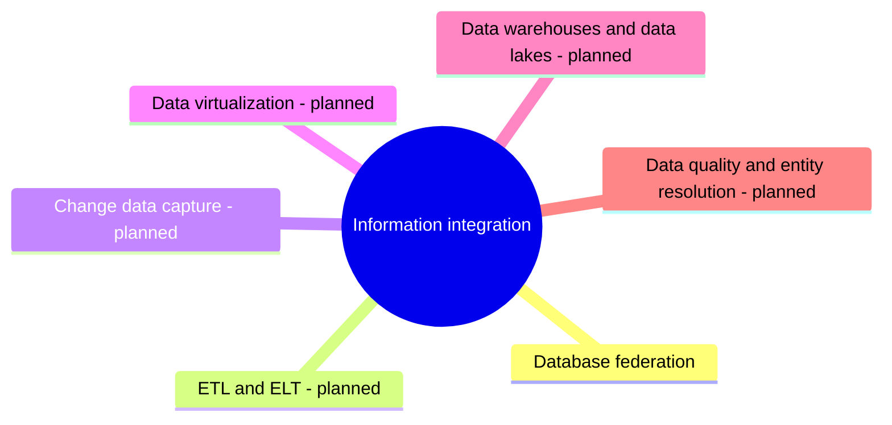

# Information integration

Combining data from several databases: federation, data virtualization, ETL and ELT, and change data capture.

This area corresponds to the ACM CCS 2012 concept *Information integration*. See [GUIDELINE.md](../GUIDELINE.md#311-placement-of-a-note) for what belongs here.

## Map

The map shows the parts of this section: written notes and subsections, and planned topics, which end with the word planned.

## Reading order

1. [Database federation](database-federation.md): Database federation integrates several autonomous databases behind one unified query interface, so that users can query data spread over different databases as if it were one database, while the data stays where it is.

## Planned topics

- ETL and ELT
- Change data capture
- Data virtualization
- Data warehouses and data lakes
- Data quality and entity resolution
