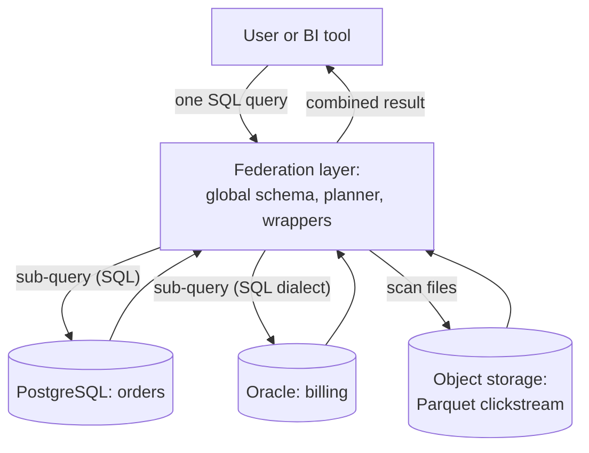

# Database federation

## Summary

Database federation integrates several autonomous databases behind one unified query interface, so that users can query data spread over different databases as if it were one database, while the data stays where it is. A federated system translates each query into sub-queries for the member databases, runs them, and combines the results. It gives one point of access across heterogeneous sources (relational and NoSQL, different vendors) without copying everything into one place, at the cost of slower and harder-to-optimize queries, weaker consistency across sources and complex security. Federation can be virtual (query in place), materialized (copy into a central store) or a hybrid. Examples are PostgreSQL foreign data wrappers, SQL Server PolyBase and Amazon Redshift Spectrum.

## Prerequisites

- [Relational model](../database-design-and-models/relational/relational-model.md) and [SQL joins](../query-languages/sql/sql-joins.md), since federated queries join across sources.

## Core concepts

### Definition

*Database federation* refers to the integration of several autonomous databases into a single unified interface. Users query and interact with data distributed over different databases as if it were one database. A federated database manages the complexity of combining diverse databases by offering a unified query interface, while the actual data remains stored in the individual databases. The research term is *federated database system* (Sheth and Larson, 1990): a collection of cooperating but autonomous component databases.

The diagram shows the federation layer splitting one query into sub-queries for three member databases.



*Analogy.* A federated database is a travel agent. You ask for "a flight and a hotel in Lisbon for next weekend", and the agent queries airlines and hotel chains, each with its own system and rules, and returns one combined itinerary. The airlines and hotels stay independent and keep their own data. The analogy breaks for consistency: a travel agent may come back with a hotel that sold out a minute later, and a federated query can likewise combine data from sources as they were at slightly different moments, because there is no common transaction across them.

A second meaning of "federation" exists in system design literature (for example the System Design Primer): splitting one application's database by function, such as separate databases for users, products and forums. That is [vertical partitioning](../distributed-databases/sharding.md#definition) for scale; this note covers federation as integration of autonomous sources.

### How a federated query runs

1. **Parse and map.** The query against the global (federated) schema is mapped to the schemas of the member sources.
2. **Decompose and push down.** The planner splits it into sub-queries and pushes filters, projections, joins and aggregates down to the sources that can execute them, so that less data crosses the network.
3. **Execute through wrappers.** A *wrapper* (connector) per source translates the sub-query into the source's language and converts the results.
4. **Combine.** The federation layer joins, aggregates and sorts the partial results.

Push-down is the key to performance: a filter evaluated at the source can reduce millions of rows to hundreds before they travel.

### Advantages

1. **Unified access.** A single point of access to many data sources simplifies retrieval.
2. **Scalability.** New databases can be added under the federated system without consolidating data.
3. **Autonomy.** Each member database keeps its autonomy, so it can be managed and optimized independently.
4. **Flexibility.** Heterogeneous sources are supported, so different database types (SQL, NoSQL, files) can be integrated.
5. **Cost-effectiveness.** Less data duplication and less storage than consolidating everything into one database.

### Disadvantages

1. **Complexity.** Managing many databases and their interactions makes the system complex.
2. **Performance overhead.** Query decomposition, network transfer and integration slow queries down.
3. **Consistency.** Keeping data consistent across several databases is hard; a federated query has no global snapshot.
4. **Security.** Security management is harder in a distributed system with different authentication and permission models.
5. **Maintenance.** All components must keep working together, which needs careful maintenance (schema changes at a source break the mapping).

### Types

| Type | Description | Usage |
| --- | --- | --- |
| Virtual federation | Provides a virtual view of the integrated databases without physically consolidating data. | Read-heavy work where data from several sources is accessed often without being updated through the federation. |
| Materialized federation | Physically copies data from several databases into a central repository. | Applications that need high performance and fast access to integrated data, with less frequent updates. This is the data warehouse approach (ETL or ELT). |
| Hybrid federation | Combines both: virtual views for some queries and materialized data for others. | Balances real-time access with the performance of pre-aggregated data. |

### Use cases

- **Business intelligence and analytics.** Integrating data from various departments or sources for reporting and analytics.
- **Healthcare systems.** Combining patient data from different medical facilities for a complete view of patient health records.
- **E-commerce platforms.** Merging data from several stores, inventory systems and customer databases into unified product catalogs and customer profiles.
- **Scientific research.** Aggregating data from various research databases for collaborative analysis.
- **Telecommunications.** Integrating data from various network operations centers into a unified view of network performance and issues.

### Common problems

| Problem | Description |
| --- | --- |
| Latency | Federated queries have higher latency because data is fetched from and integrated across several sources. |
| Query optimization | Optimizing queries across distributed, heterogeneous databases is complex: statistics about remote data are often missing, and capabilities differ per source. |
| Data synchronization | Keeping data synchronized across databases is hard, especially with frequent updates. |
| Security | Enforcing consistent security policies across federated databases is difficult. |
| Data integrity | Integrity is hard to maintain across databases with different schemas and constraints; no foreign key can span sources. |

### Supporting databases

| Product | Federation capability |
| --- | --- |
| Microsoft SQL Server (PolyBase) | Queries data across SQL Server, Azure SQL Database, Hadoop and other sources using T-SQL. |
| IBM Db2 (federation) | Integrates several databases, including Oracle and SQL Server, behind Db2. |
| Oracle Database (Oracle Database Gateway) | Connects to non-Oracle systems for federated queries. |
| [PostgreSQL](../engines/postgresql/postgresql-overview.md#federation-with-foreign-data-wrappers) (foreign data wrappers) | Foreign data wrappers connect to and query external sources (other PostgreSQL servers, MySQL, files, MongoDB and others). |
| SAP HANA (Smart Data Access) | Queries and analyzes data across databases and data warehouses. |
| Amazon Redshift (Spectrum) | Queries data stored in Amazon S3 and other sources without loading it. |

Query engines built for federation, such as Trino (formerly PrestoSQL) and Apache Drill, play the same role outside any one database.

## Worked example

Tested on PostgreSQL 17.11 inside one container: database `crm` holds customers, and database `shop` accesses them through the `postgres_fdw` foreign data wrapper and joins them with local orders. The full commands are in the [PostgreSQL overview](../engines/postgresql/postgresql-overview.md#federation-with-foreign-data-wrappers), because foreign data wrappers are a PostgreSQL feature; the result is:

```text
 order_id | name | city   | total
----------+------+--------+-------
      100 | Ada  | London | 59.90
      101 | Alan | Paris  | 99.00
(2 rows)
```

The `EXPLAIN VERBOSE` output in that note shows the planner pushing a `WHERE` filter down to the remote server as part of the remote SQL statement, which is the push-down step described above.

## Trade offs and when to use it

- **Use virtual federation** for occasional cross-source queries, exploration and migrations, where copying data is not worth it.
- **Use materialized federation** (a warehouse) for frequent analytics across sources, where speed and a consistent snapshot matter.
- **Avoid federation** in OLTP hot paths: every request would depend on several systems and the network.

## Common mistakes

- **Expecting single-database performance.** Fix: push filters down, fetch only needed columns, and materialize frequent joins.
- **No push-down awareness.** A function the wrapper cannot push forces the whole remote table across the network. Fix: check plans (`EXPLAIN VERBOSE`) for the remote SQL.
- **Ignoring schema drift at sources.** Fix: monitor source schemas and test federated views.

## Practice

1. What is the difference between virtual and materialized federation?
2. Why is push-down the most important optimization in a federated query?
3. Why can a federated query return data that never existed at one moment in time?
4. How does federation as integration differ from federation as functional partitioning?

Hints:

1. Query in place versus copy into a central store.
2. It reduces the data transferred from sources before it is combined.
3. Sub-queries read different sources at different moments without a global snapshot.
4. Integration combines autonomous existing databases; functional partitioning splits one application's database for scale.

## Further reading

- Amit P. Sheth, James A. Larson, "Federated Database Systems for Managing Distributed, Heterogeneous, and Autonomous Databases", *ACM Computing Surveys* 22(3), 1990. https://doi.org/10.1145/96602.96604 - The foundational survey.
- PostgreSQL Global Development Group, "postgres_fdw", PostgreSQL 17 documentation. https://www.postgresql.org/docs/17/postgres-fdw.html - Foreign data wrapper for PostgreSQL sources, push-down rules.
- Microsoft, "Data virtualization with PolyBase in SQL Server". https://learn.microsoft.com/en-us/sql/relational-databases/polybase/polybase-guide - PolyBase.
- Amazon Web Services, "Querying external data using Amazon Redshift Spectrum". https://docs.aws.amazon.com/redshift/latest/dg/c-using-spectrum.html - Redshift Spectrum.
- Donne Martin, "The System Design Primer: Federation" (GitHub). https://github.com/donnemartin/system-design-primer#federation - Federation as functional partitioning.
