# Query languages

Languages for querying and changing data: SQL with its statement classes, joins and procedural extensions, and the query languages of non-relational engines.

This area corresponds to the ACM CCS 2012 concept *Query languages*. See [GUIDELINE.md](../GUIDELINE.md#311-placement-of-a-note) for what belongs here.

## Map

The map shows the parts of this section: written notes and subsections, and planned topics, which end with the word planned.

```mermaid
mindmap
  root((Query languages))
    SQL
    MongoDB Query API and aggregation pipeline - planned
    Cassandra Query Language CQL - planned
    Cypher and ISO GQL - planned
    SPARQL - planned
    Redis commands and scripting - planned
    Elasticsearch Query DSL - planned
```

## Reading order

1. [SQL](sql/README.md): The SQL language: its statement classes, joins, and the procedural extensions used for stored procedures and triggers.

## Planned topics

- MongoDB Query API and aggregation pipeline
- Cassandra Query Language (CQL)
- Cypher and ISO GQL
- SPARQL
- Redis commands and scripting
- Elasticsearch Query DSL
