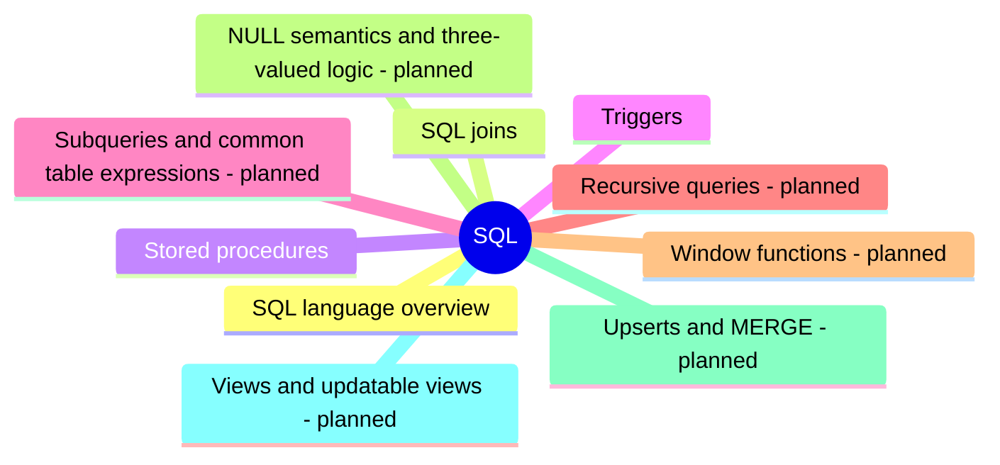

# SQL

The SQL language: its statement classes, joins, and the procedural extensions used for stored procedures and triggers.

## Map

The map shows the parts of this section: written notes and subsections, and planned topics, which end with the word planned.

## Reading order

1. [SQL language overview](sql-language-overview.md): SQL (Structured Query Language) is the declarative language of relational databases, standardized as ISO/IEC 9075 and used for more than four decades.
2. [SQL joins](sql-joins.md): A join combines rows from two tables into result rows, pairing them by a condition, usually that a foreign key equals a primary key.
3. [Stored procedures](stored-procedures.md): A stored procedure is a named, precompiled collection of SQL statements and procedural logic that is stored in the database and executed on the database server.
4. [Triggers](triggers.md): A trigger is a special kind of stored procedure that the database executes automatically when a specific event occurs, instead of being called explicitly.

## Planned topics

- Subqueries and common table expressions
- Recursive queries
- Window functions
- NULL semantics and three-valued logic
- Upserts and MERGE
- Views and updatable views
